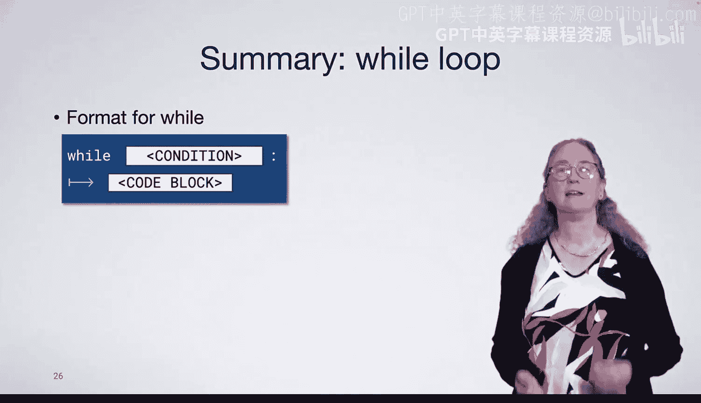

# Python编程实践：while循环与添加收据


在本节课中，我们将学习如何使用while循环来重复执行代码块，直到满足特定条件。我们将通过一个添加收据的例子来理解while循环的用法。

## 1. while循环简介

while循环是一种重复执行代码块的结构，直到满足特定条件为止。其基本格式如下：

```python
while 条件表达式:
    # 代码块
```

其中，`条件表达式`会在每次循环开始时进行评估。如果条件表达式为真（即结果为True），则执行代码块；如果为假（即结果为False），则退出循环。

**公式**：`while (条件表达式)` {代码块}

## 2. while循环与if语句的区别

while循环和if语句都包含条件表达式，但它们之间有一些关键区别：

- **执行次数**：while循环可以重复执行代码块多次，而if语句只执行一次。
- **代码块**：while循环包含一个代码块，而if语句只包含一个条件表达式。

**公式**：`while (条件表达式)` {代码块} vs. `if (条件表达式)` {代码块}

## 3. while循环示例：添加收据

假设我们需要编写一个程序，用于输入收据金额并计算总花费。当输入负数时，程序停止计算。

```python
total = 0
while True:
    num = float(input("请输入收据金额（输入负数结束）："))
    if num < 0:
        break
    total += num
print("总花费为：", total)
```

在这个例子中，我们使用while循环来重复读取用户输入的收据金额，并将其累加到变量`total`中。当用户输入负数时，`num < 0`条件为真，程序退出循环并打印总花费。

## 4. while循环的优化

在上面的例子中，我们可以在while循环开始时初始化变量`num`，这样就不需要在循环体内部再次请求输入。

```python
total = 0
num = 0
while True:
    num = float(input("请输入收据金额（输入负数结束）："))
    if num < 0:
        break
    total += num
print("总花费为：", total)
```

在这个优化后的版本中，我们只在循环开始时请求一次输入，简化了代码结构。



## 5. 总结


本节课中，我们学习了while循环的用法，并通过一个添加收据的例子来理解其应用。通过理解while循环与if语句的区别，我们可以更好地掌握Python编程中的循环结构。希望你在编写代码时能够灵活运用while循环。