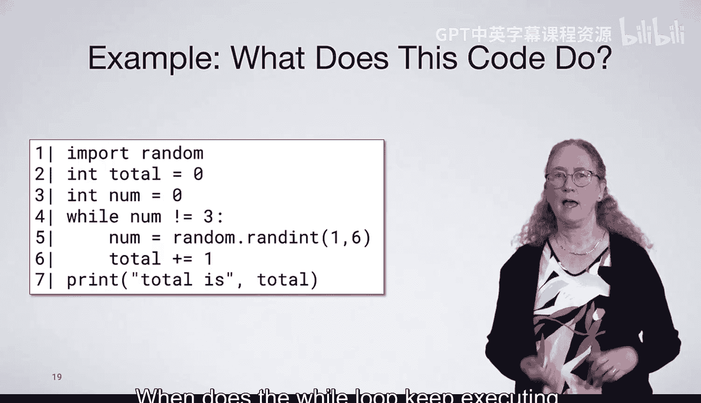

# 杜克大学《Python编程实践｜Practical Python： Start Your Programming Journey》中英字幕 p40 40_04_02_重新执行代码示例-查找最大数.zh_en -BV1tTmCBWEQD_p40-

Let's look at an example where code is re executed a lot。 Suppose we have a bunch of numbers。

 and we want to find and print the largest value。Assume all the numbers we consider are positive numbers。

How can we solve this problem。Your program could allow for multiple inputs stopping when a negative number is entered。

Then your program needs to calculate which number is the largest。Here is an example。

Suppose the user enters 6。3。Then they enter 9。4。And then they enter 2。8。Followed by negative one。

Your code runs on the numbers and then prints out 9。4， the largest number of all those values。

How does your program calculate the largest number。

Your program needs to somehow keep track of the largest value so far as it is collecting the input。

For that， your program needs a variable to store the largest value it has seen thus far。

Let's build a program plan to find the largest value。First。

 your code needs to keep track of the largest value。

 Let's call that variable largest and initialize largest to 0。

We also need a variable to store the number that is typed in。

Let's call that nu and initialize nu to 0。Now， we can repeat the following as long as the number is valid。

Compare numb to largest。 And if nu is larger than largest， then set largest to nu。

Largest represents the largest number your program has seen so far。Next。

 get the next number and store it in none。Your code is at the end of the while loop。

 This loop will repeat over and over again。Finally， once all the numbers entered have been processed。

 your program can print the largest value found。Notice again。

 how I indented to make it easier to read the plan。Let's sell trace through code。 that does this。

Here on line one， the code creates and initializes the largest value to 0。On line 2。

 the code tells a user how to stop entering numbers by typing in negative 1。On line 3。

 the code creates and initializes the variable nu to 0。

This variable will be used to take input numbers from the user。On line 4。

 the code checks the value of none and sees the condition is true。

The next line of code to execute is line 5。Since 0 is not greater than 0。

 the if condition evaluates default faults and execution moves to line 7。

 where the user is asked to enter a number。Suppose the user enters 6。82。

Noum is updated to this value。What happens next， The end of the while loop is reached。

 So execution moves to line 4。The wild condition is evaluated。

And the condition evaluates the true because 6。82 is greater than 0。So execution moves to line 5。

The if condition evaluates to true 6。82 is greater than the value of largest， which is 0。

So line 6 executes， and largest is updated to 6。82。

 because we discovered that nu was a larger number。

 and we want the variable largest to contain the largest number。Line 7 executes。

 and the user enters in 8。67。Num is updated to 8。67。 Again， we are at the end of the while loop。

Execution moves to line 4。 The wild condition is evaluated again。The condition is evaluated to true。

In the if nu is greater than the variable largest。 That is true。

 On line 6 largest is assigned the value of variable nu。 So largest is now 8。67。

The user inputs another number。 Suppose they input 2。94。The num is assigned the new value 2。94。

Execution moves to line 4。 the wild condition is evaluated。The condition evaluates to true。On line 5。

 the if condition evaluates defaults，2。94 greater than 8。67 is not true。Line 7 executes next。

 and the user enters another number。Let's say this time， the user enters negative1。

Noome is updated to negative1。Execution moves to line 4。 The wild condition is evaluated。Negative 1。

 greater than 0。0。 That is false。 The while loop is now completed。Execution moves to line 8。

 and largest is 8。67， is printed。We just saw the wild loop repeated four times once for 0 to start the loop and once for three numbers greater than 0。

The wild condition was false， when negative one was entered。Let's look at another example。

Pause the video and see if you can figure out what this code does。Focus on line 3。

 When does the whileale loop keep executing and when does the whale loop ends。

The condition in the w loop is true when numb is not equal to 3。 So the while loop is false。

 if nu equals 3。This loop executes until No is set to 3。Inside the while loop。

 a random number from one to6 is generated。And one is added to total each time in the loop。

How would you describe what this code does？The code prints the number of random numbers generated until a three is generated。

But how long will it take to exit the while loop。That depends since the numbers are randomly generated。

Eventually， a three is generated， and the loop stops。So when does a whale loop stop。

It stops whenever the wild condition is false。What if the condition is never false。

 That means you have an infinite loop。 The coat is stuck in a loop forever ever。

Let's think back to the examples we just saw。1 condition was， while nu is greater than or equal to 0。

What if a negative number is never entered， If that happens， you have an infinite loop。

 The loop never stops。Another condition we saw was while numb is not equal to 3。

That is not an infinite loop， since a random number between one and 6 is generated each time in the loop。

And eventually， three should be generated。When you are using a while loop。

 you must make sure that your coat is designed。 So eventually your while loop will end。

One way to make sure the while loop will end is to tell the user what to type to end the loop。

Another way is just to make sure the code is designed so that the while loop condition will eventually be false。

For example， suppose you write a program to keep score of a tennis game。

The while loop would stop when some one has enough points to win。

Happy programming and watch out for Infin loops。

