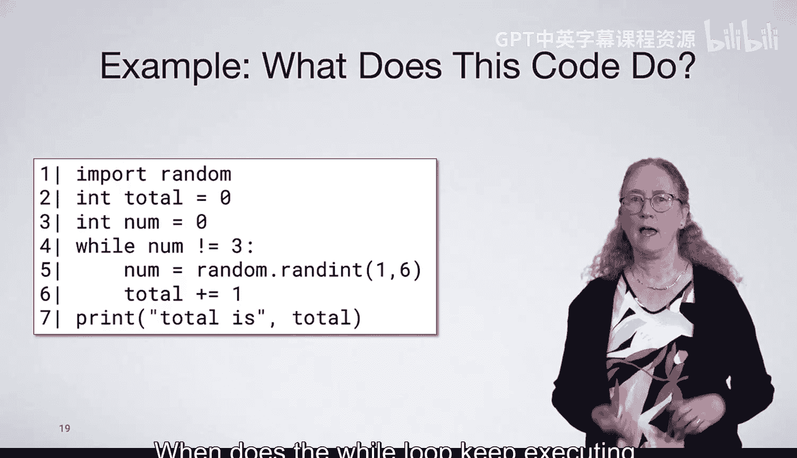

# Python编程实践：查找最大数


在本节课中，我们将学习如何使用Python编写程序来查找一组数中的最大值。

## 1. 问题分析

假设我们有一组正数，我们需要找到并打印出最大的值。程序可以接受多个输入，直到输入负数为止。然后程序需要计算哪个数是最大的。

## 2. 程序设计

以下是查找最大值的程序设计：

1. **变量初始化**：
   - `largest`：用于存储迄今为止找到的最大值，初始化为0。
   - `num`：用于存储用户输入的数字，初始化为0。

2. **循环处理输入**：
   - 当输入的数字大于0时，重复以下步骤：
     - 将输入的数字与当前最大值比较。
     - 如果输入的数字大于当前最大值，则更新最大值。

3. **结束循环**：
   - 当输入的数字为负数时，结束循环。

4. **输出结果**：
   - 打印出找到的最大值。

## 3. 代码实现

```python
largest = 0
num = 0

while num >= 0:
    num = float(input("请输入一个数字（输入负数结束）："))
    if num > largest:
        largest = num

print("最大值是：", largest)
```



## 4. 代码解释

1. **初始化变量**：
   ```python
   largest = 0
   num = 0
   ```
   初始化最大值为0，并设置一个变量`num`用于存储用户输入的数字。

2. **循环处理输入**：
   ```python
   while num >= 0:
       num = float(input("请输入一个数字（输入负数结束）："))
       if num > largest:
           largest = num
   ```
   当用户输入的数字大于等于0时，程序会继续循环。每次循环中，程序会读取用户输入的数字，并与当前最大值进行比较。如果输入的数字大于当前最大值，则更新最大值。

3. **结束循环**：
   ```python
   while num >= 0:
       ...
   ```
   当用户输入负数时，循环结束。

4. **输出结果**：
   ```python
   print("最大值是：", largest)
   ```
   打印出找到的最大值。

## 5. 总结


本节课中，我们学习了如何使用Python编写程序来查找一组数中的最大值。通过设计合适的循环和条件语句，我们可以轻松地实现这一功能。在编写程序时，要注意避免无限循环，确保程序能够正常结束。