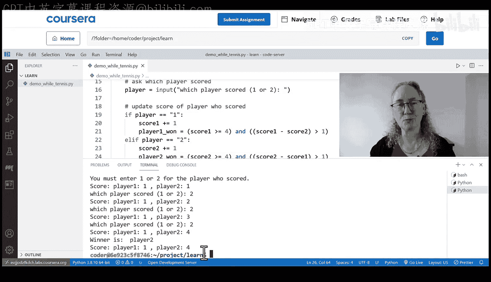

# 杜克大学《Python编程实践｜Practical Python： Start Your Programming Journey》中英字幕 p41 41_04_03_while循环简化网球计分演示.zh_en -BV1tTmCBWEQD_p41-

Suppose two teams are playing a game。 We want to look at keeping score in the game。

 This is an example that has a lot of repetition。 The teams will play until one of the teams score and then play some more until one of the team score。

 playing and scoring keeps repeating over and over again until the game is over。

 Let's look at some examples。😊，When does a game stop？Some games like basketball are limited by time。

 Basketball is played for a certain amount of time。 In particular。

 a college basketball game in the United States is limited to 40 minutes total。What about baseball？

Baseball is limited by the number of outs each team gets。Baseball plays nine innings。

 and each team gets to play each inning until they have three outs。

If you don't know the rules for basketball or baseball， that doesn't matter for this course。

 We are just using them as an example here。There are other ways for games to end， other than time。

Some games are finished when one team reaches a specific score。 In this case。

 the repetition continues until a specific score is reached。😊，Table tennis， also known as ping pong。

 is a game that is played until a specific score is reached。The game can be played by two players。

 so each team is just one player。The players hit the ball back and forth until one player either misses the ball or hits the ball outside of the table。

The other player then， scores a point。The winner is the first player to get at least 11 points and have at least two points more than the other player。

Tennis is also a game that is played until a specific score is reached。

Tennis has fancy names for the first few points， but basically。

 the winner is the first player to have at least four points and have at least two points more than the other player。

Let's write a program to keep score of a tennis game and declare which player has won。Specifically。

 we are going to write a program to score the game of tennis。In tennis。

 we will assume there are two players。They hit the tennis ball back and forth until one of them misses the ball or hits the ball at a bound。

 Then the other player gets a point。Our program will keep track of points each player receives。

The programme will keep checking to see if either player has won。

 The winner is the first player to receive at least four points and have at least two points more than the other player。

😊，Let's plan that program。What do we need to initialize。

 We will need to keep track of how many points each player has。

 That means we will need a variable for each player score。

We also need to keep checking if either player has won。

We could use buoyant variables for each player and set them to faults if a player has not won yet and set them to true if a player has one。

We would have to keep setting them each time a player score has changed。What else do we need。

We need repetition to play the game。 That means we need a while loop。What are we repeating？

We need to know which player received the current point。

We can just ask the user which player won the point。Once we know which player won a point。

 we can update their score and check to see if they won the game or not。

This repeats over and over until a player wins。At that point， the loop will stop。

 and we will need to announce the final score and the winner。That is a good plan。

Let's discuss one more thing。We need to figure out what the wild condition will be。

It is easier to think about the stopping condition。When do we want our loop to stop。

When the game is over。When is the game over？When one of the players has won。

That means either player1 has one or player 2 has one。

So what would the wild condition be for our loop？It should be the opposite of our stopping condition。

As long as player 1 has not won yet。 and player 2 has not won yet。Our game should keep going。

Now we have a complete plan， let's code this up。We will code this up in V S code。

 I' already started with comments。 You can see em here。

I added one comment at the top of the file in lines 1 and 2。That explains the scoring。

 And I added an outline of the plan that we just discussed。

So let's go ahead and initialize the variables that we're going to need。

We said that we're going to need variables to keep track of each player score。

So under initialized variables， I'm going to use score  one。For player1。

And I'm going to set that to0。And I'm going to use score two for player2。

 and I'm going to set that to zero。Both of these variables need to have an initial value so that we can add to that value when they win a point。

0 makes sense for the initial value since neither player has scored any points yet。

We also talked about having boolean variables for each player to indicate if they had one or not。

And no one has won before we start。 So let's use buoying variables for each player and set them to fault。

 I'm going to add those variables now。Right here， we're going to say variable。Player one。

Underscore one。That is going to be set to fault。And then we'll also have player  two underscore one。

And that's also going to be set to falses。Now we're ready to play the game。

So the next step in our plan is this comment on line 12。That says play game until one player wins。

We already discussed what the wild condition should be for the loop。

 So let's go ahead and enter that right below there。So we're going to say while。Not。Player 1，1。And。

Not player 2，1。So this code here， on line 13。Our game is going to continue until as long as neither of the players has won yet。

 So since both players Booleion variables were set to false to start with。Not player 1，1 is true。

 and not player 21 is going to be true。So when starting the live the first time。

 the wild condition evaluates to true。Let's go ahead inside the loop。 Now。

 the first thing in the game is to ask the user which player scored。 So we've got a comment there。

 Ask which player scored。And we want to store the player who won the point in the variable。

 Let's call that a player。We're going to set that too。That is。

 we need to ask the user for input to ask which player scored。So that code is going to be。

 we'll use the input。And we need to ask a question。Which player scored。And we'll just。

Put in per one or two for player one or player two。唔。So we're going to get input from the user。

And then the next thing we need to do is update the variables of the player that scored。Now。

 the player that scored is stored in the variable player。

 but our code doesn't know which player that is。 So our code needs to determine which player' variables to update。

So we have this comment update the score of the player， who。Scored。

So we're going to have to ask the following question。If。Player is equal to one。

 so this is what the user type。Then we know the player is one， and we update player one's variables。

 We add one to player1 score。😊，So we'll do that here。Score 1。Gets score 1 plus1。

We can actually write that assignment statement a shorter way。 We can write it this way。

Score1 plus equals1。Those two lines are exactly the same thing。 So I'm going to delete this one。

And we'll just say score1 plus equals1。Next， we need to determine if player 1 has won the game。

 That is player 1 just got a point。 Did they win。There's going to be two things we have to check。

First， does playerer 1 have at least four points。So we're going to reset。Player 1。One。

 we're just recalculating it based on the new information we have。

Does player 1 have at least four points， so is score1 greater than or equal to 4？

We are evaluating if score 1 is greater than or equal to 4， and if it is， we set player 1，1 to true。

 and otherwise， we set it to false。But we actually have to check one more thing that also has to be true。

Has player 1 won by at least two points。 Let's add that。

I'm going to put parentheses around here because this is the first thing。And。Score1， minus score2。

Is that whoops。Is that value。Greater than one。So if both of these conditions are true。

 then player 11 will be set to true。If either of them are not true， then player 1。

1 will be set to falses。Now。If player 1 did not win a point， then player 2 must have scored。

 So let's add an else。Else。If player 2 scored， then we need to update player 2's variables。 So first。

 let's update player 2s score by adding one。So， score 2。Plus equals。One， one more point。

And then we have to also update player 2s Boion variable。

 Player 21 by checking if score 2 is 4 or more。 So player 2。1 is going to be set to。

Score2 greater than or equal to4。Rather than or equal to four。And。

We also have to check if score2 is bigger by at least two points。So is score2。Minus score 1。

Is that greater than one？That's it for。The loop body。 Now， the loop asks， who won a point。

And then it updates that player's score and checks to see if that player is won。

And this repeats over and over until a player wins。So now， let's suppose。The loop is over。

 and we need to announce the winner。 But first， our code needs to figure out who won。

 So let's add code after the loop to determine who won。We already have a comet right here that says。

 determine which player won。So we'll just ask if。Player 1，1。That's all you have to type。

What's the value of player 11， Is it true。If it is true， then we know winner is equal to。Player1。

And if it's not true， then that means Per 2 should have won。Winner equals。Player 2。Now。

The game is over。 Let's print the result in the final score， so we can print。Winner is。The winner。

And then let's print out the score。Print。Score。Player1。NowLet's put the quote here。😔。

And then we can say player one score， which is score one。And then we can have another comma and say。

 player 2。And then we can put player 2 score， the score of player 2。All right， we've got the code in。

 Now let's go ahead and play the game。So we're going to click the button up here。

And it tells us which player scored one or two。 And we can just type one。We could type two。

And we want to keep going， let's say until player two wins。And it says， winner is player 2。

Score player 1，1， player 2，4。So， that worked pretty good。嗯。But notice， though。

 it's hard to keep track of what's going on。It would be nice to know the score as it's going。

 So what we could do is we could also show the score after each point at the very bottom of the while loop so we can just copy this that we just wrote here。

 print score。This one here， we can copy that。And we can just put it at the bottom of the while loop。

 So the very last thing in the while loop， it would be after here。But not in the elsets。

 we can just add it right here。Okay， that way， it shows the score every time。 So let's。

 let's run the game again。We'll start it here。So it says which players scored。One or two。

 and we can say one。And then it shows us the score to。1，2， and now you see it's2 to two。

 we can keep going， maybe player1， player 1， and we see player1 now has four points， player 22。

 so that makes sense that player 1，1。Let me write it again。Now， suppose a tight player 3。

It says one or 2。 But what happens if I type player 3。 Oh， it gives a score for player 2。

Type 3 again， type 5， Oh you can see playerer2 is getting all the points for the numbers that are not one or two。

2 and it looks like player two one so we can fix that I entered three by mistake and that's not good it gave the point to player two and that really shouldn't happen so it would be better if we told the user that they needed to enter one or two if they type another number by mistake and let's fix that。

So if we go back to our is statement where it says。

 if the player is one instead of saying the else here。Let's say， if player is two。If。Player。Equals。2。

 so only if you type 2， will player 2 now get a point， but we also need to add in an else。

 And this should not be an if。 Sorry。 This should be an L if。So if it's player one。Else。

 if it's player 2， L F， then otherwise here well say else。

We just need to let the the player know that they typed in the wrong thing。

 So we'll just say something like。You must。Enter one or two for the player。Weho scored。And notice。

 it doesn't score a point for either one of them。 So that's also good。Okay。

 so let's try this again then。We'll run this again and we'll give a little bit more space here。Okay。

 so let's say we say one， player one has one point， player 2，3。

And it says you must enter one or two and notice a doesn't score points for either one。Okay。

 so then we can keep going。And it looks like player 2，1。 So now notice here that when3 was entered。

 there was a message to enter one or 2， and it did not add of score to either player。

 Our program works correctly。So that is it for the game。

 You should think about what changes would you need to make to use this game for a game of， say。

 table tennis with two players。 That has a different scoring system。

How would you change the code So the winner is the first to have at least 11 points。

 and they must win by at least two points。

Happy programming。

