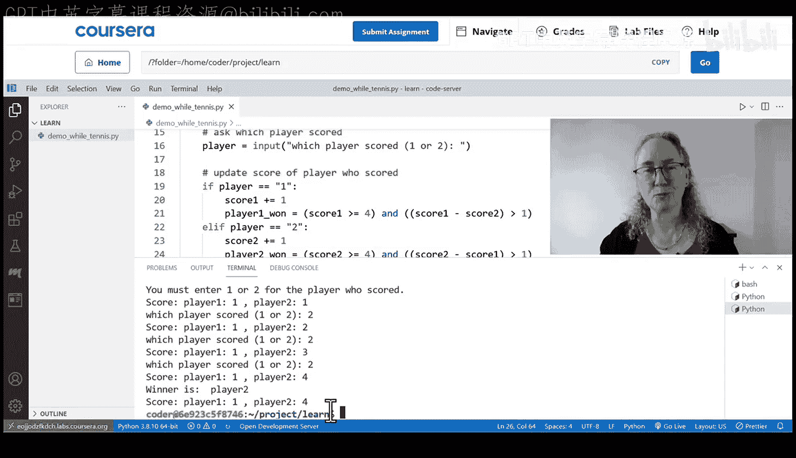

# Python编程实践：04：使用while循环简化网球计分程序


在本节课中，我们将学习如何使用`while`循环来编写一个网球比赛的计分程序。我们将模拟一场网球比赛，直到一方选手获胜为止。通过这个例子，你将理解如何利用循环来处理重复性任务，并掌握条件判断在程序流程控制中的应用。

---

## 游戏结束的条件

上一节我们介绍了循环的基本概念，本节中我们来看看如何确定循环的停止条件。不同的游戏有不同的结束规则。

*   一些游戏，如篮球，受时间限制。例如，美国大学篮球比赛总时长限制为40分钟。
*   棒球则受出局数限制。比赛进行九局，每队每局有三个出局机会。
*   还有一些游戏，当一方达到特定分数时结束。循环将持续进行，直到达到这个特定分数。

## 网球计分规则

现在，我们聚焦于网球。网球就是一种达到特定分数即结束的游戏。

*   网球比赛有两名选手。
*   选手来回击球，直到一方未能回球或将球击出界外，另一方则得一分。
*   获胜者是**第一个获得至少4分，且领先对手至少2分**的选手。

## 程序设计思路

我们将编写一个程序来记录网球比赛的分数并宣布获胜者。

以下是我们的程序设计步骤：

1.  **初始化变量**：我们需要跟踪每位选手的得分，并为每位选手设置一个布尔变量来记录是否获胜。
2.  **游戏循环**：使用一个`while`循环来重复进行比赛。循环条件是“两位选手都尚未获胜”。
3.  **处理得分**：在循环内，询问用户哪一位选手赢得了当前这一分。然后更新该选手的分数，并检查其是否满足获胜条件。
4.  **宣布结果**：当循环结束后（即一方获胜），打印最终比分和获胜者。

## 代码实现

现在，让我们根据上述计划来编写代码。我们将在VS Code中完成。

首先，初始化所需的变量。

```python
# 初始化变量
score1 = 0  # 选手1的得分
score2 = 0  # 选手2的得分

player1_won = False  # 选手1是否获胜
player2_won = False  # 选手2是否获胜
```

接下来，我们设置游戏的主循环。循环将继续，直到其中一位选手获胜。

```python
# 游戏循环：持续进行直到一方获胜
while not player1_won and not player2_won:
```

在循环内部，我们首先询问哪一位选手赢得了当前这一分。

```python
    # 询问哪一位选手得分
    player = input("哪一位选手得分？输入 1 或 2: ")
```

然后，我们需要根据用户的输入来更新相应的分数并检查获胜条件。

```python
    # 更新得分选手的分数
    if player == "1":
        score1 += 1  # 选手1得分加1
        # 检查选手1是否获胜：得分>=4 且 领先至少2分
        player1_won = (score1 >= 4) and (score1 - score2 > 1)
    elif player == "2":
        score2 += 1  # 选手2得分加1
        # 检查选手2是否获胜：得分>=4 且 领先至少2分
        player2_won = (score2 >= 4) and (score2 - score1 > 1)
    else:
        # 如果输入不是1或2，提示用户
        print("必须输入 1 或 2 来表示得分的选手。")
```

为了让玩家能实时看到比分，我们可以在每轮循环结束时打印当前分数。

```python
    # 显示当前比分
    print(f"比分：选手1 {score1} - 选手2 {score2}")
```

当循环退出时，意味着有一方选手已经获胜。我们来确定获胜者并宣布结果。

```python
# 确定获胜者
if player1_won:
    winner = "选手1"
else:
    winner = "选手2"

# 宣布最终结果
print(f"获胜者是：{winner}")
print(f"最终比分：选手1 {score1} - 选手2 {score2}")
```

## 程序运行示例

运行上述程序，你将看到类似以下的交互过程：

```
哪一位选手得分？输入 1 或 2: 1
比分：选手1 1 - 选手2 0
哪一位选手得分？输入 1 或 2: 1
比分：选手1 2 - 选手2 0
哪一位选手得分？输入 1 或 2: 2
比分：选手1 2 - 选手2 1
...
哪一位选手得分？输入 1 或 2: 1
比分：选手1 6 - 选手2 4
获胜者是：选手1
最终比分：选手1 6 - 选手2 4
```

## 总结

本节课中我们一起学习了如何使用`while`循环来构建一个网球计分模拟程序。我们掌握了如何设定循环条件（`while not player1_won and not player2_won`），如何在循环内处理用户输入、更新变量状态，以及如何根据特定条件（得分>=4且领先至少2分）来终止循环。这个程序的核心逻辑可以轻松修改以适应其他类似规则的比赛，例如乒乓球（获胜条件改为至少11分且领先至少2分）。通过这个实践，你巩固了循环和条件判断这两个重要的编程概念。




祝你编程愉快！🎾