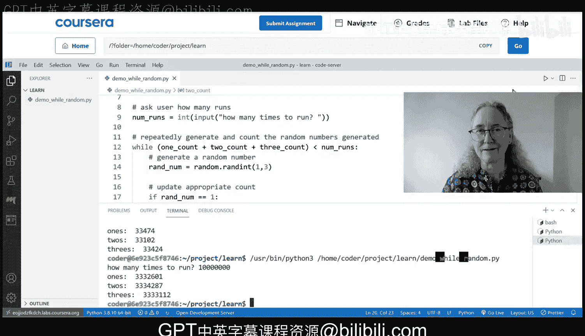

# 杜克大学《Python编程实践｜Practical Python： Start Your Programming Journey》中英字幕 p42 42_04_04_while循环多个随机数演示.zh_en -BV1tTmCBWEQD_p42-

Now that you know about loops， you can create computer simulations。

Maybe you're wondering about random numbers that are generated by the computer。

 Do they really look random， You could test that theory by running a simulation that repeatedly generates random numbers and counts how many times each number occurs。

With loops， you can run the simulation for a long time。

Consider a three sided dice that has the numbers，1，2 and 3 on it。 Yes， they really exist。

Suppose you roll the dice10 times。Since rolling the dice is a random event。

 you would likely get each number appear about one third at a time。For 100 rolls。

 the number one will appear about 33 times。 The number two would appear about 33 times。

 and the number 3 would appear about 33 times。Let's simulate this example on the computer。Now。

 more specifically。Let's test generating random integers from one to3。

You will generate a lot of them and see if about one third of them are ones。

 one third of them are twos， and one third of them are threes。What will you need in the code？

You're going to need variables to count the number of once。

So I'm going to start here with initializations。A comment。And let's use one underscore count。

This is for the count of the number of times， the number ones happen， and let's set that to zero。

So that's equal to zero。Let's use two underscore count。To count the number of twos and set that to0。

And similarly， let's use three underscore count。To count the number threes and set that to zero。

You can ask the user how many times they want to generate a random number to count。

 So let's add a comment。Ask， user。How many runs？You need a variable to store that number。

 So let's use the variable nu。Undersre runs。And what are we going to set that to？

You need to use input to get the value from the user， so let's type input。And let's say。

How many times to run？Question mark。Now。Let's think about the loop。What is the loop going to do。

 It's going to repeatedly。Generate。And count the random numbers generated。Okay。

 so when do you want the loopt to stop？Pause the video to think about this。

You want the loopt to stop when the sum of one count，2 count and three count are equal to nu runs。

Greater than or equal to number runs would also be okay。So what is the opposite of that？

When the sum of the three，1 count，2 count and three count have not reached the value of number runs yet。

So the wild loop will be。w。One count plus two counts。Plus three counts。Well。

 all of that is less than numb runs than we still need to keep going in our wildlife。ok。

So now what do you need to do in the body of the loop each time？

You need to generate a random integer number and stored in a variable。

 Then you check to see if it's a one， a two or three， and you update the corresponding count。

So let's go ahead and generate a random integer from one to3。So I'm just going to add a comment。

enGenerate。A random。Number。We'll use the variable RA nu。

And so we'll just say random dot R ats from one to three。Now。

 let's see which count should be updated。So we'll update the appropriate account when we add a comment。

That is the number has been stored and ran numb， and we need to see， is it one。

 is it2 or is it 3 and update the corresponding count。So we'll just say if ran numb。Is equal to one。

Then one count。Plus equals one。We add the count to one count。LF。Randome is equal to 2。In that case。

 we want to add the count to two count。So we'll add one more to two k。Plus equals 2。

And I'm just going to add a space up here so it's easier to read。And then let's check for three。EF。

Rand nu is equal to3。Then that in that case， we add one to three count。Plus， equals1。And otherwise。

 there's a problem。So let's just print an error message。A。Number is not1，2， or3。Now。

 supposedly this error shouldn't happen because we are generating a number from one to three。

 but it doesn't hurt to put that there。Okay， so that is all you need for the loop。The while loop。

Is going to repeatedly generate a random number that is 1，2 or3， and updates the corresponding count。

The loop stops once the total random numbers generated is equal to the variable nu underscore runs。

Now after the loop is over， let's go ahead and print the values of one count。

 two count and three count。So let's come over here。And we'll just go ahead and say。

 this is after the loop。Print the calendars。So we could say printt。Once。Which is one count。And then。

 print the twos。It's two count。And finally， print the count of the threes。

And that's it for our program。So let's go ahead and run the program and see what happens。

So I'm going to type in here， let's see， we'll just run it here。How many times to run。

 I'm going to say， let's run it 200 times。2。We got an error。

 Let me just make this a little bit bigger。So the program has an error。

The error is in the wild statement。You see while one count plus two count plus three counties less than number runs。

The error message says less than operator is not supported。

The lesson operates not supported between instances of int and STR。

 So this is the type error right here is what I was just reading。

That means we're comparing if an int is less than a string。That doesn't make sense。Let's see。

So when the program uses input back up here。Way back up here。

 When the program uses input to get a value for nu runs， remember that value is a string。

 If we want to convert the string number to an integer data type， we need to use the int function。

Okay， also， let's just notice back down here。It says， on this line， right here。

This says that the error is on line 10。But if you look at line 10， that's the wild loop。

 and we don't see a problem。 So the next question is。

 where did the values and the variables on this line come from。That is。

 we're using several values here，1 count，2 count，3 count and none runs。 And where did they come from。

 They came from above。 So that might tell you that the error is either on the line where it says or it might be above that。

So in this case， you'll find that the true error is a few lines before that， it's in the input line。

 so let's fix line7 and put int before the input so that we're converting the input string into an integer number so we just need to put on this line7 an int。

And that has to convert the whole thing。The value that's entered in by the user into an integer and then nu runs is now an integer。

Okay。Let's run this again。Let's say，200 again。OhWe got another bear。This time。

Let's see what the error is。 Now you should pause the video and see if you can find the error。Now。

 I'm going to tell you that the error is a name error right here。 It says name error。

 Name random is not defined。 So the error is on line 12。 right here。 It says line 12。

If we look at line 12， we're calling random dot Rant and it doesn't know what random is。

We forgot to import random。 Let's add that to the top of the file。

 So we're going to go all the way back to the very top。And we're going to say up here。Import。

 let's see all the way up here。Import。Random。There we go。Let's try the program again。

It'll run it again。This time， again， we'll say 200。and our program ran。Interesting。So。

It says that we have 5 ones， hundred and62s and 443s。That's not really a third， a third， and a third。

 Let's try this again。Let's see back over here。I'm going to run it again。呃。200。Okay， still。

 we're getting a lot more twos than we are ones and threes。

 Let's try a bigger number because maybe 100 isn't good enough for that。 So let's try 100000。Oops。

 oh， I don't want to type that there。I meant to run it here。 so let's run it here。

How many times you run，100，000？There we go。Now， we're still getting。Twice as many twos as we are。

 ones and threes。That doesn't sound quite right。 Let's go look at our code again。Up here。

 let's go look at that if statement。If random is one， one count plus equals 1。 If random is 2。

2 count plus equals 2。 Oh my gosh， I type the wrong number there。 That should be a one。

If random equals 3，3 count plus equals1。 So we are hitting more twos。 So that's why。

 But this should be a one。 that's a typo。 Okay， this is a logic error that we just came across。Now。

 if we get 1，2 or 3， we'd just add a one。 Let's try that again。 I'm going run it。Let's try 200。55，70。

75 dots a little bit better。 Let's try 100000 Now， run it with 100000。Oh， that looks much better。

 That's about a third of them are ones， a third or twos and a third or threes。

That's why you want to do a lot of testing with your program。

Let's run it one more time with an even bigger number， so let's try this。 let's see run it here。

I'm going to try 10 million，10，0，0，0，0，0，0。Okay， that's a big number。

 so we see that the program is a little bit slower because the loop is repeating 10 million times and that takes time to do。

But anyway， let's see。 there。 It just answered。The program still generates about one third ones。

 one third twos， and one third threes。 you can see it right there。Each one gets。3330000。

 So it's definitely about one third each。 So that looks really good。

 makes me confident that this program is probably working。 Now， if we use an even larger number。

 the program might hang， meaning the program may take too long for us to wait for it to complete。Now。

 there's many other simulations you can run。 We are done with this。

 You should think about how you could modify this program to simulate dice with more than three sides。

 such as four sided， five sided or even six sided dice。

What would be the random integers in each case， and approximately how many times should each integer appear。

Which lines of code would you need to modify？Another way to modify the program would be to roll more than one dice。

 What modifications would you need to make for that change。Happy programming。

