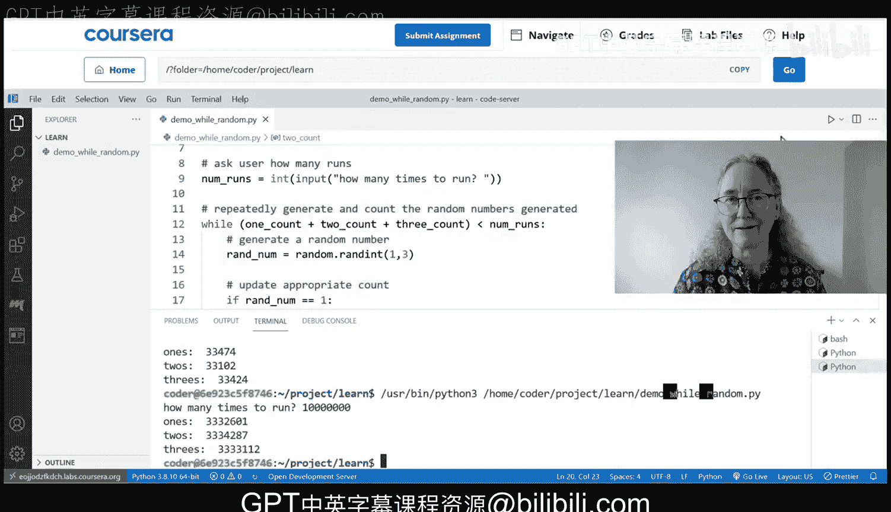

# Python编程实践：使用while循环生成多个随机数


在本节课中，我们将学习如何使用while循环在Python中生成多个随机数，并统计每个随机数出现的次数。

## 1. 概述

通过本节课的学习，你将能够：

- 理解while循环的概念及其在程序中的应用。
- 使用Python的random模块生成随机数。
- 统计随机数出现的次数。

## 2. 实现步骤

以下是实现该程序的步骤：

### 2.1 初始化变量

```python
# 初始化计数器
one_count = 0
two_count = 0
three_count = 0
```

### 2.2 获取用户输入

```python
# 获取用户想要生成的随机数的次数
num_runs = int(input("How many times to run? "))
```

### 2.3 while循环

```python
# while循环生成随机数并统计
while one_count + two_count + three_count < num_runs:
    # 生成随机数
    rand_num = random.randint(1, 3)
    
    # 更新计数器
    if rand_num == 1:
        one_count += 1
    elif rand_num == 2:
        two_count += 1
    elif rand_num == 3:
        three_count += 1
```

### 2.4 打印结果

```python
# 打印统计结果
print("ones:", one_count)
print("twos:", two_count)
print("threes:", three_count)
```

## 3. 错误处理

在编写程序时，可能会遇到以下错误：

- **类型错误**：当比较整数和字符串时，会引发类型错误。解决方法是使用`int()`函数将字符串转换为整数。

```python
num_runs = int(input("How many times to run? "))
```

- **名称错误**：如果忘记导入random模块，会引发名称错误。解决方法是导入random模块。

```python
import random
```

## 4. 修改程序

你可以修改程序来模拟更多面的骰子，例如四面、五面或六面骰子。以下是修改程序的方法：

- 修改`rand_num = random.randint(1, 3)`中的参数，使其生成更多面的骰子的随机数。
- 修改计数器变量和打印语句，以适应更多面的骰子。

## 5. 总结



本节课中，我们学习了如何使用while循环在Python中生成多个随机数，并统计每个随机数出现的次数。通过实际操作，我们了解了while循环的概念及其在程序中的应用，并学会了如何处理程序中的错误。希望你能将所学知识应用到实际项目中，祝你编程愉快！