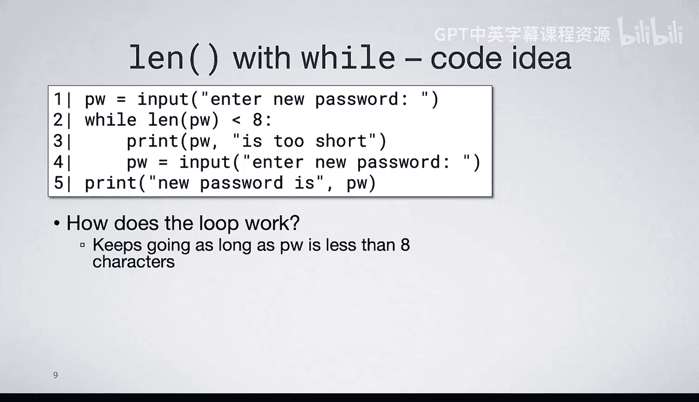

# 杜克大学《Python编程实践｜Practical Python： Start Your Programming Journey》中英字幕 p43 43_04_01_控制字符串长度-使用len函数.zh_en -BV1tTmCBWEQD_p43-

Let's talk about passwords。 I'm sure you have entered a new password before in some software。

 and it tells you your password is not good enough。

That means your password may be too easy for someone else to guess。

There are lots of requirements to make a password good。

 Let's focus on just one of those requirements here。 Let's focus on the length of the password。

 A good password has several characters。At least eight characters is good。

Your password can have more than eight characters， the longer the password。

 the harder it is for someone else to guess it， but most apps require a password with at least eight characters。

Let's look at some examples。 The string animal is only six characters。

 That is too short for a good password。 The word elephant is exactly8 characters。

 That is a good password because it meets our requirements for at least eight characters。

What about the string。 I like ice cream。That is an even better password。

 as it is 13 characters that would be much harder to guess。

So how do you require the user to create a password with at least eight characters？

Before we look at passwords， let's learn about a Python built in function called LN or L。

Lan is an abbreviation for the word length。You can apply the land function to a string and it tells you how many characters are in the string。

 The land function also works with other things， but we'll talk about that later。

Here is a format of the length function。 The word Elian left parentheses， a string variable。

 string value or even string expression， followed by a right parentheses。

 The length function evaluated the length of the string inside the parentheses。

Let's look at some examples。First， we have x is assigned the L E N of the string animal。

 since the string animal has six caps。X is assigned sign the value 6。 Next。

 Y is a sign the length of the expression。String car plus a string 3，2。

 The concatenation happens first， creating the string。Car 3，2。That is five characters。

 So why is assign sign the value 5。Next， the variable word is assigned the string bike。

 Then W is assigned the length of the variable word。 So W is assigned for。Finally。

 Z is assigned the length of the expression word times 3。 That is word times 3 is the string。

 bike by bike。 Notice it has no spaces。 And since bike is  four letters， and we multiply it by 3。

 That means z is assigned 12。😊，Now， you may be wondering why Python uses LN instead of the word length。

 Would't length be easier to understand。Where well。

 the reason goes back to the founder of Python Gurido von Rossom， who created Python back in 1991。

He likedgged short names， so he wanted to use Ean instead of length。

You've also seen other short names， SDR for Str， IN T for end， BOOL Boion。

There likely is also another reason。The abbreviations are shorter to type。

 and that is helpful when you want to use several of them in the same line。

 like the expression that uses LEN， SDR and INT。Here x is assigned s 2。

 which is the length of the string 34。Here is an example of how to use L in a wild condition。

This code checks to see if a user's new password is at least a characters。

 If the password is too short， the while loop asks the user to type another password until they type one that is the correct length。

Let's look at the code more closely。On line one， the user enters a new password。

 Line2 checks to see if that new password is too short if the length of the password is less than8 characters。

If the password is too short， the body of the while loop executes。On line3。

The code tells the user the password is too short， and line 4 prompts the user for another password。

Lines 2 through 4 will continue to repeat until the user enters a password that is at least a characters。

 The while loop is making the user type a password of the correct length。

When the user finally enters a password of length 8 or greater， the while loop ends。

Then Line 5 executes and tells the user what your new password is。

Let's step through an example or run。The user is prompted for a new password。

 Suppose the user types the word cat。 The program tells the user that cat is too short。

 It's only three characters long。Then the program askeds the user again to enter a new password。

 Suppose the user enters the word cat bark。The code tells the user that cat bark is too short。

 It is 7 characters。 Then the program asks the user again to enter a new password。

Suppose the user enters the word cat Miao Miao。That word is long enough。

 It has more than8 characters。 The while loop ends。

The code prints out that the new password is cat Mio Miao。

It is interesting that we can use a while loop to make the user do something。

Let's think about how the loop works。One thing to observe is that the loop will go on forever until the user enters a password that has eight or more characters。

The program helps a user by giving them an informative message。

 telling the user that the password is too short。Then the program asks the user to try again to enter a new password。

😊，We can also observe that the while loop stops。When the opposite of the condition happens here。

 the condition is the question， is the password length less than 8。The opposite of that is。

 is the password length，8 or more。So the loop stops if the password has eight or more characters。

Let's summarize what we have learned。We learned about the land function。

 when the land function takes a string value as an argument that evaluates the number of characters in the string。

That argument can be a string， a string variable， or a string expression。

We also learned that you can use the LA function in a while condition to control what the user is allowed to do。

We saw that we were able to make the user enter a string of the correct length。Specifically。

 the line while length of password is less than 8。 that condition evaluates to true。

If the length of the password string is less than 8。

 that means that the loop will keep repeating if the user keeps entering in passwords that are less than8 characters。

The loop will not end until the user finally enters a password with eight or more characters。

We will be seeing more examples of using L with the while loop。Happy programming。

