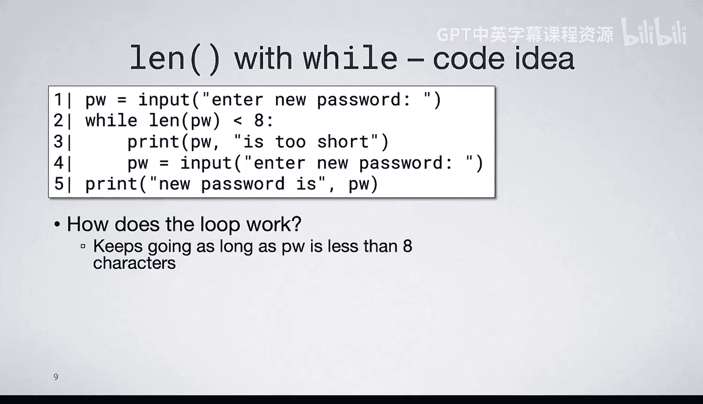

# Python编程实践：控制字符串长度 - 使用len函数


在本节课中，我们将学习如何使用Python内置的`len`函数来控制字符串的长度，并确保密码符合安全要求。

## 字符串长度的重要性

让我们先谈谈密码。你肯定在某个软件中输入过新密码，然后它告诉你密码不够好。

这意味着你的密码可能太容易被别人猜到了。

创建一个好的密码有很多要求。这里我们只关注其中一个要求：密码长度。

一个好的密码应该包含多个字符。至少八个字符是好的。

你的密码可以超过八个字符，密码越长，别人猜到的难度就越大，但大多数应用程序都要求密码至少有八个字符。

## len函数简介

在查看密码之前，我们先来了解一下Python中的一个内置函数——`len`。

`len`是单词“length”的缩写。你可以将`len`函数应用于字符串，它会告诉你字符串中有多少个字符。

`len`函数也可以用于其他事物，但我们会稍后讨论。

以下是`len`函数的格式：

```python
len(string_variable)
```

其中，`string_variable`可以是字符串、字符串变量或字符串表达式。

## len函数示例

让我们通过一些示例来了解`len`函数的使用。

```python
x = len("animal")  # x的值为6，因为"animal"有6个字符
y = len("car" + "32")  # y的值为5，因为"car32"有5个字符
word = "bike"
w = len(word)  # w的值为4，因为"bike"有4个字符
z = len(word * 3)  # z的值为12，因为"bikebikebike"有12个字符
```

## Python中的len与length

你可能想知道为什么Python使用`len`而不是`length`。

原因可以追溯到Python的创始人Guido van Rossum，他在1991年创建了Python。

他喜欢简短的名字，所以他想用`len`代替`length`。

此外，缩写更短，更容易输入。

例如，在一条使用`len`、`str`和`int`的表达式中，这很有帮助。

## 使用len函数控制密码长度



以下是一个示例代码，用于检查用户的新密码是否至少有8个字符：

```python
password = input("Enter a new password: ")
while len(password) < 8:
    print("Password is too short.")
    password = input("Enter a new password: ")
print("Your new password is:", password)
```

在这个例子中，如果用户输入的密码长度小于8个字符，程序会提示用户重新输入，直到输入的密码长度至少为8个字符。

## 总结

本节课中，我们学习了如何使用`len`函数来控制字符串的长度，并确保密码符合安全要求。

我们了解到，`len`函数可以用于计算字符串、字符串变量或字符串表达式的长度。

我们还学习了如何使用`len`函数在`while`循环中控制用户输入的密码长度。


希望这个教程能帮助你更好地理解Python编程实践中的字符串长度控制。