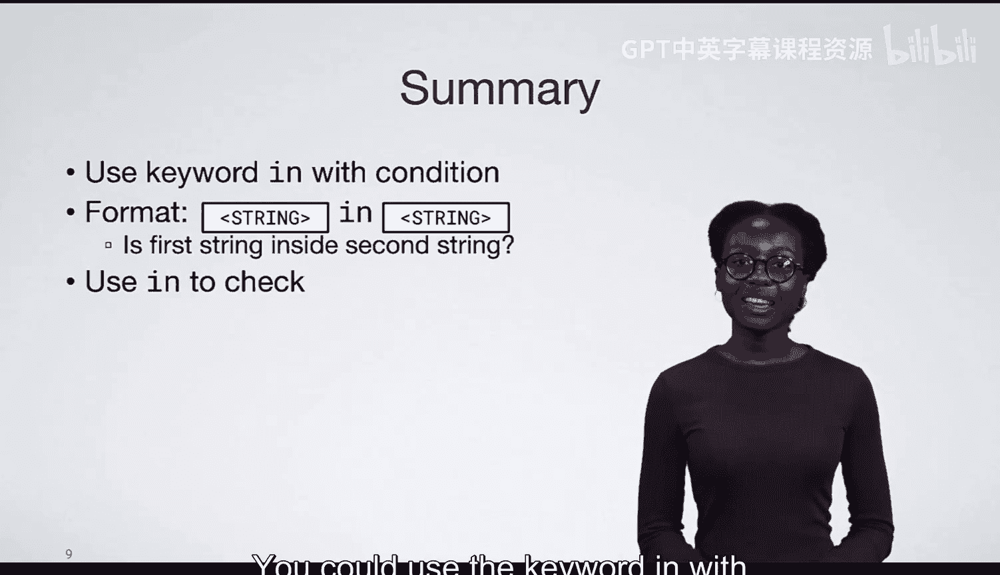

# 杜克大学《Python编程实践｜Practical Python： Start Your Programming Journey》中英字幕 p44 44_04_02_检查字符串内部-使用in关键字.zh_en -BV1tTmCBWEQD_p44-

Having a secure password is important in our digital world。

A secure password protects our personal information， finances， and even our identities。Today。

 we'll discuss how to create a secure password using two specific requirements。

The password must be exactly eight characters because eight characters is a good length for a password。

Shorter than eight characters can be too easy to guess。

The other requirement is the password must have at least one character that is not an alphabetic letter。

Many people are tempted to create a password with just alphabetic letters that are words。

 but that is too easy to guess。Here are some examples。Consider the string， An 8。

Is that a good password。No， it is too short， only seven characters。What about the string tree bark。

Is that a good password。It is eight characters。But it is only alphabetic characters。

 so it is not a good password。What about the string， go the number two party。

 Is that a good password。It is8 characters， and it has one character that is not an alphabetic letter。

 So， yes， this is a good password。So how do you write a program to verify that the user has entered a good password that meets our specifications？

The password has exactly eight characters， and at least one of those characters must not be an alphabetic letter。

We will surely see how to write a program to create a password and verify the password has our specific requirements。

 But first， before we look at our password example， let's learn another new concept。

The keyword in can be used in a condition to check if one string is a part of another string。

Here is the format for the condition。 It is just one string， the keyword in。

 followed by another string。The condition checks if the first string is inside the second string。

 The letters from the first string must be altogether in the second string and in the same order。

 That is， they appear exactly the way they appear in the first string。

This condition evaluates to true， if the first string is inside the second string and otherwise evaluates to false。

Note that angle bracket string， angle bracket could be an actual string or a variable that is a string。

 or even an expression that is a string。Let's look at some examples here we ask if the Str REV is in the Str university。

Now， all the letters from RV are in university and they're even together。 I see VR。

 but they're not in the same order。This condition evaluates false， so W is assigned false。

Here's another example。 Is T O in customize。 Yes， it is。 The condition evaluates a true。

 and x is a sign true。In the next example， we see an expression STR 28 is the Str 28。

 The Str 28 is in the Str March 28， so why is a sign true？One more example。

Is the string T O in the word total。It looks like it is。

 but notice that the T in T O is lowercase and the T in total is uppercase。 They do not match。

And they have to be the same case to match。This expression evaluates to false， so z is a s false。

Let's look at our password requirements， again。Our password requirements are that the password is exactly eight characters。

 and the characters should not be all alphabetic letters to keep our example simple。

 we will assume the letters the user types in are all lower case and the user enters one character at a time。

Let's do the plan activity for how to write a program and plan out how we would implement this。

 The user will build a password in a loop， character by character。

 and the program can check each character to see if all the characters or letters。😊，In fact。

 the program can count how many of the characters are letters as the characters are entered。

Since the requirements say the password should be exactly 8 characters。

 the loop will stop building the password when it has eight characters。 Therefore。

 that means the loop will do the opposite。 The while loop will continue as long as the password the user' is building is less than8 characters。

Once the password is built， the program would tell the user if it is a good password or not。

The password would be good if it has at least one character in it that is not an alphabetic letter。

Let's look at code to do this。Here is the first part of the code。 What does it do。

Line 1 stars the password that will be built initially。 It is the empty string。

Line 2 starts to count for how many alphabetic letters there are Lines 3 through 7 are the loop that builds a password of a characters。

One character at a time。Line4 ask for the character and the user enters the one character。

Line 5 add the character to the password， slowly building out the password。

Lion 6 is a good example of using the keyword in。Inside a condition line 6 checks if the new character is in the alphabet。

And if it is， then line 7 adds one to the count of alphabetic characters。

Lines 3 through 7 keep repeating while the password is slowly built。

The loop stops when the password is8 characterss。We're not done yet。

We need to let the user know if they built a good password or not。 Let's add some more code。

 We have added lines 8 through 11。 If every character was an alphabetic character。

 then the count should be equal to the length of the password。If that happens。

 we can inform the user that the password is not so good。

 otherwise we can tell the user that the password is good。

Let's step through an example to see how this code works。

We will focus on what happens with the input and output as the program runs and also show the value of the password。

 the variable PW as it is slowly built。Let's run the program。The user is prompted to enter character。

And enters the letter B。You can see B is concatenated to the variable P W。The user is prompted again。

And enters the letter， O。You can see O is concatenated to PW。Another prompt， the user enters， oh。

Another prompt， the user enters K。Another prompt， the user enters W。

 Another prompt the user enters O。 Another prompt the user enters R， another prompt。 and finally。

 the user enters M。The word bookworm has been entered。 That is 8 characters in length。

That means a loop was stop， and line 8 is evaluated to make a decision about the password。

We note that when the while loop stops， the value of the variable count is 8。

 the user only entered in lowercase alphabetical letters。

The program tells the user that Bookworm has all letters， and that is not a good password。

Let's step through another example。The user is prompted and enters the letter B。

You can see B is concateninated to the variable PW。

 the user is prompted again and enters the letter 5。 You can see5 is concatenated to Pw。

Another prompt the user enters 3， another prompt the user enters K。 Another prompt the user enters W。

 Another prompt the user enters O， another prompt the user enters R。Another prompt the user enters M。

 The word B 5，3 K worm has been entered。 That is8 characters in length。 The loop will stop。

 and line 8 is evaluated to make a decision about the password。Notice that when the while loop stops。

 this time， the count is 6。The user entered two characters that were not lowercase alphabetical letters。

The program tells the user that this password is good。Let's summarize what we have learned。

We learned about the keyword in that can be used in a condition to check if one string appears inside another string。

The format is just one string， followed by the keyword in， followed by another string。

The angle bracket string angle bracket， in either case， can be a string constant， a string variable。

 or even a string expression。This condition is checking if the first string appears inside the second string。

You could use the keyword in with the condition to check many things。

 You could check to see if a character is an alphabetic character。

 or you could check to see if a character is an numer character or digit。

Let's look at some specific examples。Here is an example to check if the letter is a vow one of A EI O or you。

E is a vow， So this condition evaluates the truth。Here is an example to check if the string row is in the string password。

 row is not in password， so this condition is false。

Note that the letters RO and W are all in the word password as WOR。And altogether。

 but not in the order。 they are in the string row。Is the string or in the string password。

That is true。You now have another tool to add to your toolbox， the keyword in。

And you now know how to write a program for a password that has exactly eight characters。

 and at least one of those characters is not alphabetic。

Passwords could have so many different requirements。

 Think about other requirements you could test for， happy programming。

