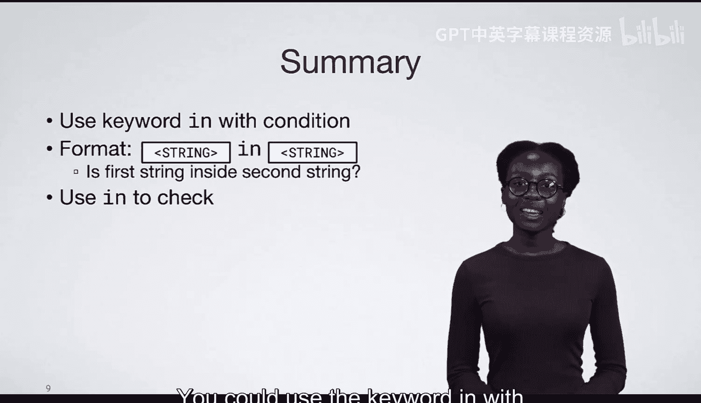

# Python编程实践：创建安全的密码


## 1. 引言

在本节课中，我们将学习如何使用Python编写程序来验证用户输入的密码是否符合特定的安全要求。我们将探讨如何创建一个包含至少一个非字母字符且长度为8个字符的密码。

## 2. 密码要求

为了确保密码的安全性，我们需要满足以下两个要求：

1. 密码长度必须正好为8个字符。
2. 密码中必须至少包含一个非字母字符。

## 3. 使用in关键字检查字符串

在Python中，我们可以使用`in`关键字来检查一个字符串是否是另一个字符串的子串。以下是一个示例：

```python
if "hello" in "hello world":
    print("True")
else:
    print("False")
```

输出结果为：

```
True
```

这是因为字符串`"hello"`是字符串`"hello world"`的子串。

## 4. 编写程序验证密码

以下是一个简单的Python程序，用于验证用户输入的密码是否符合上述要求：

```python
password = ""
count = 0

while len(password) < 8:
    char = input("请输入一个字符：")
    password += char
    if char.isalpha():
        count += 1

if count == 8:
    print("密码不符合要求，请确保密码中包含至少一个非字母字符。")
else:
    print("密码符合要求！")
```

## 5. 代码解释

1. `password`变量用于存储用户输入的密码。
2. `count`变量用于计算密码中字母字符的数量。
3. `while`循环用于提示用户输入字符，并将它们添加到密码中。
4. `if`语句用于检查密码中字母字符的数量是否等于8。如果等于8，则提示用户密码不符合要求；否则，提示用户密码符合要求。



## 6. 总结

本节课中，我们学习了如何使用Python编写程序来验证用户输入的密码是否符合特定的安全要求。我们使用了`in`关键字来检查字符串是否是另一个字符串的子串，并编写了一个简单的程序来验证密码是否符合要求。


**本节课中我们一起学习了如何使用Python编写程序来验证密码的安全性。**