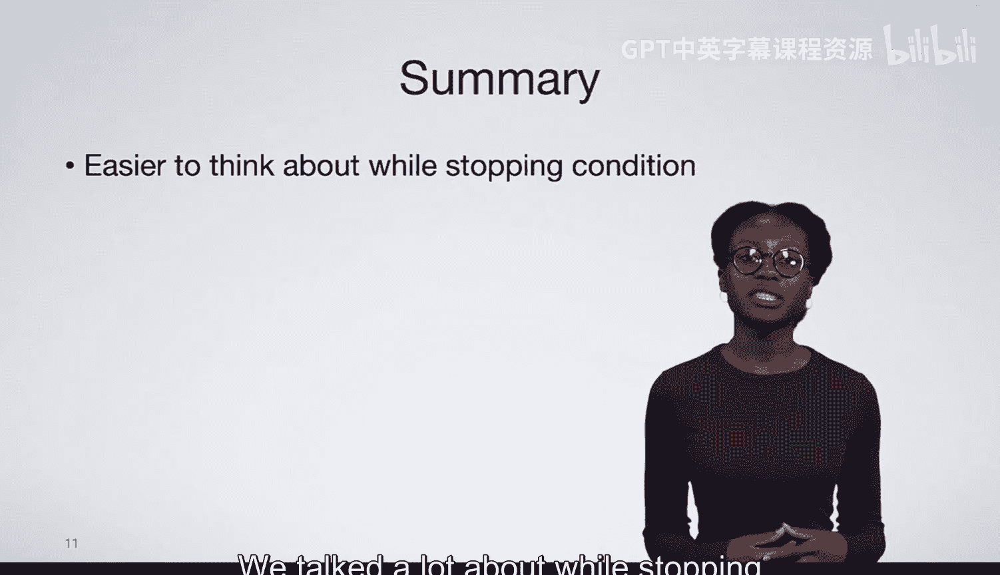

# 杜克大学《Python编程实践｜Practical Python： Start Your Programming Journey》中英字幕 p45 45_04_03_停止条件-while循环与布尔值.zh_en -BV1tTmCBWEQD_p45-

Let's talk about wild loop conditions。 And when the wild loop stops。

 Sometimes it is easier to think about the stopping condition first。

When do you want the while loop to stop。Then if you do the opposite of the stopping condition。

 or rather the negation of the stopping condition， then you have your while condition that will repeat until the stopping condition occurs。

 That is， you put the boolean operator not in front of your stopping condition and you have your wild condition for your loop。

Here is the format。It is the word while followed by the Boolean operator， not。

 followed by left parentheses， followed by the stopping condition followed by a right parentheses。

 followed by a colon。Your loop will repeat while the stopping condition is false。

 and the loop will stop when the stopping condition is true。Let's look at an example。

 Sose you want to stop when the length of the password you're building is eight or more characters。

Then what is your wild condition？It is the negation of this stopping condition。While not parentheses。

 length of Pw is greater than or equal to 8， and parentheses colon。

There is an easier way to say that。That just means while the length of your password is less than8 characters。

Let's see an example of creating a wild condition from a stopping condition that has logic operators。

Consider the requirements for a password that has at least eight characters and at least two number characters or digits。

 That means the stopping condition has two parts。 The length of the password must be 8 or more characters。

 and the number of digits must be  two or more。Assume we're using the variable count to keep track of the number of digits in the password。

What would the wild condition be。We just need to negate the whole stopping condition。

 put parentheses around the whole condition， and then apply not to all of that。Thathou would be。

 while not then parentheses around this whole condition。

 length of password is greater than or equal to 8， and count is greater than or equal to 2。 Also。

 don't forget the colon at the end。That is equivalent to， while left parentheses。

 not length of password is greater than or equal to8， right parentheses。

 or left parentheses not count is greater than or equal to two right parentheses colon。

Both of the not expressions can be simplified。That whole condition is equivalent to。

 while length of password is less than 8 or counts as less than2 colon。That is。

 if it is true that the length of the password is too short or it is true that the password doesn't have at least two digits yet。

 then the wild loop should keep going until both of those are false。

Let's review a minute in case you're wondering how I knew this condition was equivalent。

Do you remember we went over complex Boolean expressions before。Let's review them。

Here I have two expressions， A and B。I want to show you that not around the expression。

 A and B is the same as not A or not B。Here I have a true table。

And I'm showing all the possible combinations of A and B being true or false。

You should think about and pause the video to see if you can fill in the missing values。

Let's look at the first row where A is false and B is false。What is not A and B， Well。

 if A is false and B is false， then A and B is false。 That means not A And B is true。

What about not A or not B。Does that have the same value， Yes， it does。If a is false。

 then not A is true， Tru or anything is true， so not A or not B is also true。

You should pause the video， and check the rest。For whatever values of A and B。

 not A and B has the same value as not A or not B。Let's now look at an example for user to create a new password with specific requirements。

In this example， the password must have at least eight characters and at least two of the characters must be digits。

Also in this example， we're going to make the user meet these requirements。

 The program won't stop until the user's new password meets these requirements。

Let's plan out how our program would work for this type of password。

The program would need to build a password one character at a time， and as it builds a password。

 it can look up the individual characters。The program needs a while loop to process each character one at a time。

The program needs to count how many of the characters are digits。

There need to be at least eight characters。How can we check that。

We can use the LN function to check the length of the password。 When does the program stop。

 It stops when there are at least eight characters and at least two of the characters are digits。

 Finally， the program needs to say whether or not the password meets the requirements。

 but we know the password does。The while loop forces the user to meet the requirements。

 The user was stuck in the while loop until they met the requirement。

 So now that the while loop has finished executing， we can just tell the user their password is good。

So what would be the wild condition， It is the negation of the stopping condition。

What is the stopping condition？Remember， the password must have at least eight characters and at least two digits。

So let's write out the wild condition。In this case， it would be wild， not around the whole condition。

 at least8 characters and at least two digits， followed by Colin。 We just saw that。It is not A and B。

 that is we just saw not A and B is equivalent to not A or not B。

So our while is equivalent to while not at least eight characters or not at least two digits followed by colon。

 we can simplify that。That last line is equivalent， to。

 while less than8 characters or less than two digits colon。

Let's look at possible code for this problem。You should pause the video and see if you understand the code before we go over it。

I can wait。Now I am going to go over the main ideas in the code。

Ls 1 and2 initialize a password as an empty string and the count is 0。

Here the count is counting the number of digits in the password。 line 3 is the while condition。

The wild condition is true if the string is not big enough or there are not at least two digits。

If either of those are true， the while loop executes its body。

 The user is stuck in the while loop until there are at least eight characters。

 and there are at least two digits in the password。

 line 4 asks the user for one character and stores it in the variable C， H。

Live 5 is slowly building the password by adding one more character to it each time in the loop。

Line6 checks to see if the character is a digit and if it is， line 7 adds one to the digit count。

 What are lines 8 and 9 doing？Lines8 and9 are there to give the user information that they don't have two digits yet。

Instead of telling the user every time in the loop。

These lines tell the user once the length of the string is OK， that is。

 once the string has at least eight characters， then if their password doesn't have two digits yet。

 it reminds the user that the password needs two digits。That is everything in the while loop。

Ls 3 through 9 repeat over and over again until the password requirements are met。

Once the requirements are met， the while loop ends and line10 tells the user the password is good。

Let's step through one example，Build a password with this program。 Again。

 the variable P W will be built one letter at a time in the while loop。

 And here count is the number of digits。The user is prompted and enters the letter B。

 You can see B is concatenated to the variable Pw。 The user is prompted again。

And enters the letter I， you can see I is concatenated to PW， another prompt the user enters R。

 another prompt， the user enters D， another prompt the user enters N， another prompt。

 the user enters E， another prompt， the user enters S， another prompt， the user enters T。

The word bird nest has been entered。 That is 8 characters in length。 At this point。

 the if statement on line 8 is true。 There are 8 characters， and there are no digits yet。

So that means they still get the prompt to enter another character。 The user enters the digit  for。

 Again， they're told they need two digits。 Another prompt。 The user enters the digit 8。

 At this point， the password requirements are met。 The length of the password is 8 or more characters。

 It is of length 10， and there are at least two digits。

 Notice that count is true when the while loop ends。 There are two digits in this password。

 The program tells the user that this password is good。Let's summarize what we have learned。

 We talked a lot about while stopping conditions， and we saw that many times it is easier to think about the stopping conditions you want for your while loop than to think about the loop condition。

We also saw that if we can come up with the stopping condition for a while。

 then we can negate the stopping condition to get the condition for the while loop that will keep going until the stopping condition is met。

Here is what that looks like in code。Why not。And then parentheses surround the whole stopping condition。

 followed by Cuen。We reviewed Boolean logic and saw that not around A And B is the same thing as not A or not B。

You should review your bullying logic。Do you know what not around A or B is equivalent to。

You shall pause the video to see if you can figure that out。It is the same as not A and not B。

Build a true table and check it out。We also saw in this video how to write a program to make a user type of valid password that had the following requirements。

 The password has at least eight characters and at least two of the characters had to be digits。

You should think about other password requirements and how you might write a program for them。

Happy programming。

