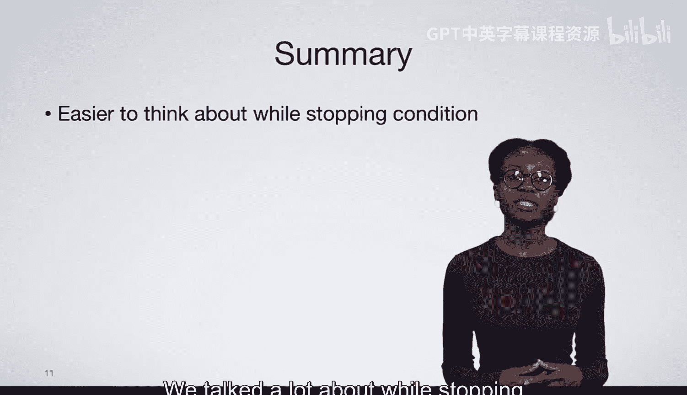

# Python编程实践：while循环与布尔值


在本节课中，我们将学习如何使用while循环和布尔值来设置循环的停止条件。

## 停止条件与while循环

**以下是while循环停止条件的格式：**

```markdown
while not (条件):
    循环体
```

**解释：**

- `while`：表示这是一个while循环。
- `not`：布尔运算符，表示取反。
- `(条件)`：循环的停止条件，当条件为假时，循环继续执行。
- `循环体`：在循环中执行的代码块。

## 例子：创建密码

假设我们需要创建一个密码，该密码至少有8个字符，并且至少包含2个数字。

**停止条件：**

```markdown
密码长度小于8或密码中数字数量小于2
```

**while循环条件：**

```markdown
while not (len(password) >= 8 and count >= 2):
    循环体
```

**解释：**

- `len(password) >= 8`：检查密码长度是否大于等于8。
- `count >= 2`：检查密码中数字数量是否大于等于2。
- `and`：逻辑运算符，表示且。

## 代码示例

```python
password = ""
count = 0

while not (len(password) >= 8 and count >= 2):
    char = input("请输入一个字符：")
    password += char
    if char.isdigit():
        count += 1
    if len(password) >= 8 and count < 2:
        print("密码需要至少2个数字")

print("密码创建成功！")
```

**解释：**



- `input("请输入一个字符：")`：提示用户输入一个字符。
- `password += char`：将用户输入的字符添加到密码中。
- `if char.isdigit()`：检查用户输入的字符是否为数字。
- `count += 1`：如果用户输入的字符是数字，则将计数器加1。
- `if len(password) >= 8 and count < 2`：如果密码长度大于等于8，但数字数量小于2，则提示用户密码需要至少2个数字。

## 总结


本节课中，我们学习了如何使用while循环和布尔值来设置循环的停止条件。通过一个创建密码的例子，我们展示了如何使用while循环来确保密码满足特定要求。希望这节课能帮助你更好地理解while循环和布尔值的应用。