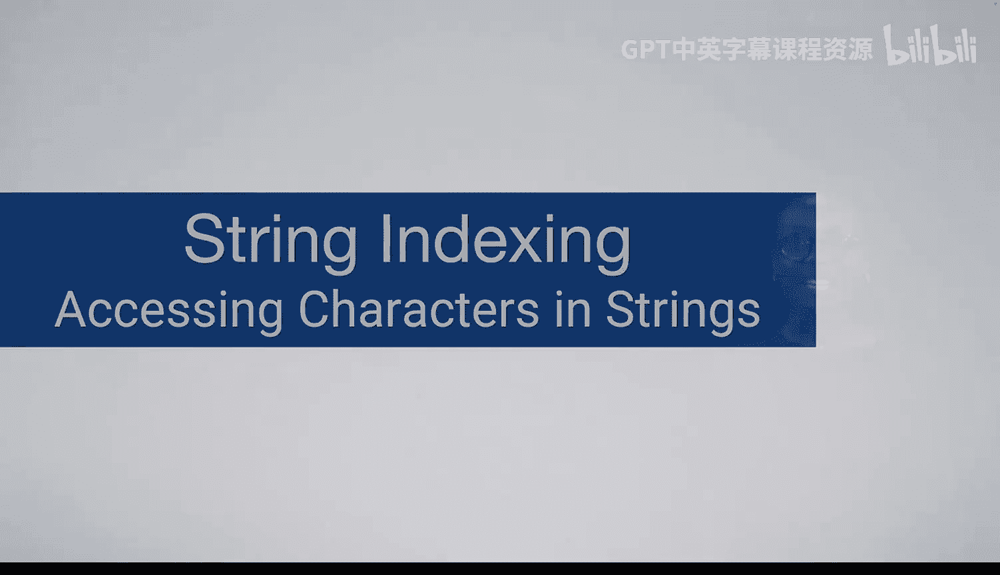
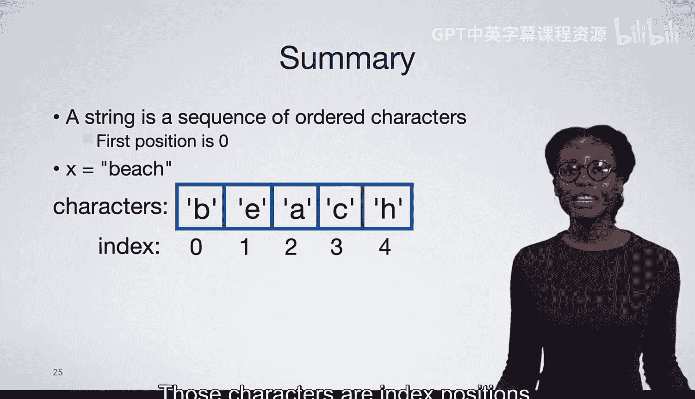

# 杜克大学《Python编程实践｜Practical Python： Start Your Programming Journey》中英字幕 p46 46_04_04_字符串索引-访问字符串中的字符.zh_en -BV1tTmCBWEQD_p46-

Suppose you are given a string， and you want to know if it represents an integer that is。

 I every character in the string a digit。

Here are some examples。 In the first example， X is the strength 7，8，6， A B。

If you try to convert it to an integer， your program will crash because the string has the letters A and B in it。

That's not good for your program to crash。Here's another example。X is the string，6，8，2，3，7。

 If you try to convert that x to an integer， it works fine since x represents an integer。

But you don't want your program to crash sometimes and not crash Other times。

 You don't want your program to crash at all。 It will be better if you could verify that the string X represents an entered first。

And then only if it represents an integer， do you try to convert it to an integer？

But how do you verify all the characters in a string or all digits。

 You need to look at each character one at a time and check to see if it is a digit。

 Let's see how you can access the individual characters in a string。

A string is a sequence of ordered characters。Ordered means that there is a first character in the string and a second character in the string and so on。

Each character in the string has a position number， which is also called an index。

Let's look at an example， consider X is assigned the string bridge。

Let's examine the string bridge more closely。 It has six characters reading the string from left to right。

 B is the first character。 R is the second character， and so on。

The characters are in a specific order。 There is a number for each ordered position。 However。

 in computer science， we like to start counting with0 instead of one。

We say the letter B is in position 0 or at index 0。

 It is a little strange The first position is index 0。

It might help to think of the index as the number of characters you move from the beginning of the string to get to the character you want。

 or its offset。Since you don't have to move to get the first character in a string。

 the offset or index is 0。The letter R is an index1 because you need to move down one character to get to it。

The letter I is in position 2 and so on。 Just remember that indexes in a string always start with 0 because it's the offset from the beginning of the string。

Now， let's look at the format for how you can access individual positions in a string。

You can get the value of a character in a particular index position in a string by referring to the variable name of the string。

 a left square bracket， an integer。Which is the index number of the character followed by a right square bracket。

 Let's look at some examples of accessing characters in a string。

Here is an example where y is set to an expression。

 The expression is the character from the string X。 That is at index1。

 That is R concatenated to the character from the string X。 That is an index 5。

 That is E concateated to the character from the string X。 That is at index 3。 That is D。

Why is assign sign the string value read。Now， you can access the values in a string。

 but you cannot change them。 Consider to follow an assignment。

 The value in string X at index 2 is assign the string U。

We're trying to change the letter I in bridge to the letter U。

 but that is change the word bridge to brush。This does not work。

 You cannot change any value in a string。 You can always build a new string。

 but you cannot change an existing string。You can use the square bracket to access a value in a string。

 but not to change the string。Let's go back to our problem of figuring out if a string represents an integer or not。

 Here is code that shows how to loop through a string character by character。

 Check in each character to see if it is a digit。 Let's examine the code more closely。On line one。

 the user is ask to enter a string that represents an integer line 2 sets the variable index to0。

 index is used for the index position of a character in the string。Lines 3 and 4 are the while loop。

 As long as the current character we're looking at is a digit。

 This while condition is true and index update so you can look at the next character in the string。

 When does the loop stop。The condition is false when the character at the index position in the string is not a digit。

As for what happens after the loop， the code determines if all the characters in the string were counted as a digit。

If， and if so， it prints that the number is an integer， because otherwise。

 the code prints that one of the characters is not a digit。

Let's trace through an example to see what happens。

The program starts and asks the user to enter an integer， S they enter 67A9。

That string is stored in the variable nu。Next to variable index is set to0。Now。

 we're at the wild condition。 The value of nu index 0 is the first character in nu。

 which is the string 6，6 is a digit。 So the wild condition is true。In the body of the wild loop。

Of the line。For the variable index is updated by one， so it is the value1。

We're at the end of the while loop。 so we start the while loop over by checking the condition。

This time index is1 and nu index 1 is the character 7，7 is a digit。 So the wild condition is true。

And a body of the while loop indexes updated by one to 2。We're at the end of the while loop。

 so we start the while loop over again。This time index is 2， so nu index 2 is the character A。

 which is not a digit。The condition ofval waste a false。 The while loop is over。

On line 5 indexes 2 and the length of no is 4。 So the condition evaluates the false。

 execution moves to the L and then to line 8 to print。A is not a digit。 That worked well。

 Our program runs fine。 Let's try another example。The program starts and ask the user to enter an integer。

 suppose the user enters 42。That string is stored in the variable nu。 Next。

 the variable index is set to 0。Now， execution is at the wild condition。

 The value of nu index 0 is the first character in nu， which is the string 44 is a digit。

 So the condition is true。In the body of the while loop， the variable index is updated by one。

 so it is the value one。Execution is at the end of the while loop。

 so execution starts the while loop over by checking the condition。This time。

 index is  one and nu index 1 is the character 2。2 is a digit。 So the wild condition is true。

In the body of the while loop， index is updated by one to2。Execution is at the end of the while loop。

 so we start the while loop over again。Time this time index is 2。 So nu index 2 is what。

There is no character in position too。 The program crashes。

 It doesn't know what to do because the program access the position that does not exist。

 That is not good if your program crashes。Let's look more closely at what just happened。

 Let's focus on this loop。If all the characters are digits， then this condition is always true。

That means the while loop keeps updating the variable index， and at some point。

 it goes to position past the end of the string。When your program tries to access that position in the string。

 it doesn't exist so your program crashes。Your program should only checkN index if indexes a valid position in the string nu。

 S nuM is the string 4832。The valid index position go from 0 to 3。 The length of the string is 4。

 No that 4 is not a valid position。3 was the last valid position because it's the offset。

 That means valid index positions are those that are less than the length of the string。

So your program needs to check if index is less than the length of the string numb before using index。

Let's try to fix the while conditional line 3 here。

 we've added a check to make sure index is a valid position。

Before we try to use index to access a character nu。

 that means a wild condition has two parts that both must be true。So we have also added the ant。

What we talk taking advantage of is short circuit evaluation。Let's revisit that。

Suppose you have two items A and B， joined with and。If A is false。

 then the whole condition A and B is false， we don't need to check B。 B depends on A being true。

Our last part of the condition is not checked If the indexes is less than the length of nu evaluates to false。

 We don't want it checked in that case， as indexes not a valid position。

Now that we have fixed the wild condition， let's go back to our last example at the point it crashed on line 3 and continue our last example to see what happens with this new condition。

 Remember that numb is the string 42， and index has the value to。We check is too less than2。

That is false， meaning the whole condition is false。The while loop ends。

 and we next check to see if the length of nu is equal to index is 2。Is equal to 2。That is true。

 That means all our characters were digits。 execution moves line 6。

 and the program prints at 42 is an integer。 Our program now works correctly and doesn't crash when the input is a valid integer。

Yeah。Let's review what we just learned。 A string is a sequence of ordered characters。

 The first character is at position 0。 The second character is at position 1。 Remember。

 think of the number as the offset or the number of characters to move over from the beginning of the string。

Here's an example where we look more closely at the Str beach。It is made up of five characters。

 Those characters are index positions starting with B in index position 0。

You learn how to loop over the characters in a string with the while loop。

You can access an individual character in a string using square brackets。And most important。

 make sure the position is valid before a is in it。

You now know how to identify a string that is made up of all digits， happy programming。

