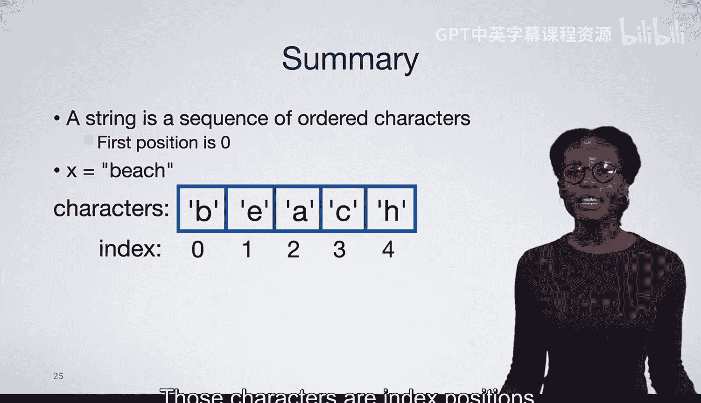

# Python编程实践：字符串索引与字符访问


在本节课中，我们将学习如何使用字符串索引访问字符串中的字符，并验证一个字符串是否表示一个整数。

## 字符串索引与访问

字符串是由有序字符组成的序列。每个字符在字符串中都有一个位置编号，称为索引。索引从0开始，这意味着字符串的第一个字符位于索引0，第二个字符位于索引1，依此类推。

### 访问字符串中的字符

要访问字符串中特定索引位置的字符，可以使用以下格式：

```python
string[index]
```

其中`string`是字符串变量名，`index`是要访问的字符的索引。

### 修改字符串

需要注意的是，字符串是不可变的，这意味着你不能直接修改字符串中的字符。如果你尝试修改字符串中的字符，实际上会创建一个新的字符串。

## 验证字符串是否表示整数

为了验证一个字符串是否表示一个整数，我们需要检查字符串中的每个字符是否都是数字。

### 代码示例

以下是一个简单的Python代码示例，用于检查一个字符串是否表示一个整数：

```python
num_str = input("请输入一个整数：")
index = 0

while index < len(num_str):
    if not num_str[index].isdigit():
        print(f"字符'{num_str[index]}'不是数字。")
        break
    index += 1
else:
    print("输入的字符串是一个整数。")
```

### 代码解释

1. 用户输入一个字符串。
2. 将索引初始化为0。
3. 使用`while`循环遍历字符串中的每个字符。
4. 如果当前字符不是数字，则打印错误消息并退出循环。
5. 如果所有字符都是数字，则打印成功消息。

## 总结




在本节课中，我们学习了如何使用字符串索引访问字符串中的字符，并验证一个字符串是否表示一个整数。通过使用`while`循环和`isdigit()`方法，我们可以检查字符串中的每个字符是否都是数字，从而确定字符串是否表示一个整数。