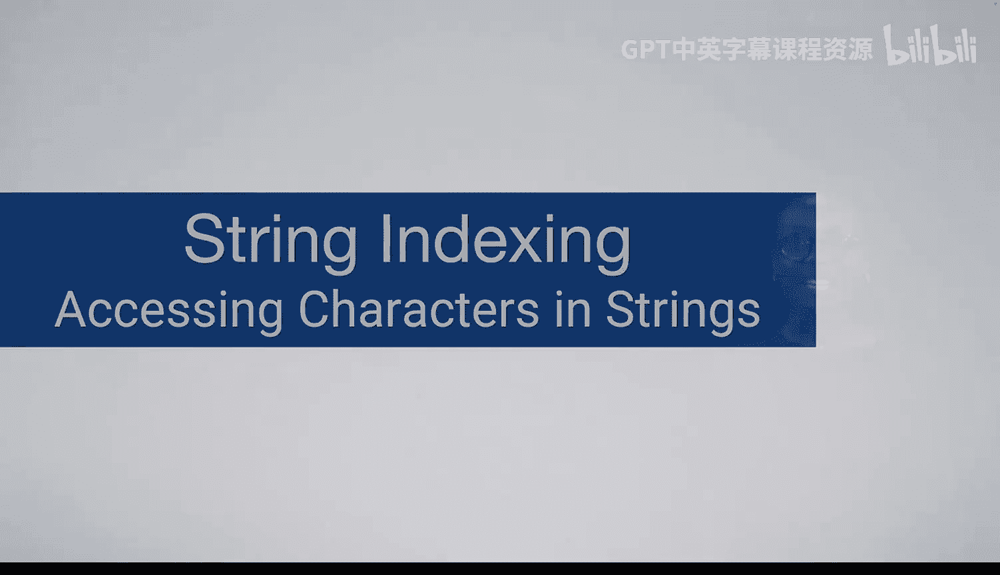

# Python编程实践：第46章：字符串索引与字符访问 🔍




在本节课中，我们将学习如何访问字符串中的单个字符，即字符串索引。我们将了解字符串中字符的顺序和位置编号，并学习如何通过索引来获取特定位置的字符。此外，我们还将探讨如何通过循环遍历字符串中的每个字符，以解决实际问题，例如判断一个字符串是否完全由数字组成。

---

## 字符串索引的基本概念

字符串是一个有序的字符序列。有序意味着字符串中的字符有固定的顺序：第一个字符、第二个字符，依此类推。每个字符在字符串中都有一个位置编号，这个编号称为索引。

在计算机科学中，索引通常从0开始计数，而不是从1开始。因此，字符串的第一个字符位于索引0，第二个字符位于索引1，以此类推。可以将索引理解为从字符串开头移动到目标字符所需的步数（偏移量）。由于第一个字符不需要移动，所以它的索引是0。

例如，对于字符串 `"bridge"`：
- 字符 `'B'` 位于索引0。
- 字符 `'R'` 位于索引1。
- 字符 `'I'` 位于索引2。
- 字符 `'D'` 位于索引3。
- 字符 `'G'` 位于索引4。
- 字符 `'E'` 位于索引5。

---

## 如何访问字符串中的字符

要访问字符串中特定索引位置的字符，可以使用以下格式：

```python
string_variable[index]
```

其中，`string_variable` 是字符串变量的名称，`index` 是一个整数，表示要访问的字符的索引位置。

例如：

```python
x = "bridge"
print(x[1])  # 输出: R
print(x[5])  # 输出: E
```

需要注意的是，字符串是不可变的。这意味着你可以访问字符串中的字符，但不能修改它们。例如，以下代码会引发错误：

```python
x = "bridge"
x[2] = "U"  # 错误：无法修改字符串中的字符
```

如果你需要修改字符串，可以创建一个新的字符串，但不能直接修改现有的字符串。

---

## 遍历字符串中的字符

为了检查字符串中的每个字符是否都是数字，我们需要遍历字符串中的每个字符。可以使用 `while` 循环来实现这一点。

以下是遍历字符串并检查每个字符是否为数字的代码示例：

```python
nu = input("Enter an integer: ")
index = 0

while index < len(nu) and nu[index].isdigit():
    index += 1

if index == len(nu):
    print(f"{nu} is an integer.")
else:
    print(f"{nu[index]} is not a digit.")
```

让我们详细分析这段代码：

1. 首先，程序要求用户输入一个字符串，并将其存储在变量 `nu` 中。
2. 然后，初始化变量 `index` 为0，用于跟踪当前检查的字符位置。
3. 在 `while` 循环中，条件 `index < len(nu) and nu[index].isdigit()` 确保索引有效且当前字符是数字。如果条件为真，则更新索引以检查下一个字符。
4. 循环结束后，如果 `index` 等于字符串的长度，说明所有字符都是数字，字符串表示一个整数。否则，说明字符串中包含非数字字符。

---

## 避免程序崩溃的关键点

在遍历字符串时，必须确保索引不会超出字符串的有效范围。如果尝试访问不存在的索引位置，程序会崩溃。为了避免这种情况，我们在 `while` 循环的条件中添加了索引有效性的检查：

```python
while index < len(nu) and nu[index].isdigit():
```

这里利用了短路求值的特性：如果 `index < len(nu)` 为假，则不会执行 `nu[index].isdigit()`，从而避免了索引越界的错误。

---

## 示例分析

让我们通过两个示例来理解代码的执行过程：

**示例1：输入字符串 "67A9"**
- 索引0：字符 `'6'` 是数字，继续。
- 索引1：字符 `'7'` 是数字，继续。
- 索引2：字符 `'A'` 不是数字，循环结束。
- 由于索引2不等于字符串长度4，程序输出：`A is not a digit.`

**示例2：输入字符串 "42"**
- 索引0：字符 `'4'` 是数字，继续。
- 索引1：字符 `'2'` 是数字，继续。
- 索引2：索引等于字符串长度，循环结束。
- 由于索引2等于字符串长度2，程序输出：`42 is an integer.`

---


## 总结


在本节课中，我们一起学习了字符串索引和字符访问的基本概念。我们了解到字符串是一个有序的字符序列，索引从0开始，表示字符在字符串中的位置。我们学习了如何通过索引访问字符串中的字符，并利用 `while` 循环遍历字符串中的每个字符。最重要的是，我们学会了在访问字符串字符之前检查索引的有效性，以避免程序崩溃。现在，你已经掌握了如何判断一个字符串是否完全由数字组成，为后续的编程实践打下了坚实的基础。祝你编程愉快！ 🎉