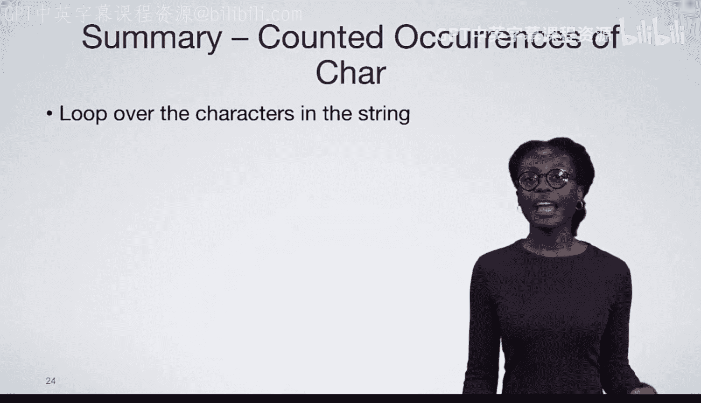

# 杜克大学《Python编程实践｜Practical Python： Start Your Programming Journey》中英字幕 p47 47_04_05_统计单词中的字符-更多索引操作.zh_en -BV1tTmCBWEQD_p47-

What。Hi everyone， suppose you want to know what is the most popular letter in a book？

You would need to go through every word in the book and count how many times each letter occurs。

If you did that， then probably E would be the most popular letter as it is in a lot of words。

Let's look at a simpler problem that we can solve with everything we have learned so far。

Let's get one character and one word and count how many times that character appears in the word。

 Here are some examples。If the word is underrepresented and the character is E。

 then our program will tell us that there are five E's in underrepresented。

If the word is butter and the character is T， then our program will tell us there are two teas in butter。

How do we write a program to calculate that？😊，In order to count how many times a character appears in a word。

 we're going to have to look at every character in the word。😊，How do we do that？

We will need a loop to loop over the characters。 We will need an index variable to know which character we're currently looking at。

 We will start with the first character in the string， so the index needs to start at0。

As we loop over the characters in the word， we will need to update index。

What will the wild condition be， meaning what does the condition check so we can continue to loop over the characters as long as the index is less than the length of the word。

 we can continue looping over the characters。We also need to count how many times the character appears。

 How do we do that， We need a variable to stall the current count of the number of times we have seen a character。

😊，We also need to compare each character in the word to our character to see。😊。

If we have found another one and if so， we add one to our count。

Let's look at some possible code to solve this problem。Let's start at the top。

Lines 1 and 2 ask the user for the word and the character。 Line 3 and 4， initialize variables。

The variable index will be used to keep track of the current character in the string and count will be used to keep track of how many times we have seen the character we're looking for。

Next， we have the loop。Where we will look at every character in the word， Let's break that down。

 The condition on line 5 verifies that indexes a valid position in the word。

 line 6 and 7 checks to see if the current character in the word is a match。 And if so。

 the count is updated to reflect that。😊，Line8 updates to index note that the index has to be updated every time in the while loop to keep loopping through the characters in the word。

Finally， in line nine， our program prints， how many times a character appeared in the word？

Let's now trace through an example so you can see what happens when the program runs。

 The program starts online one， asking for the input， supposeose a user enters the word boot。

And then On line two， the user enters the character O。Next， on line3。

 the program creates and initializes the variable index to keep track of the position of the current character in word Note the index will start at zero。

On line 4， the program creates and initializes the variable count to keep track of how many times we will see the letter O in the word boot counts is initialized to 0 line 5 is the while loop the length of the word boot is4 is0 less than4 that is true the program enters the while loop for line6 the program has to calculate the character at position  zero That is B does b equal O That is false so we skip line 7 and go to line 8。

 which updates index to1。The program is at the end of the wild loop body and moves to line  five to continue。

The while condition is checked again。 This time index is one is one less than4。 That is true。

What is the character at index position1， The character at position1 is O is O equal to O。

That is true。On line 7， the count is updated to one。

We have our first match next On line 8 index is updated by one and index is now two again。

 the program is at the end of the while loop body and moves to line five to continue。

The while condition is checked again。 This time index is 2 is2 less than4。 That is true。

 What is the character at index position 2。The character of position 2 is O， is O equal to O。

That is true。Online 7， the count is updated to2。 We have our second match。Next。

 on line 8 index is updated and index is now three。 Again。

 the program is at the end of the while loop body and moves back to line 5 to continue。

The while condition is checked again。 This time index is 3 is 3 less than4。 That is true。

 What is the character at index position 3， The character at position 3 is T is T equal to O That is false。

 so we move to line 8。Index is updated by one， and index is now 4。 Again。

 the program is at the end of the while loop body and moves to line 5 to continue。

 The while condition is checked again。 This time， index is 4 is 4 less than 4。 That just falls。

 The while loop is over。Lying nine prints out that。O occurs two times。The program is over。

 let's now summarize what this program did。In order to count how many times a specific character occurs in the word。

What did the program need to do？

The program had to look at every character by looping over the characters in word in order to access each character。

 the program needed an index that must be updated each time in the loop to move over。

All the characters in word， the program also has to count how many times a specific character appears in Word to do that a variable is needed that is updated every time a match is found。

Since the program has a loop， we need to think about how to stop the loop。

 the loop stops when there are no more characters in word to look at。

 that means when index is greater than or equal to the length of the word。

 then we should have seen every character remember the while loop condition is the opposite of the stopping condition。

The wild loop condition will be， while the index is less than the length of the word。

 the loop keeps processing the characters in word。That's it。Remember。

 this is a small program to count how many times a character is in a word。

 but this idea could be expanded to count how many times a character appears in a book。

We will learn more to get there。In the meantime， feel free to add to this program or tailor it to meet your needs。

 happy programming。😊。