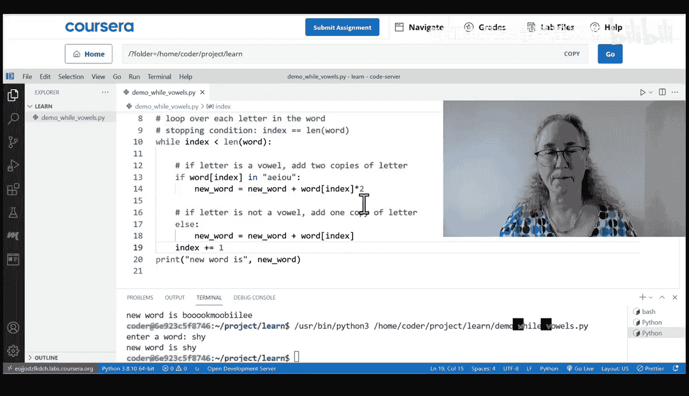

# 杜克大学《Python编程实践｜Practical Python： Start Your Programming Journey》中英字幕 p48 48_04_06_单词中元音字母翻倍演示.zh_en -BV1tTmCBWEQD_p48-

By now， you've learned how Elien gives you the length of a string。

 and the keyword N tells you if one string is inside of another。

Let's practice using those structures together where you take a word and you create a new word that doubles the vowels of the original word。

To simplify the problem， we will assume all letters are lowercase。Remember。

 you can't modify a string in Python， but you can always create a new string based on another string。

How will we solve this problem？Let's outline our plan in comments。First。

 you'll ask the user for a word。So I'm going to add a comment here。Ask user for a word。Next。

 you need， you need to build a new word and initialize it to the empty string。 That is。

 we will start with this string with no characters and add the characters from the original word one at a time to this new word。

 And if they're vowels， we'll add them twice。 So I'm going to add a comment。Initialize。

New word to empty。What do you do next， You need to look at each letter one at a time and for each letter。

 decide if it's a vowel or not。 So as you build this new string。

 you have to decide what to put into the new string。Let's write that all in comments。

So we need a loop。Loop over each letter。In the word。And inside the loop。We need to check the letter。

 if the letter。Is a vowel。Add two copies of letter。我问。And if the letter is not a vowel。

Then we just add one copy of letter。That's a pretty good plan。 So now let's add code to it。

So for the first one， ask us for a word。We need to ask the user for word and store that in a variable。

 let's use the variable word。So we'll say word gets。Input。嗯。We need to ask them to enter a word。

 enter a word。And that looks pretty good。Now let's initialize the variable to store the new word and let's call that new underscore word。

And we're just going to set that to an empty string。

 which we can do that by just doing two single quotes。And that has been initialized。And then next。

 you need to loop over each letter in the word and look at each letter。 But how do you do that。

 you'll need a while loop， But you're also going to need an index variable to access the positions in word。

 So let's also create the variable index and set it to 0。 We'll just do that here。Index。The set to 0。

Now you need a while loop。 What will this stopping condition be。You should pause a video。

 and think about that。You need to look at every letter。

 So you should stop when you have looked at every letter in the word that the user gave。

 So that means when the index is equal to the length of the word。

So I'm going to add a comment here about the stopping condition。

And that is when the index is equal to the length of the word。So now， remember。

 the while loop condition is the opposite of the stopping condition。

 That means the while loop should continue as long as the index is not equal to the length of the word。

Since the index starts at 0， the while loop should continue as long as the index is less than the length of the word。

 So I'm going to write the while loop as while the index is less than the length。Of the word。Now。

 let's process the current letter inside the while loop。

By using the index and check to see if it's a owlel。

So we're going to add that here under the comment if。The word at position index， the word index。

Is the current letter。If that letter is a vowel， how do we decide that。

 One way is just to check if it's in a string that has all the vowels。 So let's do that。

 So if word index is in the string， A， E， I， O， U。If it's in there， then we know it's a vow。

And if it's a vowel。Then we need to add two copies of the vowel to the new word。

 So we'll say new word， new underscore word gets。It's old value。

And we're going to add to the right end。Word。Index， that's the vowel。And we want two copies of this。

 so we can do that by just saying times 2。So this code here appends two vowels to the right end of the new word we're building。

Word index is the vowel， and times 2 creates a string of two copies of the vowel。Now。

 if the letter is not a vowel， we can assume it's a consonant。

 and we just add one copy of the letter to the new word， and we'll do that here under this comment。

Else。New underscore word。Gets its old value。Plus， we're just going to add one copy word。Index。

And that is pretty much all you need for the wild loop。

Your wallet it should repeat over and over again， processing each letter。After the while loop。

 let's print out the new word。So we'll come over here。This is after the while loop。

And we'll just say print。New word。Is。New underscore work。And that's it。

Let's go ahead and run the code and see if it works。I'm going to run it here。

And I'm going to type in celebrate。And hit enter。嗯。It's taking a long time。That's not good。

 I'm going to stop it by holding the control key and pressing the letter C。

That is an interrupt so that it stops the execution。

The program should have calculated the result like really fast， but it didn't。

 So when things take a long time， it might be because we have an infinite loop。

That means there's something going on in our loop， but it's not stopping。

So we have to think about which value is supposed to be changing。

You should pause a video and think about that。Now， the value that's supposed to be changing is new underscore word。

You can see inside the loop。 I'm going to move this down a little bit。

You can see inside the loop here that we change new word each time。

 whether it's a vowel or not a vowel。 So that value is supposed to be changing。But it wasn't。

 So something's going on。 So let's print out the inside of the loop so We can see what's happening。

What we can do is we can add a print statement to print out the value of new word to see if it's actually changing。

So let's。We're going to do that at the very end of the while loop。

Let's see right here at the very bottom， we're going to add a print。A new word is。And new underscore。

Word。Okay， so let's go ahead and run the code again。And we'll type in celebrate again。Oh my gosh。

 we're going a live output。 I'm going to do control C again， to stop it。

And let's scroll back to see what was happening。 And we're just getting so much output。 Here we go。

 It's a lot。 I think it's， it's， it's tons and tons of output。 So clearly， that's not right。

 It's adding the letter C over and over and over again。 And oh， there we go。 We can see it here。

 there it is。 So you can see new word is。 And it just keeps adding a C to new word over and over again。

 And it gets to be really， really long。So that's not correct。So that is helpful though。

 because we see that it's heading the letter C over and over again and that's not right。

Think about also what else should be changing in the loop。

You might want to pause and think about that。What else should be changing is the variable index。

 So let's also print index inside the while loop so we can see its value。Prince。Index is。Index。Okay。

 and let's go ahead and run that。Let's get back down to the bottom。And there's our code。 Al right。

 let me run this and I'm going to type in。Celebrate again。B it's not good。 I'm going to stop it。

 Control C。And let's see if we can see what's going on。So we have new word is very big again。

 And you can see index is zeros。 And we scroll up here， you can see， oh， it's very big。 And again。

 index is 0。 So index is not changing， but new word is getting super long。

 It just keeps adding a C on the end。So。That's not good。So。That was helpful， though。

 because we can see that index variable is not changing。 So we need to update it inside the loop。

 And apparently， we forgot to do that。 So let's do that right here at the bottom of the while loop。

We're going to update index， because if you think about that each time we go through the loop。

 we want to look at the next letter in the word。 And so index needs to be updated at the bottom of the while loop。

 So I'm going to say index。Plus， equals one。And then we'll print its new value and the new value of word。

Let's go ahead and run that now。And it's running down here at the bottom， here it is。

Let's type in celebrate。And it worked。We also got extra output。Because we wanted that extra output。

 So let's see。We have here。Where we type in celebrate。And you see the new word is C index is1。

 and then we process the E， and we put two E's， indexes 2。 We process the L， indexes 3， and so on。

 So you can see the index is changing each time， and we're processing the next letter in the word each time。

 and our program stops。 So our program is working。We have a lot of output。

 but that output helps us see that the index is updated each time。

 and one more letter is processed each time。Now you don't need to delete those print statements just yet those extra print statements that we put in to help us debug。

You can just comment them out in case you need them again。

 So I'm just going to comment them out because we're not finished testing our program。

 We've only tested on one word。There we go。Okay， so when our program is finally finished。

 then we can delete them since it'll no longer be needed and it will make your code look nice and clean。

So let's try running it again now that we've commented out the extra debugging output。

 and we'll try a different word。Let's try progress。And that looks good。 It doubled the O。

 and it doubled the E。Let's try another word， let's try bookmobile。That has a lot of oels in it。Oh。

 I'm typing in the wrong place， I need to run it here。And now， type in her word。

And you can see both of the O's in book were doubled， and the O， I And E in Mole was also doubled。

 So it's looking like it's running really good。 Let's try one word that doesn't have a vowel。

 Let's try shy。And it just gives you the word shy work。

 So it looks like our program is finally working。 Every letter is getting doubled。

So I'm going to go ahead now that I'm pretty confident it looks like it's working good。

 I don't need these extra print statements anymore， so I can just delete them。

So my code looks a little bit better。 There we go。So in summary， what does our program do。

 Our program asks a user for a word and initializes a variable for a new word and an index。

 Then the program loops over every letter in the word using a while loop and an index that has to be updated by one each time at the end of the while loop。

Inside the body of the while loop， the program looks at the current letter and decides whether or not it's a owl。

 If the letters of owl， two copies of the letter are added to the end of the new word that the program's building。

And if the letter is not a vowel， only one letter is added to the end of the new work。

After all the letters are processed， the program has built the new word and printed it out。

You should think about how you could take a word and create a new word in some other way。

Happy programming。

