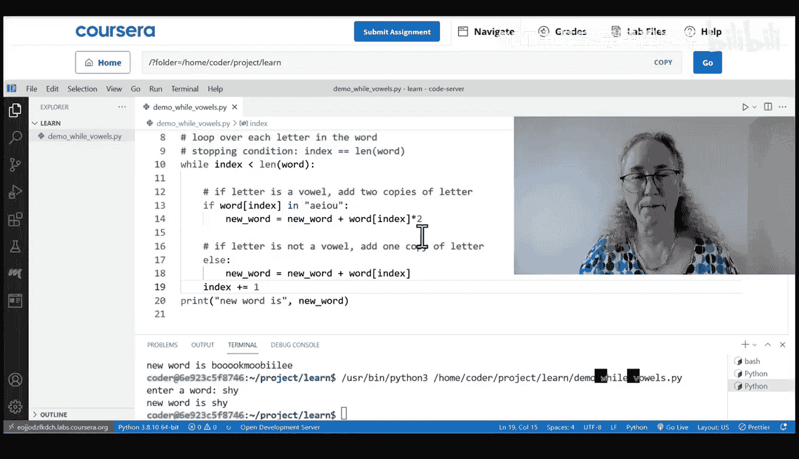

# Python编程实践：双倍元音字母


## 概述

在本节课中，我们将学习如何使用Python编写一个程序，该程序接受用户输入的单词，并创建一个新的单词，其中原始单词中的元音字母被翻倍。

## 1. 问题分析

我们需要编写一个程序，该程序：

1. 从用户那里获取一个单词。
2. 创建一个新的单词，其中原始单词中的元音字母被翻倍。
3. 打印出新的单词。

## 2. 解决方案概述

为了解决这个问题，我们将采取以下步骤：

1. 获取用户输入的单词并存储在变量中。
2. 初始化一个新的空字符串变量来存储新的单词。
3. 使用循环遍历原始单词中的每个字母。
4. 检查当前字母是否为元音字母。
5. 如果是元音字母，将其添加两次到新单词中；如果不是，只添加一次。
6. 打印出新的单词。

## 3. 代码实现

```python
# 获取用户输入的单词
word = input("请输入一个单词：")

# 初始化新的空字符串变量
new_word = ""

# 定义元音字母
vowels = "aeiou"

# 使用循环遍历原始单词中的每个字母
index = 0
while index < len(word):
    # 获取当前字母
    letter = word[index]
    
    # 检查当前字母是否为元音字母
    if letter in vowels:
        # 如果是元音字母，将其添加两次到新单词中
        new_word += letter * 2
    else:
        # 如果不是元音字母，只添加一次
        new_word += letter
    
    # 更新索引
    index += 1

# 打印出新的单词
print("新的单词是：", new_word)
```

## 4. 调试与优化

在编写代码的过程中，我们可能会遇到一些问题，例如：

1. 循环无法正常结束。
2. 新单词中缺少某些字母。
3. 程序运行速度过慢。

为了解决这些问题，我们可以：

1. 检查循环条件是否正确。
2. 检查元音字母的定义是否正确。
3. 使用更高效的方法来遍历字符串。

## 5. 总结

本节课中，我们学习了如何使用Python编写一个程序，该程序接受用户输入的单词，并创建一个新的单词，其中原始单词中的元音字母被翻倍。通过学习本节课，我们可以：




1. 理解循环和条件语句的使用。
2. 掌握字符串操作的方法。
3. 提高编程调试和优化的能力。