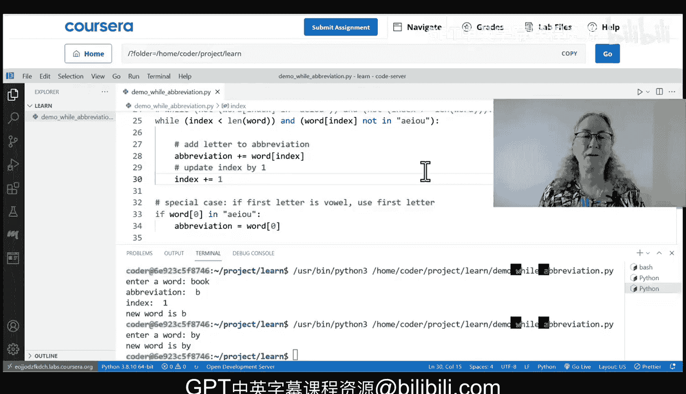

# 杜克大学《Python编程实践｜Practical Python： Start Your Programming Journey》中英字幕 p49 49_04_07_创建单词缩写演示.zh_en -BV1tTmCBWEQD_p49-

In this video， we'll be using while loops with the LN function in membership and also take advantage of short circuiting。

We'll do this by writing code that will look at a problem where you take a word and make an abbreviation of the word。

Maybe the abbreviation will be all the letters from the first letter up to。

 but not including the first vowel。Let's write that down as a commentt with some examples。

We will also assume all words are lower case letters。So I'm going to write some comments。

Here's our problem。And。Will say abbreviation。Is all letters。Up to， but。Not， including。The first。w。

So that would be scrap， for example， would be SCR。And water。Would be Wie。So scrap has SCR。

 you see the first vowel， which is a， so it's just SCR water is just W because the second letter is a vowel。

 so it goes up to， but not including the first vowel。Now， what if the word starts with a vowel。

 this is a special case。You could handle it after processing the word。 That might be easier。

 but you still have to decide how to handle this case。 So if the word starts with a vowel。

 let's just use the first letter as abbreviation。So I'll write that comment。

If word starts with a vowel。Use that vowel。For abbreviation。Let's give an example。Apple would be a。

Now。Let's think about our plan for how to solve this problem。First， I'll ask the user for a word。

 So let's type the plan。As a comment。So first， we'll ask the user for a word。And then next。

 you need to build a new word that is the abbreviation and initialize it to the empty string。

 So let's add some initial an initialization。Initialize。Abbreviation to empty。What do you do next。

You need to loop over all the letters in the word， but only until you find a vowel。

 once you find a vowel， you can stop。 so I'm going to write a comment。Loop over each letter。In word。

 until。Find a vowel。Since you're looping over the letters in the word。

 youll need an index to look at each letter。So let's go back and initialize the index before the loop。

So I'm going to put that here。Initialize。Index to 0。Then inside the loop， you know。

 the letter is not a vowel。 so you can just add the letter to the abbreviation。

 and you also need to update the index。 So inside the loop， let's go over here。

We're going to add letter to abbreviation。And we're also going to。Update index。By one。Now。

 suppose the first letter is a vow。 Then our program won't even enter the while loop body。

You should handle that special case after the while loop。

So we're going to put that after the while loop。Here。I'm going to say a special case。If first letter。

Is vowel。Use first letter。唔。And then finally， that should be et so we can go ahead and print the abbreviation。

 so I'll just add a comment。Print。Abbreviation。That's a good plan。

 So let's go ahead and code this up。You can start by asking the user for a word。 So that's up here。

We'll go ahead and put code in here on line 10。Let's use the variable word。If we spell it right。

 word。Gets input， and we're going to ask the user for a word， so we'll just say enter a word。Okay。

 and then let's initialize the variables abbreviation and index。

 so I'm going to initialize abbreviation。To the empty string。

 So it gets two quotes that makes it a string， but it makes it an empty string。

 And then let's initialize index to 0。Index get 0。Next。

 you need to loop over each letter in the word until you see a vowel。

 So the stopping condition is when you see a vowel or you're out of letters in the word。

 Let's write that as a comments。Stopping condition。Letter is a vowel。 Letter is vowel。

Or out of letters。Let's translate that into our wild condition。

Which is the opposite of the stopping condition。 That means that we enter the body of the while loop when the negation of the stopping condition is true。

That is， while it is not the case that letter is a vowel or you are out of letters。

So I'm going to write that as。While。Not。Letter is vowel。Or out of letters。Now。

 the knot is applied to both of these， and the orar turns into an ann。

 That is this while is equivalent to。I'm going to again， write it as a comment。

While we take the knot and put it into both of those parts and change the orange to an ant。

 So we'll say， while not。Letter is vowel。And。Not。Out of letters。Again， this is a common。

 It's not code。But let's translate this now into code。 So if we translate this into code。

 we're going to get。while。😮，Not。呃。Lettter is a vowel。 So we we to tell if a letter is a vowel or not。

 what we can do is we can look at that letter。 Word index is the current letter。

And we could see if it's in a string of all vowels。This is one way to do it。Well， not word。

Index is in。A E IO U。Now I'm going to put all of this。In parentheses。Okay， so while this is not true。

嗯。Well， it's not true that word index is an AIU。 So that means its that current letter is not a available o。

And。We're not out of letters。 So that means not。And then out of letters would mean that index。

Is greater than or equal to the length of the word。Okay， so that is。

Translated into code line 21 comment while not letters of owl and not out of letters。

 We've just translated that into code to be while not word index in AI O U。Well， it's not about and。

Were not out of letters， so not。 and out of letters would mean the index is greater than or equal to the length of the word。

ok。We can now apply the knot to both of these parts。

 And that means this could also be written as this is just to simplify it。Just rewriting it as while。

And let me comment this one out。It doesn't get confused。So not word index in AIOU。

 that is the same thing as we could say， while。Word。Index。Is not in。A E， I， O， U。

 So that's another way to say that。 Instead of saying not against the whole thing。

 we just say word index， not in A I O U。 So that is not a owl。And then we'll just copy the and。

And then， for the next part。Not index greater than equal to length of word。

That's the same thing as just saying。Index is less than the length of the work。

And I'll just put that in parentheses also just to make it a little bit clear。

And we'll add a colon of the at。Okay， so I'm just going to also add a comment to note that it doesn't matter which of these you use。

 they're equivalent。So I' will put that right here。I'll just add。Any。Of the next two whilsts。

Are wild conditions。Would work。ok。Maybe I'll add a space here too， So okay。

 so now we're going to use this one。嗯。And now we need to work on the body of the while loop。

 So we have the while condition。And now we need to look at the body。So。

The first thing we have is we need to add the current letter to the abbreviation at the right end。

So we can do that， we can say。Appbbreviation。Two bees here。So abbreviation。Plus， equals。A word。Index。

 again， we know it's not a owlel because we're inside the while lips。

 We just add that letter to the end。And then we need to update the index by one。

 and we can do that too by saying index plus equals one。And that should be it for the while loop。

So now。Let's go ahead， and。Print。The final abbreviation and try a word and just see if that works。

 And then we'll come back and handle the special case in a minute。So let's go ahead and just here。

 go ahead and print。The new word is。Abbreviation。Okay。So let's run the program。

And let's try a word stripe。And it tells us the word S T R。 So that worked great。

 Ca that is the correct abbreviation for strikeite。 Let's try another word。

I'm going to run it and type in water。And we get the new word is W。 So that also is great。 Now。

 let's go ahead and run it one more time。😊，And this time， I'm going to type in Apple。Now。

 what do you think the output will be。You should think about that。I'm going to run it。

It just says the new word is empty。 So you get an empty word if you enter word that starts with a foul。

 because we didn't fix that part。 So let's fix that now。

How do you know if the word starts with a vowel。You just need to check the first letter in the word。

So let's go back here to the special case。 and we're going to say if the first letters of owl。

 so we could say if word。不。If。Word 0。 That's the first letter。If that is in a string of owls。

A E I O U。Then we know the first letter is a oel and the abbreviation。Is going be。That first letter。

 word。0。So let's go ahead and try and run this again。We'll run it on Apple， A B， oops。

Let's put Apple down here， A PPPLA。And it works。 It said the new word is a， So that works great。Now。

 let's test it on a word that doesn't start with a vowel just to make sure we didn't mess up anything。

 So let's run it again。And I'm going type it on the word pineapple。And we get the letter P。

 So that also works great。 And let's test one more word。Let's see testinging。

 You got to think about all the words that are different。 Let's try the word shy。Oh， oh my gosh。

 We got an error。 So we are not done yet。 We have an air。 I'm going pull this up a little bit。

So we entered the word shy， and we got an error。 So it says。Index error， string index out of range。

 It also says the error is on line 25。So here is line 25。

And it says the string index is out of range。So。Our program tried to access a position that is not in the word。

So to help us figure out what's going on， let's add more output inside the while loop so we can see what is actually going on。

So what is changing in the while loop， There's two items changing abbreviation and index。

 Let's print them out at the end of the while loop just so we can see their values。

 So let's say print。Areviation。And let's print index。Okay。

So let's then go ahead and run the program with this extra output that's in the while loop。

And let's take the word shy。Okay， so we got some output。 So let's see what happens。 We've got。

Enter the word shy abbreviations S index 1， abbreviation S H， index 2， abbreviation S H Y， index 3。

 and then it crashes。So you can see that right before the perilgrim crashes。

 abbreviation is the word shy， and index is 3。 That means the wild condition will check。

If word3 is about， but wait。The word shy has only three letters in positions 0 to 2。

 position 3 does not exist。Let's look more closely at our wild condition。Here's our wild condition。

 right here。So。We are checking if index is less than the size of the word。

 but we check that after checking if the position is not a vow。

That's not good because the vowel condition is evaluated first， which causes the error。

 So how do we fix that。See if you can pause the video and think about that。I'll give you a hit。

Do you remember short circuiting， It's where if the first item in avoidant condition with a logical operator evaluates in a way that the second item is value。

 doesn't matter。Python doesn't bother， checking the second item。

We can use that to our advantage here by checking if index is less of the size first。

Because we don't want to look at word index if index is not a valid position。 So let's fix this line。

What we're going to do is we're going to check。Take this part of it。And do it first。

So I'm going to leave that part and put it first。Here。And we'll say， and。

And then we'll remove the end here。Okay， so now we're asking。

While index is less in the length of the word， if that's true。

Then we'll check the second one to see if that letter， which we know is okay。Is a vowel or not。Okay。

 let's now run the program and try。That。To see if that fix works。Okay， in word。啊。Get rid of that。

 sorry。Okay， in our word。Shy。And it works， it says new word is shy， so that works great。

So let's go ahead and test a different word just to make sure。I'm going to test。Strike。S， T， R， I。

 K E。We got STR that looks good。And we'll try one more word。嗯。Book。And that looks good。

 So we can go ahead now and comment out the extra outputs。We don't need that。

We could do some more testing if we wanted to， let's try one more。

 let's try without the extra output， let's try by BY。No word is by。 So that also looks good。

When there's no vowel from AIO U， the word you get back is the whole word and that was our intent。

 so return all the letters up to the first vowel。So we can now go ahead and get rid of this extra output。

 So our code just looks nicer because pretty confident our program works now。

Let's summarize the code。 You got a word from the user。 You initialized a few variables。

 including setting an index to 0。 Then you looped over the characters in the words。

 stopping if you looked at all the letters or if you found a vowel。Inside the loop。

 you added the non vowel letter to the abbreviation and updated the index。

 Once the while loop was over， you had a special case to check if the words started with a vowel and used that vowel as the abbreviation。

Last， you printed out the abbreviation。You should think about other rules you could make for an abbreviation。

Maybe include the first vowel in the abbreviation or maybe only use the unique letters in the word。

Think about how the code would change。Have fun experimenting with your code。

