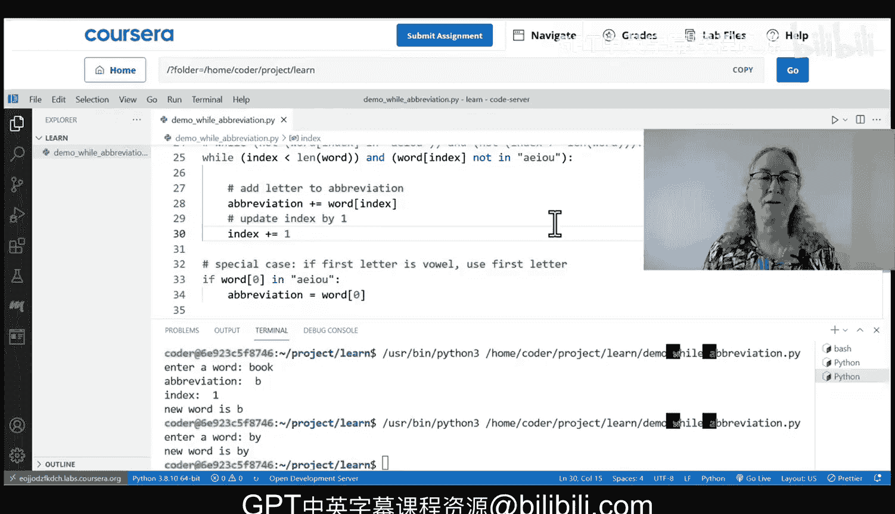

# Python编程实践：49：创建单词缩写演示 🧩


在本节课中，我们将学习如何利用`while`循环、成员运算符`in`以及逻辑运算的“短路”特性，来编写一个程序。这个程序的功能是：输入一个单词，然后生成它的缩写。缩写的规则是：提取从单词开头到（但不包括）第一个元音字母之间的所有字母。

## 问题定义与计划

首先，我们来明确一下问题。缩写规则是：提取单词中从**第一个字母**开始，到**第一个元音字母（不包含该元音）** 为止的所有字母。
*   例如：`scrap` 的缩写是 `SCR`（第一个元音是 `a`）。
*   例如：`water` 的缩写是 `W`（第二个字母 `a` 就是元音）。

我们还需要考虑一个特殊情况：**如果单词以元音开头**。对于这种情况，我们简单地使用这个元音作为缩写。
*   例如：`apple` 的缩写是 `a`。

现在，让我们规划一下解决这个问题的步骤：
1.  向用户请求输入一个单词。
2.  初始化缩写变量为空字符串。
3.  初始化索引变量为0，用于追踪当前检查的字母位置。
4.  循环检查单词中的每个字母，直到找到元音或检查完所有字母。
5.  在循环中，将非元音字母添加到缩写末尾，并更新索引。
6.  循环结束后，处理特殊情况：如果单词以元音开头，则缩写就是该元音。
7.  最后，打印出生成的缩写。

## 代码实现

现在，让我们根据上述计划来编写代码。首先，获取用户输入的单词。

```python
word = input("Enter a word: ")
```

接下来，初始化缩写变量和索引变量。

```python
abbreviation = ""
index = 0
```

### 构建循环条件

循环的停止条件是：**当前字母是元音** 或者 **索引已超出单词范围**。因此，`while`循环的进入条件应该是这两个条件的反面（即“非”）。

我们可以将其写作：
`while not (letter is vowel or out of letters)`

根据逻辑运算规则（德摩根定律），这等价于：
`while (not letter is vowel) and (not out of letters)`

现在，让我们将其翻译成具体的Python代码。判断字母是否为元音，可以使用成员运算符`in`。判断是否超出范围，即检查索引是否小于单词长度。

以下是几种等价的写法，我们将使用最后一种，因为它更清晰：

```python
# 写法一：直接使用德摩根定律后的逻辑
# while (not word[index] in "aeiou") and (index < len(word)):

# 写法二：使用 `not in` 使代码更易读
while index < len(word) and word[index] not in "aeiou":
```

请注意，我们调整了两个条件的顺序，将`index < len(word)`放在了前面。这是为了利用逻辑“与”`and`的**短路**特性：如果第一个条件`index < len(word)`为`False`（即索引已越界），Python将不会计算第二个条件`word[index] not in "aeiou"`，从而避免引发`IndexError`错误。

### 循环体与特殊情况处理

在循环体内，我们将当前字母（已知是非元音）添加到缩写中，并递增索引。

```python
while index < len(word) and word[index] not in "aeiou":
    abbreviation += word[index]
    index += 1
```

循环结束后，我们需要处理特殊情况：如果单词以元音开头，则缩写应为该元音。由于我们的循环在遇到元音时立即停止，如果第一个字母就是元音，循环体根本不会执行，`abbreviation`将保持为空字符串。因此，我们需要额外检查：

```python
if word[0] in "aeiou":
    abbreviation = word[0]
```

最后，我们输出结果。

```python
print("The new word is", abbreviation)
```

### 完整代码与测试

将以上所有部分组合起来，就得到了我们的完整程序：

```python
word = input("Enter a word: ")
abbreviation = ""
index = 0

while index < len(word) and word[index] not in "aeiou":
    abbreviation += word[index]
    index += 1

if word[0] in "aeiou":
    abbreviation = word[0]

print("The new word is", abbreviation)
```

让我们用几个例子来测试一下：
*   输入 `scrap`，输出 `SCR` ✅
*   输入 `water`，输出 `W` ✅
*   输入 `apple`，输出 `a` ✅
*   输入 `shy`（没有元音），输出 `shy` ✅
*   输入 `book`，输出 `b` ✅

程序运行良好！

## 总结

本节课中，我们一起学习了如何创建一个生成单词缩写的程序。我们首先定义了缩写规则并制定了实现计划。在编码过程中，我们运用了`while`循环、`in`成员运算符以及逻辑运算的**短路**特性来安全地遍历字符串。我们还特别处理了单词以元音开头的边界情况。



你可以尝试修改缩写规则来进一步实验，例如：**包含第一个元音**，或者**只使用单词中不重复的字母**。思考一下代码需要如何调整。祝你编码愉快！