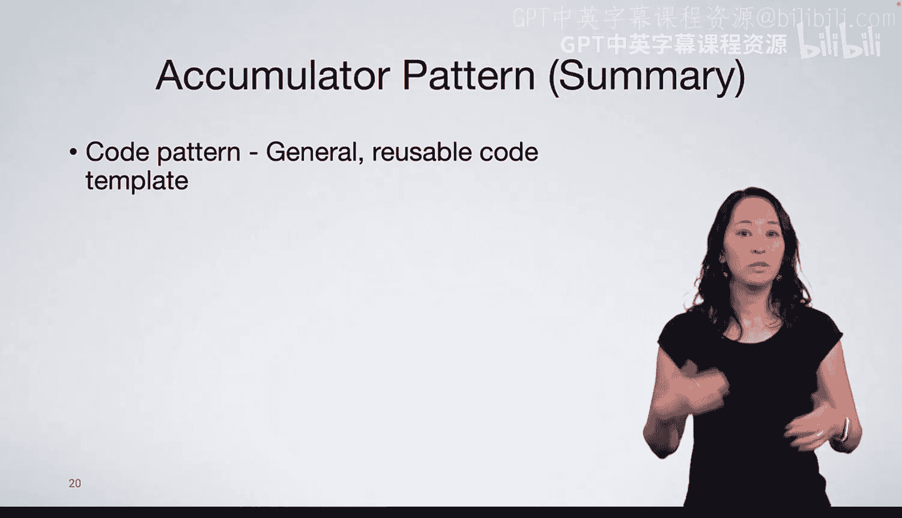

# 杜克大学《Python编程实践｜Practical Python： Start Your Programming Journey》中英字幕 p50 50_04_01_代码模式-累加器模式.zh_en -BV1tTmCBWEQD_p50-

Once you start wanting to write more complex code， it's useful to start chunking them into bigger ideas。

In computer science， we call these code patterns， which are generic。

 reusable code templates that help us accomplish many different goals。

 They are also known as software design patterns。 The word pattern here is similar to how fashion designers create sewing patterns for clothes。

 The pattern for a dress is a template for measuring the cloth， and how to sew the dress together。😊。

But the person using the pattern gets to choose the cloth and decide how to change or embellish the pattern to best suit their needs。

Now， you may have heard of the term algorithm。Code patterns and algorithms are not the same thing。

An algorithm is a specific sequence of steps where the goal is for the outcome to be the same every single time the code is run。

A pattern is a template。 It's generic and can be implemented in many different ways to achieve different goals or outcomes。

 So let's take a concrete example with the accumulator pattern。

 which is a common thing you would do with a loop。The accumulator pattern has three steps。First。

 the code initializes one or more variables before the loop。

Then those variables are updated inside the loop。Finally。

 the code does something with at least one of those variables after the loop。

Notice the main things in this pattern， there's at least one variable， and there's a loop。

The code does something with the variable before， inside， and after the loop。

Here's a table to separate the two pieces out in terms of what is happening and where it is happening。

And at first， you may struggle to remember all the pieces of the accumulator pattern。

 and that's okay。You can always refer back to this video， and you'll find as you use this pattern。

 you'll more and more start recognizing when to use the accumulator pattern and start seeing it as you read more and more cook。

ow。That's all theoretical。 Let's go through an explicit example。

Here is some code that sums all the numbers between one and n。Let's walk through it。

 On the first line， we ask the user for a number 4 hour N。Let's say the user inputs 3。

We then convert it to an int and put it in a variable named ant。Then we go to line2。

 create the variable called result and assign it the value0。On line 3。

 we create another variable called I and also assign it0。Next。

 we go to our wild loop and have the condition。 is I less than an。In this case， the answer is true。

 I is 0， and n is 3。 This means we go inside the wildup， and execute line 5。

This line updates the value of I by adding one to it， so now I is one。

Then we go to the next line and add the value of I to result， which in this case is adding 1 to0。

 So result is now the value 1。Now that we've reached the end of our loop。

 we go back to the beginning of our wall loop and check the while condition again。Is I less than N。

Yes， so let's continue。 We go into our walllu and execute line 5。

 which increments the variable I by one。 So now it's 2。😊，Exection goes to line 6。

 and we add the value of I to the value n result and get 1 plus 2 equals 3。Therefore。

 result is now 3。 And since we've hit the bottom of the while loop。

 we go back up to the well condition and check， is I less than N Yep， so onward back into the while。

We increment I by one， so I is now3。And add results value of 3 to I's value of 3 to set result  to 6。

We are done with the while Luine。 So back to the top。Is I less than n， in this case is3 less than 3。

No， it is not。 That means we now skip the whole loop's codeed body and execute line 7。

 That is after the while loop， which in this case prints out the sum of 1，2，3 is equal  to，6。

So let's summarize what this code is doing。On the first line， we ask the user for N。On lines2 and3。

 we initialize the variables result and I。Lines 4 through 6 are a loop。On line 4。

 the while loop checks if I is less than the value of n。Inside the loop。

 the code adds one to I and adds the value of I to the variable result。Finally， on line 7。

 the code prints out that the sum of1 to n equals the value in result。1。

Do you see the three parts of the accumulator powder。Here are the three parts， as a reminder。

Which lines map to which part。Try to apply what you are learning right now to help your brain remember it。

 In fact， if you are wrong， that is great because the feeling of being wrong tells your brain this is important information to hold on。

😊，Okay， now go ahead and pause。All right。Ready。😊，So the initial part is lines 2 and3。

 where we create and initialize the variables， result and I。

The update part are the two lines in the while loop， lines 5 and 6。

 Those lines update the variables we initialized。Finally， the use part is the last line， line 7。

Because the code prints out the value of result。And now you're probably wondering， what about line 1。

我。😮，That line is part of the program to help us achieve the goal of calculating the sum of one to n。

That line is not considered part of the pattern because it does not create variables that are updated in the loop。

While we do use the variable N and assign it a value。

 we never change N's value in the rest of the program。If we include line 1。

 then we are more talking about an algorithm， which is a specific sequence of steps to find the sum of one to n。

And the point of this video is to help you focus on the idea of common patterns in code。

 like the accumulator pattern。So， for example， how would change this code to get the sum from M to n。

That has you still using the accumulator pattern， while you can't use the exact same algorithm as we have here that gets the sum from one to it。

Now that we've gone through an example， let's talk about why this pattern uses the word accumulator。

And why we were explicitly teaching this to you。It's because the word accumulate means to gather information。

 And I don't mean information where the code always holds on everything the code loops through。

 like summing all the numbers between one and 10。This gathered information could also mean finding the largest number from a series of numbers。

 a user inputs by checking each input and keeping in a variable the biggest number so far。

Even though the code only holds on to the biggest number and doesn't hold on to any other numbers。

 the code has accumulated the information that all the other numbers are not the largest。

As for why you should care about this pattern， it's because there are so many uses for the accumulator pattern。

This pattern helps write code to count the number of times a letter is in a string。

Remove all the vowels in a string。Reverse a string to see if the string as a pollindrome and much。

 much more。Let's go through another example to show you a more complex use of the accumulator pattern。

Here is the code to find the earliest alphabetical letter in a word。 So， for example。

 the code would find the A in cat or the O in zoo。In this code。

 the first line asks the user for a word。The next two lines initialize the variables earliest and I。

The variable earliest starts out as a letter at index 0 of the string in the variable word。

The plan is that the variable earliest will hold on to the letter earliest in the alphabet that the code has seen so far。

So might as well start with the first letter of this string and change it later when we find an earlier letter。

The code will use the variable I to index into the variable word。Lins 4 through 7 are the while loop。

 Line 4 checks if I is less than the length of the user's word。Inside the loop。

 we have an if statement。 The if statement checks to see if the letter at the index I in the variable word is before the letter in the variable earliest。

If the new letter is earlier， the code updates the value of earliest to that letter and otherwise doesn't do anything。

Outside of the if statement， the code adds1 to I。Finally。

 the last line prints out the value in the variable earliest。 So again。

 what lines are the accumulator pattern。In which part of the pattern does that line belong to。

This time， I won't even show you the parts。 Can you remember them。

Go ahead and pause the video to see if you can do it and not remembering is O。

 That just tells you and your brain to try harder to remember this。 Go ahead and pause。All right。

 So here are all the parts。 Line 1 is not part of the accumulator pattern。

 Well lines 2 and 3 are the initialization part。All the code in the while loop belongs to the update part of the accumulator pattern。

And once again， the last line is the use part of the pattern。

Notice that our last line does not use the variable I， and that's fine。

We don't have to use all of the variables we initialized。

And we needed the variable I to help us index into the string， to achieve ouracle。

Let's summarize a code pattern is like a code template that is general and reusable in a lot of different circumstances。

A code pattern is not an algorithm， which is a specific set of steps that when you run。

 you get the same thing every time。The accumulator pattern gathers information about something using a loop。

 It has three parts。 First， initialize one or more variables before the loop。

Then update the variables inside the loop。And finally。

 use at least one of the variables after the loop。Now go forth and try to find the accumulator pattern。

 We've actually been using the accumulator pattern ever since we introduced loops。

Feel free to go back to old videos and try to spot them。

