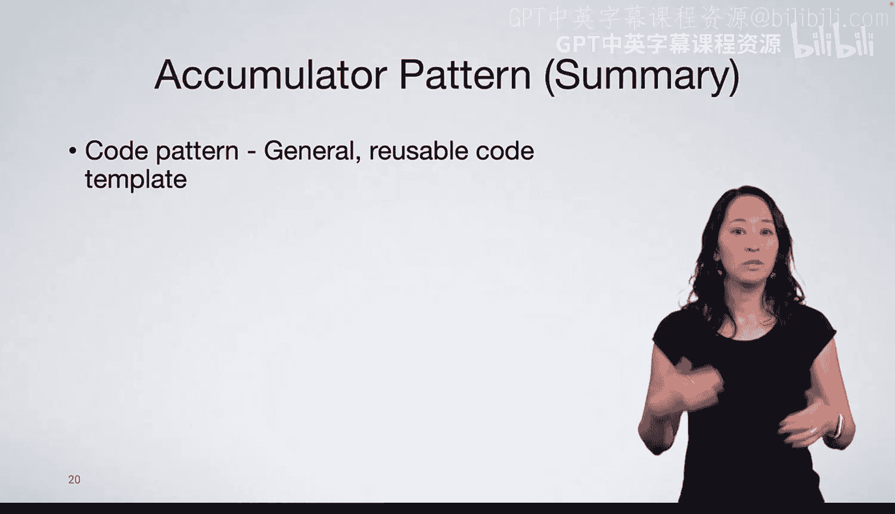

# Python编程实践：50：代码模式-累加器模式 🧮


## 概述
在本节课中，我们将要学习一种在编程中非常实用的代码模式——累加器模式。这是一种通用的代码模板，能帮助我们通过循环来收集或“累积”信息。我们将通过具体的例子来理解它的三个核心步骤，并学会如何识别和应用它。

## 什么是代码模式？
当你开始编写更复杂的代码时，将它们组织成更大的概念会很有帮助。在计算机科学中，我们称之为**代码模式**。代码模式是通用的、可重用的代码模板，能帮助我们实现多种不同的目标。它们也被称为软件设计模式。

这里的“模式”一词，类似于时装设计师为服装创建的缝纫纸样。连衣裙的纸样是测量布料和缝制方法的模板。但使用纸样的人可以选择布料，并决定如何修改或装饰这个纸样，以最好地满足他们的需求。

现在，你可能听说过“算法”这个词。代码模式和算法不是一回事。

*   **算法**是一个特定的步骤序列，其目标是每次运行代码时，结果都相同。
*   **模式**是一个模板。它是通用的，可以通过多种不同的方式实现，以达到不同的目标或结果。

## 累加器模式详解
让我们通过一个具体的例子——**累加器模式**——来深入理解。这是你在使用循环时经常会做的事情。

累加器模式包含三个步骤：
1.  在循环开始前，初始化一个或多个变量。
2.  在循环内部，更新这些变量。
3.  在循环结束后，使用至少一个这些变量。

请注意这个模式的核心要素：至少有一个变量，并且有一个循环。代码在循环前、循环中和循环后都会对这个变量进行操作。

以下是区分这两个部分（发生了什么以及在哪里发生）的表格：

| 部分 | 描述 | 发生位置 |
| :--- | :--- | :--- |
| **初始化** | 创建并设置变量的初始值。 | 循环**之前** |
| **更新** | 在每次循环迭代中修改变量的值。 | 循环**内部** |
| **使用** | 利用循环后变量的最终值。 | 循环**之后** |

一开始，你可能很难记住累加器模式的所有部分，这很正常。你可以随时回看这个视频。随着你更多地使用这个模式，你会越来越容易识别何时该使用它，并在阅读更多代码时发现它的身影。

## 示例一：计算从1到N的和
理论部分讲完了，让我们来看一个明确的例子。

以下代码用于计算从1到n的所有数字之和。我们来逐步分析它。

```python
n = int(input("Enter a number: "))  # 第1行
result = 0  # 第2行
i = 0  # 第3行
while i < n:  # 第4行
    i = i + 1  # 第5行
    result = result + i  # 第6行
print(f"The sum of 1 to {n} is {result}")  # 第7行
```

**代码执行流程：**
假设用户输入了数字 `3`。
1.  **第1行**：获取用户输入，转换为整数并存入变量 `n`。
2.  **第2行**：创建变量 `result` 并赋值为 `0`。
3.  **第3行**：创建变量 `i` 并赋值为 `0`。
4.  **第4行**：进入 `while` 循环，检查条件 `i < n` (0 < 3)。条件为真，进入循环体。
5.  **第5行**：`i` 的值增加1，变为 `1`。
6.  **第6行**：将 `i` 的值 (1) 加到 `result` (0) 上，`result` 变为 `1`。
7.  循环体结束，回到第4行检查条件 `i < n` (1 < 3)。条件为真，再次进入循环。
8.  **第5行**：`i` 变为 `2`。
9.  **第6行**：`result` (1) 加上 `i` (2)，`result` 变为 `3`。
10. 回到第4行检查条件 `i < n` (2 < 3)。条件为真，进入循环。
11. **第5行**：`i` 变为 `3`。
12. **第6行**：`result` (3) 加上 `i` (3)，`result` 变为 `6`。
13. 回到第4行检查条件 `i < n` (3 < 3)。条件为假，**跳过循环体**。
14. **第7行**：执行循环后的代码，打印结果：`The sum of 1 to 3 is 6`。

**总结代码功能：**
*   第1行：获取用户输入的 `n`。
*   第2、3行：初始化变量 `result` 和 `i`。
*   第4至6行：是一个循环。第4行检查条件；循环内部（第5、6行）更新变量 `i` 和 `result`。
*   第7行：打印最终结果。

### 识别累加器模式的三部分
现在，你能看出累加器模式的三个部分吗？试着将你正在学的内容应用起来，帮助大脑记忆。事实上，如果你答错了，那很好，因为“出错”的感觉会告诉你的大脑：这是需要记住的重要信息。

以下是三个部分以及它们对应的代码行：
*   **初始化部分**：第2行和第3行。我们在这里创建并初始化了变量 `result` 和 `i`。
*   **更新部分**：`while` 循环内的两行，即第5行和第6行。这些行更新了我们初始化的变量。
*   **使用部分**：最后一行，第7行。代码在这里打印出了 `result` 的值。

你可能会想，那第1行呢？这一行是程序的一部分，帮助我们实现计算1到n之和的目标。但它不被视为模式的一部分，因为它没有创建在循环中被更新的变量。虽然我们使用了变量 `n` 并给它赋值，但在程序的其余部分我们从未改变 `n` 的值。如果我们包含第1行，那么我们讨论的更像是一个**算法**——一个计算1到n之和的特定步骤序列。本视频的重点是帮助你关注代码中的常见模式，比如累加器模式。

例如，如何修改这段代码来求从 `m` 到 `n` 的和？你仍然会使用累加器模式，但不能再使用我们这里从1到n的完全相同的算法。

## 为什么叫“累加器”？
既然我们已经看了一个例子，让我们谈谈为什么这个模式使用“累加器”这个词，以及为什么我们要明确地教你这一点。

因为“积累”意味着收集信息。我指的信息不一定是代码始终保留循环遍历的所有内容（比如求1到10所有数字的和）。这种收集的信息也可能意味着：通过检查每个输入，并在一个变量中保留目前最大的数字，从而从用户输入的一系列数字中找到最大值。即使代码只保留了最大的数字，而没有保留任何其他数字，但代码已经积累了“所有其他数字都不是最大的”这一信息。

## 累加器模式的应用
至于为什么你应该关心这个模式，是因为累加器模式有非常多的用途。

这个模式可以帮助编写代码来：
*   计算一个字母在字符串中出现的次数。
*   删除字符串中的所有元音字母。
*   反转字符串以检查它是否是回文。
*   以及更多其他任务。

## 示例二：查找单词中字母表顺序最早的字母
让我们看另一个例子，展示累加器模式更复杂的用法。

以下代码用于查找一个单词中字母表顺序最早的字母。例如，代码会在“cat”中找到“a”，在“zoo”中找到“o”。

```python
word = input("Enter a word: ")  # 第1行
earliest = word[0]  # 第2行
i = 0  # 第3行
while i < len(word):  # 第4行
    if word[i] < earliest:  # 第5行
        earliest = word[i]  # 第6行
    i = i + 1  # 第7行
print(f"The earliest letter is {earliest}")  # 第8行
```

**代码解析：**
*   第1行：获取用户输入的单词。
*   第2、3行：初始化变量 `earliest` 和 `i`。变量 `earliest` 初始化为字符串 `word` 中索引0处的字母。计划是让变量 `earliest` 保存代码目前看到的字母表顺序最早的字母。所以不妨从字符串的第一个字母开始，稍后找到更早的字母时再更改它。变量 `i` 将用于索引到变量 `word` 中。
*   第4至7行：是 `while` 循环。第4行检查 `i` 是否小于用户单词的长度。
*   循环内部有一个 `if` 语句（第5行）。它检查变量 `word` 中索引 `i` 处的字母是否在变量 `earliest` 中的字母之前（按字母表顺序）。如果新字母更早，代码就将 `earliest` 的值更新为该字母（第6行），否则什么也不做。
*   在 `if` 语句之外，代码将 `i` 加1（第7行）。
*   最后，第8行打印出变量 `earliest` 中的值。

### 再次识别模式
那么，哪些行属于累加器模式？这些行属于模式的哪个部分？这次，我甚至不会展示各个部分。你能记住它们吗？

以下是所有部分：
*   **第1行**不是累加器模式的一部分。
*   **第2行和第3行**是**初始化**部分。
*   `while` 循环中的所有代码（第4至7行）属于累加器模式的**更新**部分。
*   最后一行（第8行）再次是模式的**使用**部分。

请注意，我们的最后一行没有使用变量 `i`，这没关系。我们不必使用所有初始化的变量。我们需要变量 `i` 来帮助我们索引到字符串中，以实现我们的目标。



## 总结
本节课中我们一起学习了代码模式，特别是累加器模式。

*   **代码模式**就像一个代码模板，它是通用的，可以在许多不同的情况下重用。
*   代码模式不是**算法**，算法是当你运行时每次都能得到相同结果的特定步骤集合。
*   **累加器模式**使用循环来收集关于某事物的信息。它包含三个部分：
    1.  在循环**之前**，初始化一个或多个变量。
    2.  在循环**内部**，更新这些变量。
    3.  在循环**之后**，使用至少一个这些变量。

现在，去尝试发现累加器模式吧！实际上，自从我们引入循环以来，我们一直在使用累加器模式。欢迎随时回顾以前的视频，尝试找出它们。