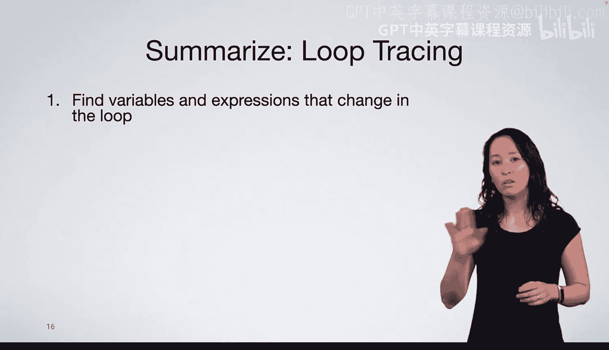

# 杜克大学《Python编程实践｜Practical Python： Start Your Programming Journey》中英字幕 p51 51_04_02_循环跟踪.zh_en -BV1tTmCBWEQD_p51-

。Now that you've experienced loops a bit， let's talk about some formal steps on what you should do when tracing through a loop。

 This is called loop tracing。Where you carefully go through a loop and keep track of the result of each line's execution。

Usually on a piece of paper or something。By writing down the values of things on a piece of paper。

 you aren't keeping everything in your head and potentially misremembering something。

The reason why you would do this is to understand exactly what the code is doing。

By being more methodical， like how a computer would read code。

 you can more easily figure out what is wrong with the code and fix the code。

If you can execute the code line by line， this skill also helps you better understand the code over all and confirms that the code is doing what you think it is doing。

Now I'll pause here and tell you there is more than one way to trace through a loop using Python Tutor is one of them。

This video will present one way of loop tracing， and you are welcome to figure out your own way。

We are recommending these steps to you because our experience has taught us that this way helps us stay organized and not miss anything when walking through the card。

Research has shown there is only so much someone can keep in their memory。

We've seen that following these steps and writing them down on paper or something helps make sure that your memory is freed up from keeping track of the value of everything so you can focus on other parts of the code。

Okay， let's walk through the steps of loop tracing。

 Step 1 is finding the variables and any other expressions that might be useful to keep track of。

These are usually variables that might get updated in the loop and expressions like Booleing statements that may evaluate to something different in each iteration。

Second， create a table to keep track of the things you found in step one。

The first columns should be the loop variable or variables。

 which are checked in the loop's condition。The column after those should be what the loop condition evaluates to。

This column is mainly to ensure you always check whether you need to execute the loop again。

Then all the other columns should be the other variables and expressions you found in step 1。Finally。

 in step 3， you are ready to iterate through the loop。Before you go through the loops code。

 copy into the next row the current values of the variables。

 Then you execute each line of code and update the value of the variables as they happen。

 and fill in the result of the expressions When you reach that line of code。 So that is a lot。

 Let's walk through an example。Here is some mystery code。 Can you figure out what the code is doing。

 Pause here， if you'd like to try。Don't worry if you can't。

 Part of the point of learning how to trace through a loop is that as you practice tracing a loop。

 you'll be able to do more and more loop tracing quickly and potentially in your head to figure out what the code is doing。

It's just like any skill。 The more you practice， the easier the skill becomes。 All right， Remember。

 that step 1 is about finding the variables and expressions that would be useful to keep track of as you trace through the loop。

😊，This is usually things like the loop variable， the loop condition。

 and anything else that is changing。 So what do you see， I'll give you a hint for this code。

 There are four things that I keep track of。 Can you find them all。

Pause the video to give yourself some time to figure it out。

 Now is a great time to start practicing and learning what to pay attention to。😊，Okay， are you ready？

The first thing to track is the looping variable， which is the variable I that is initialized online line。

 too， because the variable I is the only thing that is changing each time in the loop and used in the loop condition。

In this code， there are no other loop variables。 So the next thing we should track is the loop condition。

That's on line 4。The loop condition says if I is less than the length of the string in the variable S。

 So the loop condition is using the variable I and S。 However， while we are tracking the variable I。

 we don't need to track the variable S because S does not change。 Instead。

 we are going to track the entire while condition to make sure we know exactly when the loop is done。

The next thing we will track is the variable Re， which is initialized on line 3。

 If we look in the loop at line 6， we can see that the variable could get updated in the loop。

Finally， the last thing we will track is the if condition。

 because that will tell us whether line 6 is executed。

 which is important to be aware of since that is when the variable rat is updated。So with that。

 here is our table。 The four things we will track in our loop tracing are the variable eye。

 the while loop condition， the variable rat and the if condition。

 Not how the first column is the loop variable。 The second column is the loop condition。

 and the rest of the columns are useful things we want to track like the variable rat that is updating in the loop and the if condition that is inside of the loop。

😊，Let's start tracing the code。 First， we start with executing line 1。

 which is a call to input asking for a string。Let's say the user inputs the word make。

Which gets assigned to the variable， S。We go to the next line and create the variable I and assign it the value0。

Next on line3 is creating the variable RE and assign it the empty straight。Now。

 we are at the while loop and we can start tracing the loop。 Now， remember。

 the first step of tracing a loop。Before we iterate through the loops code。

 we copy the current values into the next row， which in this case is the first row。

So we add in the value0 for the variable's I and the empty string into the variable R。

 And now we execute the code。First， we check the wall condition and find that it is true。

 The variable S is the value make， which is of length 4。 And since 0 is less than 4。

 the wall condition is true。 So we move on to the next line。Now， we are at the if statement。

 The value of I is 0， so we are going to index into the0th position in the string make and get back the value M。

Since M is not in the string， A E。 I O U， the if condition is true。

 That means we execute the code inside the if condition and move on to line 6。

 which means we update the value of R。By app M to the empty string， resulting in listing M。

Then we go to the next line and update the value of I by adding  one to 0 to get 1。

 And now we are at the end of our loop。 So it's time to go back up to the top of our well condition and start all over。

😊，First， we copy the current values of our variables to the new row。 I is the value 1。

 and R is the value M。 Next， we check the wall condition and confirm it is true。

 The variable I is the value 1 and the length of S is still 4。

So we go into the loop to execute the if condition Is the value of S at index I not in the string A E I O U。

 Well， I is the value 1 and the value at index1 of the string make is a。

 which it is in the string A E I O U。 So the if condition evaluates to false。

 This means we do not execute the code in the if condition and skip straight to line set。

Which has us update the value of I by adding one to it， making it the value 2。

And now we are at the end of the loop。 So we go back to the top of the loop on line 4。

Then we do part  one and copy the current values of the variables down。

 And now we are ready to evaluate the while condition， which is true Again。

 we are not yet done what this loop， it looks like。

Down we go to the next line to check the if condition。 and in this case。

 it is true since the variable I is the value 2 X index I is the value K。

 which is not in the string A E I O U。So we execute the code in the estimate。

 which means the variable R gets updated to the value M K。Onward to line 7。

 which has us update I to 3。 And since we are at the end of our loop back to the top， we go。Okay。

 almost there， I promise。Copy the variables values down and a value the well condition to get true。

 So we go to line 5。And evaluates the if condition。Which is false S index I is the value E。

 and E is in the string。 A E I0 U， making the conditional check of E not in Ae I O U false。

 which means we skip if condition code and go to line set。

Update the value of I by adding one to get 4。And back to the beginning of the walloo。One more time。

 Let's copy our values down into the new row， and let's execute our well condition。 In this case。

 we get false。4 is not less than 4， which means we skip the entire loop and go to line 8 where the code prints result colon M K。

 And we made it。 That's how we trace through the entire loop， keeping track of things as we go。

 so we can understand exactly what the code is doing。😊，And now that we are done。

Do you see what the mystery code is doing。Were you able to figure it out on your own。

 or can you tell what the code does now that we've traced through it and have the table all laid out。

 pause and let at least take a guess。😊，This code takes the string from the user and prints out the same string。

 but without any of the vowels， A E I O U。You can see this by looking at each part of the code。

 First， the code initializes the variables as from the user， I is 0， and Re is an empty straight。

As we go through the wallet loop， the code is checking each character in the string from the user。

Lins 5 and 6。 Check to see if that character is not in the string。 A E。 I O U， or in other words。

 whether that character is not a vowel。 If it is， the code adds at the end of the string rat。

 So the code as a whole is slowly building a string of all the non vowel characters that are in the string variable S。

 Also， notice， I said non vowel characters。 So as a quick question to ask yourself。

 what would the code print。 If the string was something like Hello world。😊。

The code would print result colon H， L， L space， W， R， L D。

 It would print the space and exclamation point，2。And I know that probably felt really long。

Walking into the code like that。 But keep in mind， I was explaining every single step to make sure that you didn't miss anything。

When you when you trace on your own， it'll go much faster because you likely won't talk your way through everything like I did in this video。

So let's recap the steps first， find all of the variables and expressions that will change in the loop。

Step 2， create a table where each of the things you found in step 1 are a column。

 The first column should be the looping variables。 The next column is the loop condition。

 and then you have the rest of your columns。 Finally。

 fill in the table as you iterate through the loop where at the beginning of each iteration。

 you copy down the current values of all the variables。

 and then you update the row as you walk through the code in the loop。😊。

I hope this was helpful and showed you a way to be methodical when reading loop code。

 and you will try this out when you are debugging your code or trying to understand what some code is doing。

