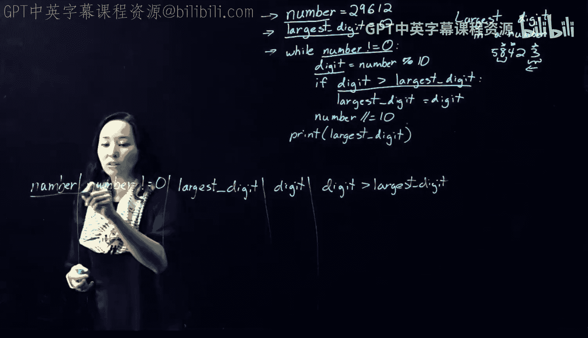
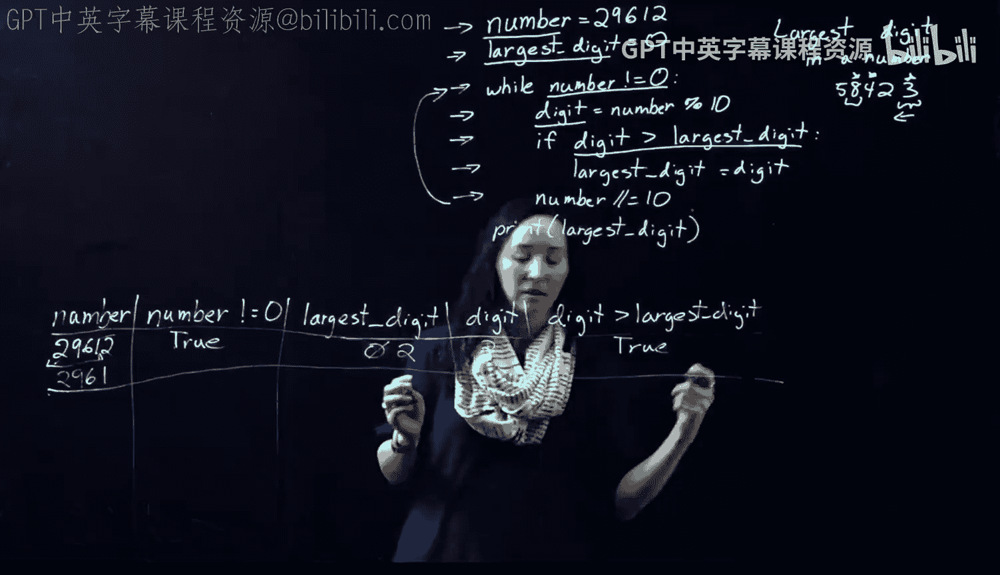
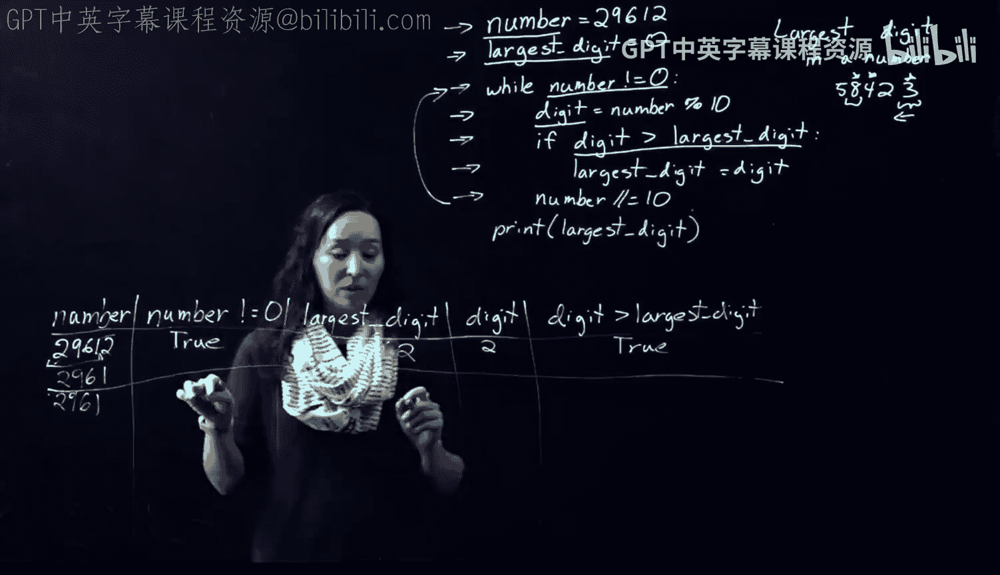
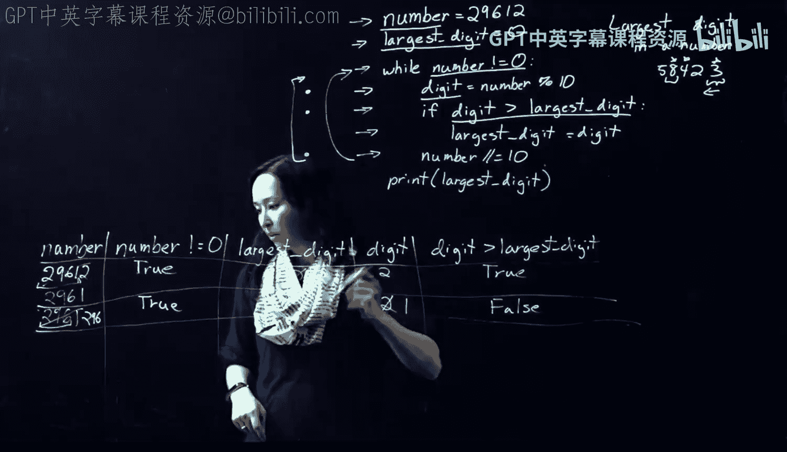
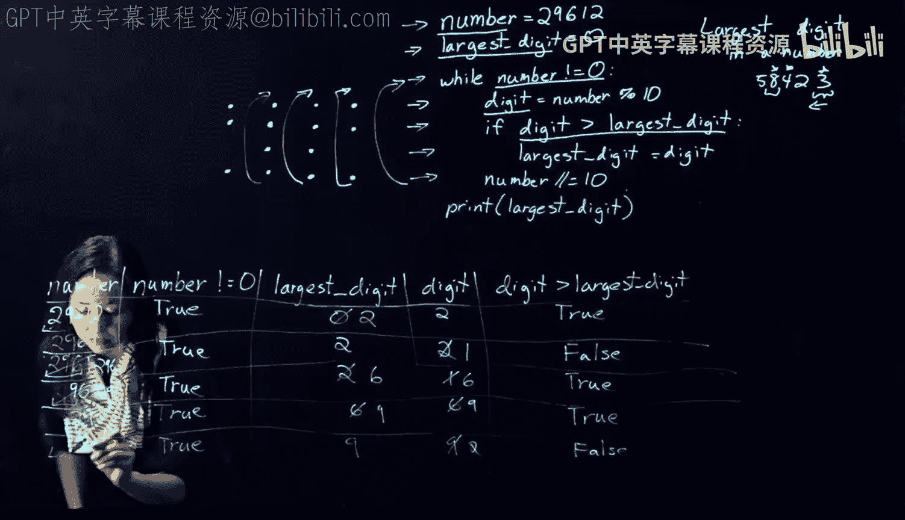

# 杜克大学《Python编程实践｜Practical Python： Start Your Programming Journey》中英字幕 p52 52_04_03_循环跟踪演示.zh_en -BV1tTmCBWEQD_p52-

Watching a video explaining to you how to trace through code is not the same as watching me walk through a piece of code and showing you how I would trace it myself。

 So in this demo， we are going to do just that。 This particular code finds the largest digit in a number。

So let's say you have a number like5，8，4，2，3。The way this code finds the largest number is it starts at the first digit and works its way to the thicker digits until it knows that it's gone through the whole number and found the largest digit。

 So in this case， first， it sees 3。 That's the bigger。 That's a big number gets to2。

 That's not the largest digit because 3 is bigger。 Then it sees the4。

 and then the8 and the5 is not bigger than 8。 So it knows by the end。

 that 8 is the largest digit in this number。It keeps track of all this with these various variables that we walk through as we go through the code and trace through it。

So let's pretend that we come to this code and we don't know what it does。

 and also the variable names are not very helpful。So what you would do is you start out by using step one of tracing through loops we look at the code and we're looking for variables and conditionals and such that would be useful to keep track of。

 So if we look at the first line we see number equals 29612。And technically。

 if this was actual code that we were using， probably this would be user input by one to make it simpler for us。

 If we look at the number variable， we can also see that the number variable is being mutated inside of the loop。

 So this。Is a useful thing to keep track of。Then we look at the next line， largest digit equals0。

 If we look inside the wall loop， we can see that largest digit is being mutated。

 So this is probably also another variable that is useful to keep track of in our loop tracing table。

Then we get to the while loop。 and it's always important to keep track of the while loop conditions。

 So we know for sure that that's something we want to keep track of in the table。

Then we see a line that is digit equals numbers mod 10。 we don't quite know if that's useful。

 so let's just keep going just in case， and then we see the if statement which is digit is greater than largest digit。

 and that's also probably something to keep track of because inside of the if condition is largest digit getting updated。

And now since we've seen that digit is being used in this if condition。

 it's probably also good to keep track of digit itself。

And then we look at the rest of the code we see number is being updated。

 but we already know we're keeping track of number。

 and then we have this print statement here and we're already keeping track of larger digigits so we know that we're good there。

So now that we know all of the things we want to keep track of while we're tracing through our loop。

 it's time to do step two， which is make our table。So when we're looking at our code。

 the first thing we want to do is any variables that are inside of our condition。

 which in this case is just the variable number。After we have number。

 we can see that there's no other variables that we need for our loop condition。

 So we're going to write in our loop condition as the next column in our table。

Number does not equal0。And the rest of the things that we're going to keep track of。

 I'm just going to go an order of the code to make it easier for us to keep track of things。

 so we have number next would be largest digit。Well reduced。

We already have the number is now equal to zero， so now we want to keep track of digit。And digit。

 greater than largest。Or just。All right， so that's everything that we need。

 So let's start tracing through our code。So first off， we start out with our very first line。

 number is assigned 2，9612， and so I'm not going to put it in the table just yet because we haven't actually gotten to the while loop in the code。

 so we're just going to make a note to ourselves that number is assigned this value。

We do our next line， largest digit is assigned zero， again。

 I' not going to put in the table of this ten because we're going to do that when we hit the actual while loop。

Next line， while is assigned number not equal to 0。 Now we do our first step。

 were tracing through code 40 loop， copying all the values down that we have so far before we execute our code。

So， here is our table。

We're to write in。诶我니까 차。So now we're ready to copy our values down into our table。So in this case。

 number is assigned 2，9，6，1，2。2，9，6，1，2。Lrgest digit is the value 0。

And we don't have anything else yet when it comes to our wallet。

So first we check our well condition number not equal to zero is number not equal to zero， well。

 the number is definitely not the value of zero， so this evaluates two true。

So that means we go into our loop。Execute digit equals， number mod 10。Here is number。

The first one's value is a two。 so digit becomes。You go to our if condition digit greater than largest digit。

 there's two bigger than zero， yes， it is。So this evaluates。True。

So we go inside and do the code inside of our if condition， largest digit， this assigned digit。

So this zero becomes a2。We're done with our if condition， Ex the code right afterwards number。

Florid vision 10。So when you do floor division， we grab all the values in this case。

 without the one digit。So that would be 296，1。Do we reassign this value。2，2，9。6，1。

So we're done with our wall up， go back to the top。And when you go back to the top。

 that means we make a new rope。

We copy all of our values down。This is 2，9，6，1。We don't know what this is yet。

This comes down as two。And this comes down as two as well。So now is number not equal to zero。

I's 2961， the value zero。No。So this evaluates to true。T。That means we go inside of our lip。

 so we execute our first line。Did she assigned number mod 10。So here's our number。

The ones digit is the number one， so this becomes one。Go to our if condition。

Is digit greater than largest digit is one greater than2。No。So this evaluates two。

So we skip the code inside of the if condition， go straight to our next line。

 number is Florida division 10。So once again， we have 296，1。

You want all the digits that doesn't equals the ones digit。 so this is assigned。2，9，6。

We're at the end of our wall loop。그 빼 둘다。Make a new row。

So can copy all I' values use down。So this is two。9，6。This is2， and this is one。

Check our well condition number 9 equal to 0，2，96， definitely not zero。So this。Evaluates to。Zhu。

That means we go inside our wedo。Execute the first line。 digit is assigned number mod 10。

Here's number 296， we just want the one digit， so this becomes six。So now we go to our if condition。

Is digit greater than largest digit is six bigger than two。Yes， it is。So this evaluate rates。

The true。So we go inside and execute the code inside the if condition， largest digit is assign digit。

So we update this value from two to six。Next line。Number floor Division 10。Here's 2，9，6。

 the value of number。We just want all the digits except the ones digit。So will we update that to 29？

We're at the end of our volumeroom。Back to the top。Draw out our line。So we have a new room。Now。

 we can't be everything done。So，6。6。Grandmar，29。Now we check our well condition is number not equal to zero。

29， it's definitely not zero。So this updates to true。Go inside of our wall。

Ex digit is the send number mod 10。That's our last ones digit so this。Comes 9。

If statement digit greater than largest digit is nine bigger than six。Yes， it is。So， that's true。

So we go inside executes a code and if condition of reassigning largest digit to the value of digit so this six。

Is now a9。Next line。Number4， 10。We want our。Digits， except for the ones digit。 so this becomes two。

There is our two。Back to the top， were almost done， promise。Copy all of our values。

Coffee down or two。Copy down our nine。A9。Exe。Are well commissioned number is not zero two is still definitely not zero。

So that's a value as to true。Go into our wall loop。Did you is the same number mod 10。

This is just the number two now。So that becomes two。Is two greater than9， nope。So， that's false。

We skip the line inside this statement。 Go straight to number mod 10。So in this case。

 this is just a two。There's nothing on the other side， So this evaluates to 0。

Back to Carlo。 And at this point， probably， you're like， we must be done。 We are。

 I'm going to show you very last line。Cause this is。What Python would do。

 it would go back to the top and evaluate like it's supposed to。This is zero。That's 9。And that's2。

Number， not equal to0。Well， that's a zero。 That's a zero。The that evaluated to fast。And now， we know。

That we skip our wall loop。And go straight to the end and start the code after the wall loop。

 which in this case， just print the value of largest digit。So in this case is 9。So。

 a few parting thoughts。First。Did you have to write every single thing， no。

When you're tracing through loops， you can figure out what pieces of this make the most sense for you to keep track of。

 Some things probably are easier to keep track of compared to other people。

 I wanted to show all of it and all the detail so that you can figure out what works for you。Second。

 I have these arrows and dots and all of that at the top here。

 And what's useful about that is that helps me keep track of where I am in the code。

 Do you need to do that once again， up to you， It's kind of how you figure out your process for keeping track of all the things that are happening when you're looping through code。

 This is just useful with all of the dots and arrows。

 all of the values in the table so that you know where you are and you can potentially go back and figure out what happened because the entire picture is here。

 And with that， I hope this lesson was useful to you on how to trace the loops and that you can trace the loops in the future to help you understand code。

😊。