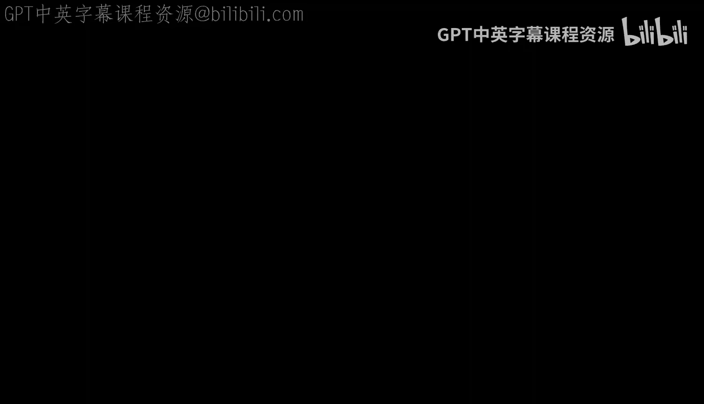
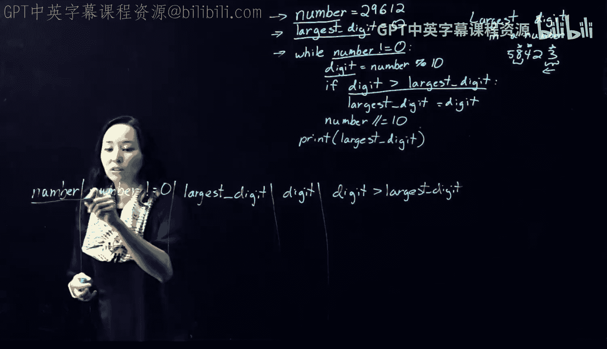
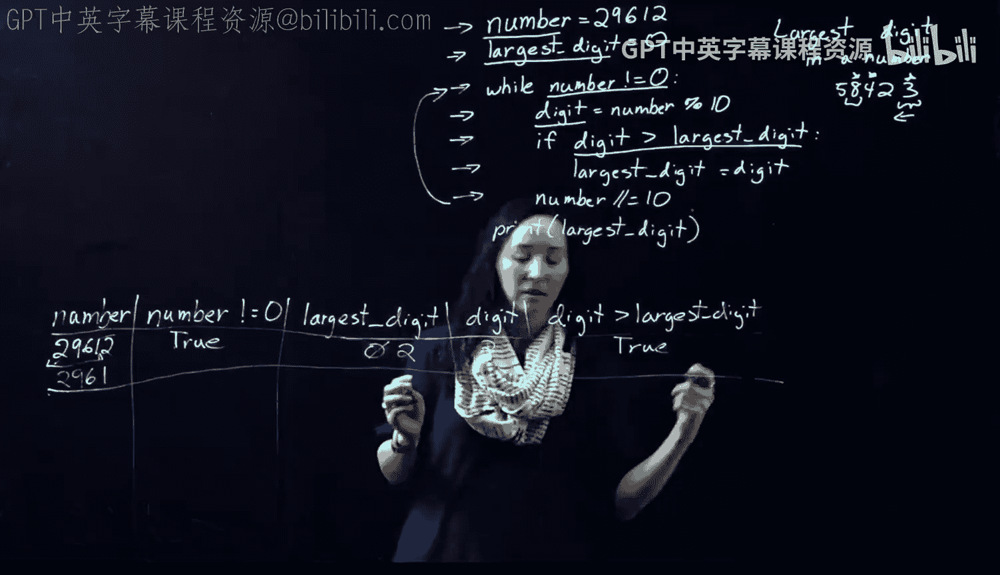
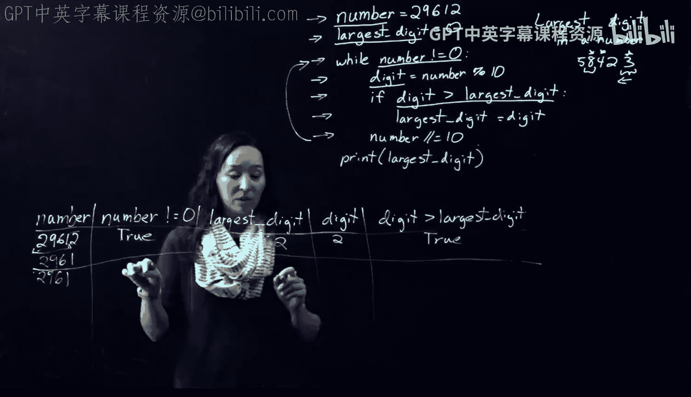
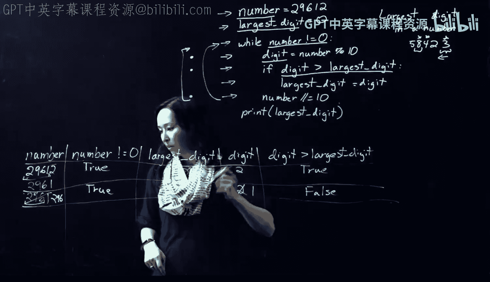
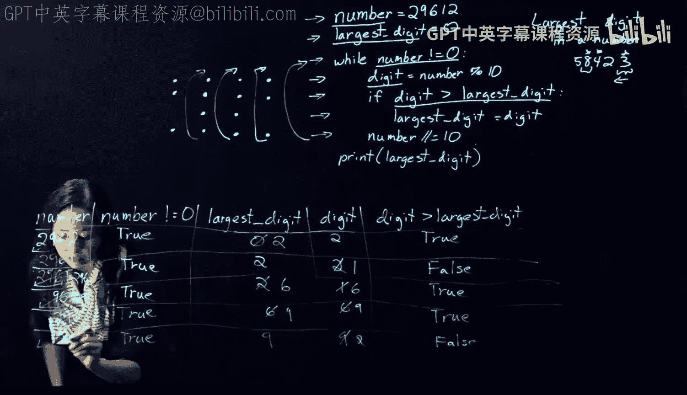

# Python编程实践：52：循环跟踪演示



在本节课中，我们将学习如何通过“循环跟踪”的方法来逐步理解代码的执行过程。我们将通过一个具体的例子——寻找一个数字中的最大数位——来演示这一过程。

---

## 概述

循环跟踪是一种手动模拟代码执行的方法，尤其适用于理解循环和条件语句。通过创建跟踪表并逐步记录变量的变化，我们可以清晰地看到程序每一步的状态。本节我们将对一个寻找数字中最大数位的代码进行完整的跟踪演示。

## 代码分析

首先，我们来看待分析的代码。它的目标是找出一个给定数字中的最大数位。

```python
number = 29612
largest_digit = 0
while number != 0:
    digit = number % 10
    if digit > largest_digit:
        largest_digit = digit
    number = number // 10
print(largest_digit)
```

上一节我们介绍了循环跟踪的概念，本节中我们来看看如何将其应用到这段具体的代码上。

## 第一步：确定需要跟踪的变量

在开始跟踪之前，我们需要确定在循环执行过程中哪些变量和条件是关键。以下是我们的分析：

*   **`number`**： 这是循环的条件变量（`while number != 0`），并且在循环体内被更新（`number = number // 10`）。必须跟踪。
*   **`largest_digit`**： 这是我们要找的目标值，在`if`语句中被更新。必须跟踪。
*   **循环条件 (`number != 0`)**： 决定循环是否继续。必须跟踪。
*   **`digit`**： 在每次循环中计算得出，并用于与`largest_digit`比较。为了理解比较逻辑，需要跟踪。
*   **`if`条件 (`digit > largest_digit`)**： 决定是否更新`largest_digit`。跟踪其布尔值有助于理解程序分支。

## 第二步：创建跟踪表

根据第一步的分析，我们创建以下跟踪表。表格的列对应我们需要跟踪的各个项目。

| number | number != 0? | digit | digit > largest_digit? | largest_digit |
| :--- | :--- | :--- | :--- | :--- |
| | | | | |



## 第三步：逐步执行与记录

现在，我们开始模拟Python解释器，一行一行地执行代码，并将每一步的状态记录到表中。

**初始赋值（循环前）**
执行前两行赋值语句后，变量的状态是：
*   `number = 29612`
*   `largest_digit = 0`

**第一次循环迭代**
1.  进入`while`循环，检查条件 `number != 0`。29612不等于0，条件为 **True**。
2.  执行 `digit = number % 10`。`29612 % 10` 的结果是 **2**。`digit` 变为2。
3.  执行 `if` 条件判断 `digit > largest_digit`。`2 > 0` 为 **True**。
4.  进入`if`代码块，执行 `largest_digit = digit`。`largest_digit` 从0更新为 **2**。
5.  执行 `number = number // 10`。`29612 // 10` 的结果是 **2961**。





将本次迭代的结果填入表格第一行：

| number | number != 0? | digit | digit > largest_digit? | largest_digit |
| :--- | :--- | :--- | :--- | :--- |
| 29612 | True | 2 | True | 2 |

**第二次循环迭代**
1.  回到循环顶部，检查条件 `number != 0`。2961不等于0，条件为 **True**。
2.  执行 `digit = number % 10`。`2961 % 10` 的结果是 **1**。
3.  执行 `if` 条件判断 `digit > largest_digit`。`1 > 2` 为 **False**。
4.  `if`代码块被跳过。
5.  执行 `number = number // 10`。`2961 // 10` 的结果是 **296**。



将本次迭代的结果填入表格第二行：

| number | number != 0? | digit | digit > largest_digit? | largest_digit |
| :--- | :--- | :--- | :--- | :--- |
| 2961 | True | 1 | False | 2 |

**第三次循环迭代**
1.  条件 `296 != 0` 为 **True**。
2.  `digit = 296 % 10`，结果为 **6**。
3.  `if 6 > 2` 为 **True**。
4.  执行 `largest_digit = 6`。
5.  `number = 296 // 10`，结果为 **29**。

| number | number != 0? | digit | digit > largest_digit? | largest_digit |
| :--- | :--- | :--- | :--- | :--- |
| 296 | True | 6 | True | 6 |

**第四次循环迭代**
1.  条件 `29 != 0` 为 **True**。
2.  `digit = 29 % 10`，结果为 **9**。
3.  `if 9 > 6` 为 **True**。
4.  执行 `largest_digit = 9`。
5.  `number = 29 // 10`，结果为 **2**。

| number | number != 0? | digit | digit > largest_digit? | largest_digit |
| :--- | :--- | :--- | :--- | :--- |
| 29 | True | 9 | True | 9 |

**第五次循环迭代**
1.  条件 `2 != 0` 为 **True**。
2.  `digit = 2 % 10`，结果为 **2**。
3.  `if 2 > 9` 为 **False**。
4.  `if`代码块被跳过。
5.  `number = 2 // 10`，结果为 **0**。



| number | number != 0? | digit | digit > largest_digit? | largest_digit |
| :--- | :--- | :--- | :--- | :--- |
| 2 | True | 2 | False | 9 |

**循环结束**
1.  回到循环顶部，检查条件 `number != 0`。`0 != 0` 为 **False**。
2.  循环终止，跳转到循环体之后的代码。
3.  执行 `print(largest_digit)`，输出最终结果 **9**。

## 总结与建议

本节课中我们一起学习了如何对循环代码进行逐步跟踪。通过创建跟踪表，我们清晰地看到了变量`number`如何被逐步分解，以及`largest_digit`如何被更新为最大值9的过程。

最后，提供两点建议：
1.  **个性化跟踪**： 在实际操作中，你不需要记录所有细节。可以根据代码逻辑和你自己的理解难点，选择最关键的部分进行跟踪。本次演示展示了完整细节，旨在帮助你找到适合自己的方法。
2.  **使用辅助标记**： 在代码旁使用箭头或圆点标记当前执行位置，在表格中高亮刚刚变化的值，这些视觉辅助工具能有效帮助你理清执行步骤和状态变化，方便回溯和检查。

掌握循环跟踪技能，能极大地帮助你理解复杂的代码逻辑，尤其是在调试和阅读他人代码时。