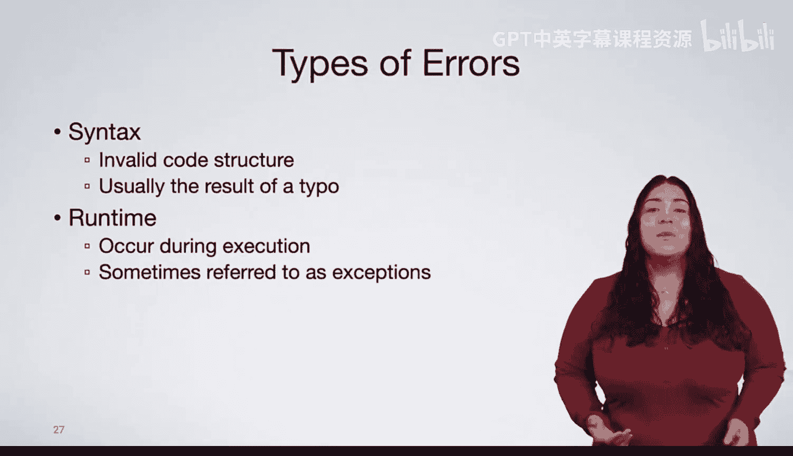

# 杜克大学《Python编程实践｜Practical Python： Start Your Programming Journey》中英字幕 p53 53_04_01_错误类型.zh_en -BV1tTmCBWEQD_p53-

Let's travel back to 1969。 The Apollo 11's space mission is flying to the moon。

 Everyone is holding their breath。 Their eyes glued to the television， witnessing what is happening。

 This is the furthest humanity has ever gone and anything can go wrong at any moment。

 The mission success depends a lot on complex software that guides of spacecraft。

 and behind that software was Margaret Hamilton leading a team of developers at M mighty。

 He or she is with the big printouts of Co that they wrote for the Apollo 11 moon landing。

 Hamilton worked relentlessly to write coat that would anticipate anything that might occur in the cold vacuum of space。

 and to create such groundbreaking code。 Hamilton and her team had to decipher countless error messages。

😊，And to plan ahead for what errors could happen。In fact， during the actual moon landing。

 the flight computers were sending an alarm that was running more tasks than it could actually handle simultaneously。

 But they recognized that this alarm was not something that would jeopardize the landing。

 and they pushed on to land on the moon。Now， following some of the principles Hamilton employed in debugging her code。

 we'll look at how we can decipher our own error messages， because just like Apollo 11。

 the success of our code often hinges on the ability to decipher what the computer is trying to tell us。

Arrors are very common， and they are universal shared experience。

 Even the most experienced programmers make mistakes and frequently encounter error messages。

 In fact， as your programme become larger and more complex。

 the likelihood that you will encounter errors increases。

 And although these messages can sometimes be frustrating。

Every error message is an opportunity to grow your knowledge and to improve your code。For example。

 if you encounter an error message， you'll see how it provides information and valuable feedback on what might be wrong with your coat。

We'll talk about how to read these error messages later in this video。Typically。

 you will only see one error message at a time when the programme finds an error。

 it will usually stop and crash。 In which case， you won't see the next error until you fix the first one。

 However， there are going to be occasions where you might see multiple errors before the program crashes。

 This happens when the program can still run for just a little longer， even with mistakes。

Sometimes fixing one error will reveal new errors。 This means you're making progress。

 The programme is now able to check more of the code and find new mistakes。 It couldn't do so before。

Some mytic will never show an error message， but still cause the programme to behave incorrectly。

 You will need to look at the programme's output to notice these silent errors。

If all this makes you feel a little worried。That's perfectly O。 Every one feels this way Sometimes。

 Even people who have coded for many years handle one error at a time。

 And each time you fix something you are learning， Be proud and celebrate all your hard work。

 both big and small。😊，Now， with all this in mind， let's look at some examples to better understand errors。

Suppose we're trying to create a bot。 And you ask yes or no questions to this bot named Chip。

 It's a kind bot。 And Chip will answer you。 Sometimes Chip says go for it。 And other times。

 Chip says maybe later。 Chiip's responses are chosen at random。

Here's an example of how this program should execute first the program will print instructions prompting you to enter a question for chipI to answer。

 you can also enter Q if you want to end the program。Suppose you entered。

 Should I recommend this course to my friends， And Chip responds with， go for it。

 And between you and me， I agree with Chip on this one。

You will keep being prompted to enter a new question until you eventually type in queue to end the program。

Suppose you go ahead and enter Q has your next input。 Well， the program ends saying goodbye。

With all this in mind， here is our first attempt at writing the code。

 There are a few errors in this code， Well， three to be exact， and some red wavy lines are shown。

 and we'll discuss those in a few minutes。Feel free to pause this video if you would like to some time to try to understand the code and see if you can spot the errors。

Let's do a quick run rundown of the logic behind the code。 Since the code has errors。

 I will only be mentioning the expected behavior of the program。

 Basically what the code should be doing rather than what it's currently set up to do。

We input random on line 1 because we will be using it to generate Chi's response。

 The variable message on line 2 will contain the instructions presented to the user。

The variable question on line 4 will contain the question the user will eventually enter。

 but for now， it's just an empty string。The while loop on lines 5 through 14 contain most of the action in the program。

 It should basically keep looping until the user enters queue， exiting the loop。

 and thus ending the program。Line 6 asks the user to enter their question。

Line 7 through 12 will generate chip's response if the user does not enter Q。

 A random number should be generated， either 0 or 1。And using a nested if statement。

 there should be a 50% chance of chip either saying go for it or maybe later。

If the user enters queue， then in the outer else blog we'll execute instead， printing goodbye。

Before even executing this code， you might have already noticed some red wavy squiggles on lines 5 and 6。

 This is a sign that you may have a syntax error。 Stax errors are much like grammatical mistakes。

 They are usually typos made in the code that goes against Python's rules for how the code should be written。

Maybe there's a missing parentheses， colon hintdentation somewhere in the code。

 These errors are often detected by looking at the red wavy lines that visual studio displays to let you know that not only is there a syntax error present in the code。

 but is also a hint as to where it most likely is located。Going back to our previous example。

 we have red wavy lines in lines 5 and 6 of the coat。

That means our syntax error is most likely located in either line 5 or line 6 or maybe even both。

If we try to execute our buggy code without attempting to fix the typo， we get the following error。

Now， this error message can seem intimidating， but let's break it down a little further。

There is a lot of information in these error messages to best understand them。

 I recommend you read them from the bottom and work your way to the top。

At the bottom you will see the term syntax error， which lets us know the type of error we have just encountered。

Moving up， we see the while condition we wrote in our buggy chip code and a little carrot character。

 The carrot acts like an arrow pointing to where the arrow most likely is located within this line of the code that the computer is mentioning。

In our example， it seems to be pointing at the end of the while condition。

What if you weren't sure which line of code the computer is actually referring to， Well， that's okay。

 The error message tells us what line in the file to look for and also the file itself。

In this example， we need to inspect the file chip。pyy， which is a file we use to write our code。

And inside that file， we need to look at line 5 for the error。Now。

I should mention that just because the computer says to look at a specific line of code for the error doesn't necessarily mean the air will be at that specific location。

This is indicating where the computer finally noticed something went wrong for the error。

 this could be located earlier in the code。 In our example， it might be in lines 1 through 5。

On the bright side， we at least know the specific error mentioned won't be after line 5 because the program crashed before executing any lines of code after line 5。

Let's go back to where code and inspect line5。The carrot was pointing to the end of line 5。

 And indeed， we see that this line of code is missing a colon。

Typing in that missing colon will make the red wavy lines go away。

 We just fixed our first syntax error。 Let's run this coat again， and see what happens。You prompt。

 you're prompted to enter a yes or no question。 Suppose you typed in。 Should I go for a run， then。

 oh， oh。Oh looks like we just encountered our second error。

And this one looks more complex than the last one。 Let's break this one down。

Value error usually means there's an invalid value somewhere in the code。

Let's read the rest of this line to get more hens as to what's wrong。Empty range for round range 1，1。

0。 That's even more confusing。 Sometimes the error messages in Python can be very confusing。

 but don't worry。 Let's try to make the most of what we can understand and use that to our advantage。

Even if you can only understand bits and pieces for an error message。

 it can still help quite a bit in detecting the error。Even if we don't understand the issue。

 we at least know that it has something to do with an invalid value。Moving up the error message。

 we see this block of text。 The nice indentation in the error message helps to understand what block of text can be grouped together。

And with this block of text， notice which file it is referring to。

The file we are writing our code and is chip dot P Y， not random dot P Y。

 So this is referring to the random library that we imported in line 1 of our code。

 in this hints to us that the arrow might have something to do with a function。

 We are calling from the random library。But since random W P Y is not the file we are trying to fix。

 we can ignore the rest and continue to the next block of text。Now， moving up one more。

 we see another block of text。And since this block of text is referring to random dot Py。

 not the file we have written in our code in。Let's keep moving up。Finally。

 we reach a block of text that is referring to chip。pyy let's inspect this in more detail。Look。

Looks like line8 and chipped up Py might have the error。

And if you look at the code in line 8 is highlighted here。

It does indeed hint that the issue might have something to do with how we are calling the function R in。

Well， with all this in mind， it seems that the issue might be in linenate。

 has something to do with how we are generating random numbers and includes the use of an invalid value。

But remember， that doesn't necessarily mean that the error is exactly on line 8， but rather。

 lines 1 through 8 since the program crashed in line 8。And that's a lot of clues。

And we actually have one more clue that can help us in observing what lines of code were able to print successfully before the program crashed。

In this case， the programme was able to successfully ask the user to enter a question before crashing。

The user input is on line6 of code。So the bug must be between lines 7 and8， why？Well。

 because if the bug was before line 6 or on line 6。

 then we never would have been able to print instructions for the user to enter their question。Now。

 with all these clues， let's go back to our code and remove the bug。

Line 6 executed successfully before the program crashed， we were able to see it on the terminal。

Lne 7 doesn't look to have any issues with it。And it doesn't have anything to do with random number generation。

 So the issue most likely in line  aid， just like the error message mentioned。More specifically。

 it probably has something to do with the values we use for random dot Rant。

And looking at those values， you can now see how the numbers should be swapped。

It shouldn't be1 comma 0。 It should be0， comma 1。 The smaller number goes first。

 then the larger number。Let's go ahead and fix that in our code。Much better。

Before we run our code once more， I want to take a moment to talk more about that value error we just fixed。

Value errors are a part of a larger group of errors called runtime errors。

 A runtime error is an error that occurs during execution。In Python。

 runtime errors are often also referred to as exceptions。

These types of errors are harder to detect because they do not have the red wavy lines to help you spot them。

There are many kinds of runtime errors in the chart below， you'll see some common runtime errors。

 but there are others， too。An index error happens when there is an attempt to index into a part of a string that doesn't exist。

A name error is when a variable name is misspelled or the code tries to use a variable that doesn't exist yet。

A type error happens when data types are mixed in ways that they shouldn't be。

 usually in an expression， like adding together gather a string in an integer。

And a value error happens when a value is used that doesn't make sense， like in our earlier example。

Now let's run this code again。😊，Suppose you enter。 should I go on an adventure and ship responds with。

 go for it。And then you enter。 should I try a new hobby。

 And shipp responds one more time with go for it。 O， let's try ask another question。You enter。

 should I treat myself to a small gift， and Chip responds with a message saying， go for it。Well。

 maybe that was just a coincidence。 Let's try asking one more question。You enter。

 should I focus on self care？And chipp responds with。Go for it。 At this point。

 you might be realizing something's wrong。 Chip is responding with the same message each time。

 This is an example of a logic error。 A logic error means a programme runs without crashing and doesn't show an error message。

But it still doesn't work correctly。 These errors can be tough to find and fix。 Remember。

 syntax errors show up with the red wavy lines， and we can see them before the program runs。

 Runtime errors happen when we run the program and it stops working。 but with logic errors。

 we get no messages。 The computer doesn't know if the result is what we want it because it only knows when what the exact instructions are that we gave it。

 It doesn't know what our goal is。A logic error happens when there is a difference between what we expect the program to do and what it actually does。

In another video， we'll give some advice on how to spot and fix these logic errors。 But for now。

 let's go back to our example and see if we can find that logic error。Well。

 we know that the logical issue is that Chip is always responding with go for it。

 and it never says anything else。So what could be causing the print statement on line 10 to be the only one to execute and never the print statement on line 12？

Feel free to pause this video if you would like time to figure it out。

The problem is likely with the nested if condition， It seems to always be true。

So the else block never executes。Look at the line。The code on line 8。

 where the program picks a random number， either 0 or one。Instead of having the nested if condition。

 check if the number。Is greater than or equal to 0。

 We should change it so that it checks if the number is exactly 0。 This way。

 the if block will only run when the number is 0 and the nested else block will run when the number is one。

 Both statements will have an equal chance of happening。 in our， our code should finally be working。

😊，Let's go ahead and run it one more time。Here is the program's output with the same input as last time。

 notice how this time chipIP is responding with different messages。And when we enter Q。

 the program ends with a good。 We have successfully created a friendly bot named chip。😊，In summary。

 syntax errors are the result of invalid code structure， usually due to a typo。

Runtime errors reveal themselves during the execution and are sometimes referred to as exceptions。

Logic errors do not provide an error message， but the program still does not behave correctly due to the lack of feedback from the computer。

 They are the hardest to detect and remove。And even though errors can be annoying。

They can help you grow as a programmer if you find these errors hard to understand， that's okay。

 Just keep practicing。 And with time， you'll find them easier to read。Keep trying new things。

 Keep learning and enjoy the challenges of coding。 Happy programming。

