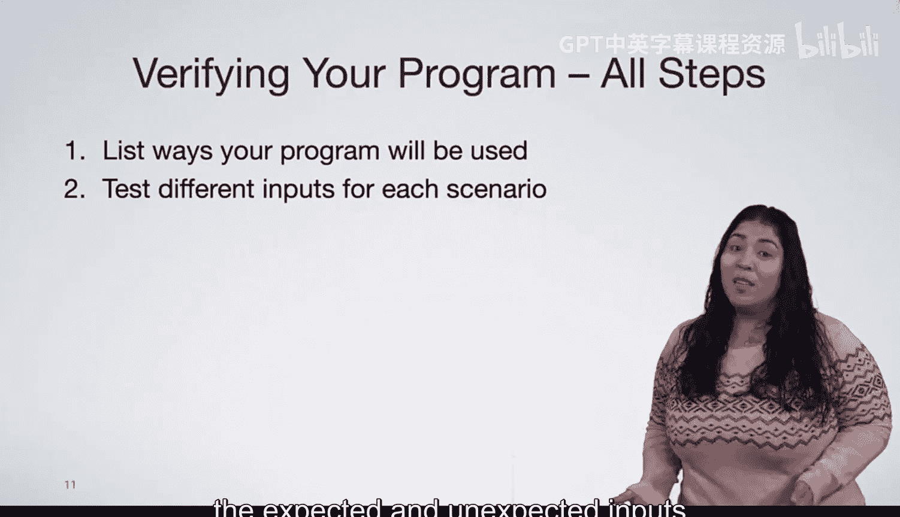
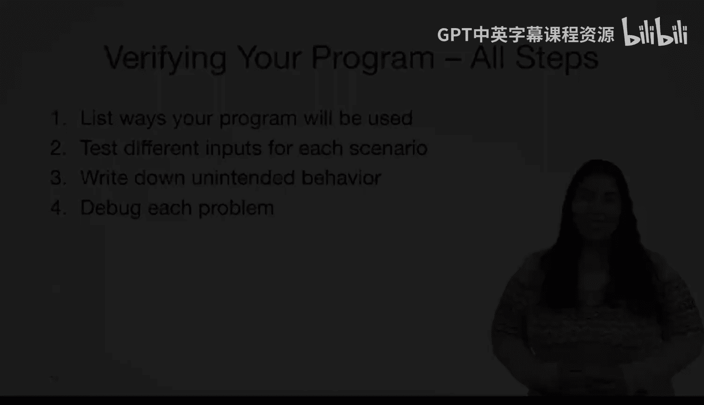

# 杜克大学《Python编程实践｜Practical Python： Start Your Programming Journey》中英字幕 p54 54_04_02_调试策略.zh_en -BV1tTmCBWEQD_p54-

By now， you've written some really interesting programs。

 You probably executed these programs a few times， gave them different inputs。

 and discovered they didn't work as you intended。 Maybe they behaved in ways you didn't expect。

 or perhaps you encountered an error message。This experience of finding and fixing bugs is not only a central part of programming。

 but it's also crucial in building your programming and debugging skills。

But have you ever thought about why we call these errors bugs。Well， to answer that question。

 let's first explore a fascinating story about Grace Brewster Murray Hopper。

 a pioneer in computer science。 Grace Hopper was an outstanding programmer and a forward thinker。😊。

One of her many contributions was the creation of Fmatic。

 the first programming language that used English like commands。 And as a result。

 programming became a lot easier and more accessible to all。😊，In fact。

 here she is pictured holding the instruction manual to Cobal。

 a programming language that was heavily influenced by Flomatic。In her honor。

 the Grace Hopper celebration， which is the world's largest event for women in computing。

 was named after her。😊，But how is Grace Hopper connected to the term bug， Well。

 she helped make the term popular。The term bug was a word used by engineers to describe problems or faults。

 but it wasn't well known outside of engineering。 In 1945。

 Grace Hopper and other engineers who were working on the Harvard Mark  I computer。

 They found it was making unusual mistakes in its calculations。

And when they opened the computer to check the hardware， they discovered a real moth inside。

 causing the trouble。 This incident was written down in a log book here， as you can see。

 the actual moth was attached to the book。 followed by a joke saying first actual case of a bug being found。

 even though the word bug was already in use。 So this was a first time。

 a bug literally an insect was found causing an issue in a computer。😊，This story spread wildly。

 making bug a common term for everyone one to use when talking about computer errors。Now。

 this story highlights the challenging and sometimes unpredictable nature of finding and fixing bugs。

 a challenge that we will talk about how to address in this video。

Sometimes trying to verify if your program actually does what you intended it to do can be difficult。

 Here are a few steps you can follow to test if there are any hidden bugs in your code。First。

 list the main ways your program will be used。A program that works in one situation might not work in all situations。

This step is closely related to what you do when youre originally writing the program。

 particularly focusing on the verification and debugging activities。During these activities。

 you can check if the code does what you originally planned and whether it achieves your original design goals。

When considering different uses， focus on using each feature of your program。

 this helps to verify that your program's plan or implementation is done correctly。For example。

 if you are creating a calculator program， one situation could be to check if the program correctly adds numbers。

 Another situation is to test whether the program follows the right order of operations。

 Consider different inputs when considering these different situations。

But it's not just all about the calculations。 Also。

 consider scenarios where on how your program will be used by your users and if it meets your design goals。

 confirmming the design of your program is just as important as confirming the plan。

If your program is meant to be accessible to people with disabilities。

 think about how they might use your program。 For example。

 consider if the instructions are easy to follow with for someone with limited mobility or if the text is clear for someone with a visual impairment or color blind。

You may also want to think about users who speak different languages。

 if your program is going to be used by non English speakers or by those whose primary language is not English。

 consider how the language and word choice of the program's output would affect these users。

Creating character profiles of different users may help during this step。

You can design a different scenario for each character profile you come up with。

Be sure to also consider your goal in writing the program and come up with situations that will help you determine if you achieved your goal。

 for example。If your goal is to make someone smile。

 create a scenario or two that will help you determine if your user smiled。

By considering a variety of scenarios， including the diverse needs of your users。

 your program will become more inclusive， user friendly， effective and correct。

Now that you have a list of scenarios you want to consider。

 you can test out your program using the inputs that correspond to each scenario on your list。

Testing here means running the program， entering the inputs from your list。

 then check if the output is correct。Be sure to consider incorrect or unexpected inputs as well as how you would want your program to behave given these inputs。

Going back to our example with the calculator。Expected inputs might be numbers。

 while unexpected inputs could be letters。This step is very important。

 since it helps you to see how strong your program is against a variety of inputs that it might encounter。

 we strongly recommend that you do not skip vi stuff。Now。

 suppose that just like Grace Hopper and her team， you are testing your program and you encounter incorrect output。

 If that happens， write down the inputs that cause the incorrect behavior。

This is a lot like the log book that Grace Hopper had， except this time， your moths are virtual。

 Also， be sure to write down how the program should have behaved if it were correct。

 This will be useful later。You've gathered a lot of information。

 and now it's time to start debugging， address each of the issues that you noted one at a time。

When you encounter errors during debugging， pay close attention to the error messages。

 These messages can give you valuable clues on what might be causing problems in your code。

Look back at your log from what happened during the previous step。

 Compare what happened with what should have happened。

 This comparison is key to forming ideas on what you think may be wrong with the code。

Sometimes the output of the code doesn't clearly indicate the problem， in which case。

 examine the inputs that were used when the error occurred。 Ask yourself， was the input different。

Than others that happen to cause the error。 Often， the cause of an issue is related to the input rather than the output。

Using print statements can be incredibly helpful。 Don't hesitate to print variable values or any information that may help you understand what your code is doing at every step。

 In fact， print statements is my personal favorite debugging strategy to use。😊。

If you're still unsure about what the error is， try tracing your code manually。

 This means taking out a piece of paper and a pencil and following the code step by step。

It may be time consuming， but it's sometimes the best way to find the source of the bug。

 And doing this could potentially save you a lot of time and frustration。

 It's also a really great learning activity to help you master these programming concepts。😊，Now。

 let's review the steps。 First， write down a list of all the important scenarios in which your users might try to use your program。

Second， test out each scenario by runninging your program with the expected and unexpected inputs that correspond to each scenario。

Third， write down any incorrect behavior you might have noticed。

 along with any useful information thatll help you debug the code later。And finally。

 with all this information at your disposal， you can move on to debugging where you try to resolve each problem one by one。

Remember， these are just suggested steps。 Debugging can be done in many different ways。

 and you might have your own methods that work better for you。

If you have any unique strategies or tips that you might find helpful。

 we encourage you to share them on the course for him。

 Your insights could be very beneficial to others in the course。

