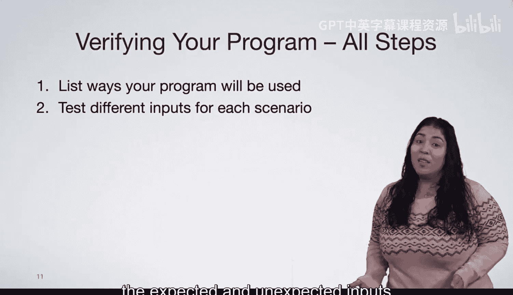
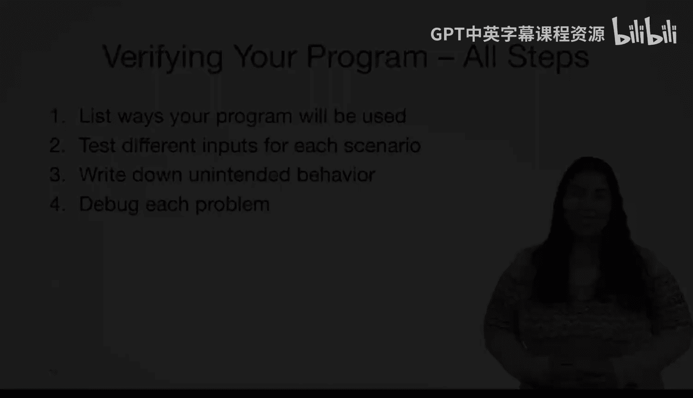

# Python编程实践：54：调试策略 🐛


在本节课中，我们将学习如何系统地发现和修复程序中的错误，即“调试”。调试是编程的核心技能之一，掌握有效的策略能帮助你更快地解决问题。

## 课程概述

你已经编写了一些有趣的程序。你可能运行过这些程序几次，并尝试了不同的输入，然后发现它们并未按预期工作。程序可能表现出意料之外的行为，或者你遇到了错误信息。发现并修复错误不仅是编程的核心部分，对于构建你的编程和调试技能也至关重要。

但你是否想过，为什么我们称这些错误为“Bug”（虫子）？要回答这个问题，让我们先探索一个关于计算机科学先驱——格蕾丝·布鲁斯特·默里·霍珀的精彩故事。

## “Bug”一词的起源 🦋

格蕾丝·霍珀是一位杰出的程序员和富有远见的思想家。她的众多贡献之一是创造了**Fmatic**，这是第一种使用类似英语命令的编程语言。因此，编程对所有人来说都变得更容易、更易接近。

事实上，图中她正拿着**Cobal**编程语言的说明书，该语言深受Fmatic的影响。为了纪念她，世界上最大的女性计算领域盛会——**格蕾丝·霍珀庆典**就是以她的名字命名的。

那么，格蕾丝·霍珀与“Bug”这个术语有何关联？她帮助推广了这个词。“Bug”是工程师用来描述问题或故障的术语，但在工程领域之外并不广为人知。

在1945年，格蕾丝·霍珀和其他工程师正在研究哈佛马克一号计算机。他们发现计算机在计算中出现了异常错误。当他们打开计算机检查硬件时，发现里面有一只真正的飞蛾导致了故障。这一事件被记录在日志本中，正如你所见，那只真实的飞蛾被贴在了本子上，旁边还附有一句玩笑话：“发现Bug的第一个实际案例”，尽管“Bug”一词当时已在工程领域使用。所以，这是第一次在计算机中发现一只字面意义上的“虫子”导致了问题。

这个故事广为流传，使得“Bug”成为每个人谈论计算机错误时的常用术语。这个故事凸显了发现和修复错误的挑战性，有时甚至是不可预测性。在本视频中，我们将讨论如何应对这一挑战。

## 系统性的调试策略

有时，验证你的程序是否确实按预期工作可能很困难。以下是你可以遵循的几个步骤，来测试代码中是否存在隐藏的错误。

### 第一步：列出主要使用场景

一个在一种情况下能运行的程序，未必在所有情况下都能运行。这一步与你最初编写程序时的活动密切相关，特别是侧重于验证和调试活动。在这些活动中，你可以检查代码是否完成了你最初的计划，以及是否达到了你最初的设计目标。

在考虑不同用途时，请专注于使用程序的每个功能。这有助于验证你的程序计划或实现是否正确。

以下是创建场景列表时需要考虑的方面：

*   **功能测试**：例如，如果你正在创建一个计算器程序，一种情况是检查程序是否正确相加数字。另一种情况是测试程序是否遵循正确的运算顺序。
*   **用户多样性**：考虑用户将如何使用你的程序，以及它是否符合你的设计目标。确认程序的设计与确认计划同样重要。
*   **可访问性**：如果你的程序旨在让残障人士也能使用，请考虑他们可能会如何使用你的程序。例如，考虑指令对于行动不便的人来说是否易于遵循，或者文本对于视力障碍或色盲用户来说是否清晰。
*   **语言与文化**：如果你的程序将被非英语使用者或母语非英语的人使用，请考虑程序输出的语言和措辞选择会如何影响这些用户。

创建不同用户的角色档案可能有助于这一步。你可以为每个角色档案设计不同的场景。同时，务必考虑你编写程序的目标，并构思能帮助你确定是否达成目标的场景。例如，如果你的目标是让人微笑，就创建一两个能帮助你判断用户是否微笑的场景。

通过考虑各种场景，包括用户的多样化需求，你的程序将变得更包容、用户友好、有效和正确。

### 第二步：测试每个场景

现在你有了想要考虑的场景列表，你可以使用列表中每个场景对应的输入来测试你的程序。

这里的测试意味着运行程序，输入你列表中的输入，然后检查输出是否正确。务必同时考虑不正确或意外的输入，以及你希望程序在给定这些输入时如何表现。

回到我们计算器的例子。预期的输入可能是数字，而意外的输入可能是字母。这一步非常重要，因为它帮助你了解你的程序在面对可能遇到的各种输入时的健壮性。我们强烈建议你不要跳过这一步。

### 第三步：记录错误行为

假设，就像格蕾丝·霍珀和她的团队一样，你在测试程序时遇到了不正确的输出。如果发生这种情况，请记下导致错误行为的输入。

这很像格蕾丝·霍珀的日志本，只不过这次，你的“飞蛾”是虚拟的。同时，务必写下如果程序正确运行，它本应如何表现。这在后续会很有用。

### 第四步：开始调试

你已经收集了大量信息，现在是时候开始调试了，逐一处理你记录下的每个问题。

以下是调试时可以采用的几种方法：

*   **关注错误信息**：调试过程中遇到错误时，请密切关注错误信息。这些信息可以为你提供关于代码中可能存在问题原因的宝贵线索。
*   **比较预期与实际**：回顾上一步中发生情况的记录。将实际发生的情况与应该发生的情况进行比较。这种比较是形成关于代码可能出了什么问题的想法的关键。
*   **检查输入**：有时代码的输出并不能清楚地指示问题所在。在这种情况下，检查错误发生时使用的输入。问问自己，这个输入是否与导致错误的其他输入不同。通常，问题的原因与输入有关，而不是输出。
*   **使用打印语句**：使用`print`语句会非常有帮助。不要犹豫，打印变量值或任何可能帮助你理解代码在每一步做什么的信息。事实上，`print`语句是我个人最喜欢的调试策略。
    ```python
    # 示例：在关键步骤打印变量值
    def calculate_sum(a, b):
        print(f"调试信息：收到 a={a}, b={b}") # 打印输入
        result = a + b
        print(f"调试信息：计算结果 result={result}") # 打印结果
        return result
    ```
*   **手动追踪代码**：如果你仍然不确定错误是什么，尝试手动追踪你的代码。这意味着拿出一张纸和一支笔，一步一步地跟随代码执行。这可能很耗时，但有时是找到错误根源的最佳方法。这样做可能为你节省大量时间和挫败感。同时，这也是一项极好的学习活动，能帮助你掌握这些编程概念。

## 总结与回顾



本节课中，我们一起学习了系统性的调试策略。让我们回顾一下步骤：

1.  **列出场景**：写下用户可能尝试使用你的程序的所有重要场景。
2.  **测试场景**：通过使用与每个场景对应的预期和意外输入来运行程序，测试每个场景。
3.  **记录问题**：记下你注意到的任何错误行为，以及任何有助于你后续调试代码的有用信息。
4.  **逐一调试**：利用手头的所有这些信息，你可以继续进行调试，尝试逐一解决每个问题。



请记住，这些只是建议的步骤。调试可以通过许多不同的方式完成，你可能会有更适合你自己的方法。如果你有任何独特的策略或技巧，我们鼓励你在课程论坛上分享。你的见解可能对课程中的其他人非常有益。