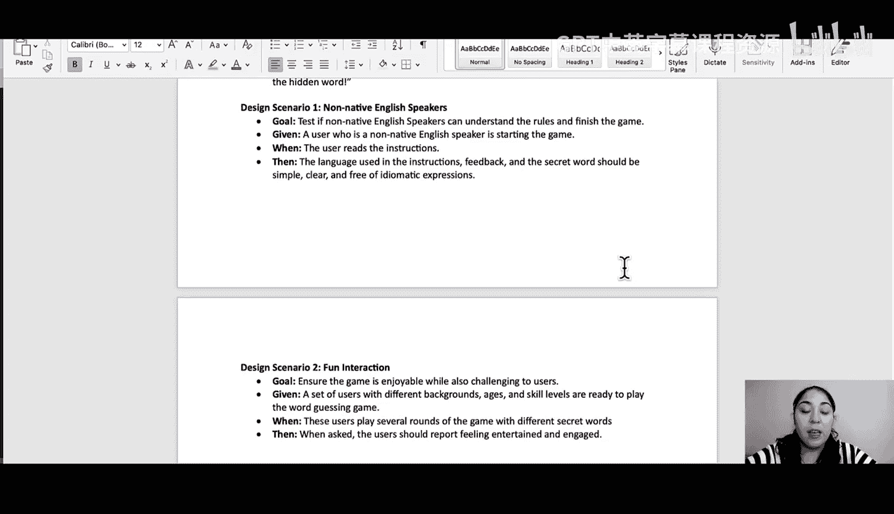

# 杜克大学《Python编程实践｜Practical Python： Start Your Programming Journey》中英字幕 p55 55_04_03_调试游戏第一部分演示.zh_en -BV1tTmCBWEQD_p55-

Let's work on a letter guessing game in this game we're supposed to guess each letter in a secret word one by one。

 and once we've guessed all the letters， then the game will end so let's go ahead and play this game to see how it works。

So in running this game， you first presented with the instructions。

 guess each letter in a four letter word。 So in our example， our secret word is four letters long。😊。

And then you're prompted to guess the next letter in the secret word since we haven't guessed any letter so far。

 we're currently essentially guessing the very first letter of our secret word， essentially。

 what letter does this word start with。So maybe our secret word starts with the letter A。

 I'll go ahead and enter A。And it looks like that's not correct， so it's saying try again。

 which basically means we didn't get it right， but that's fine， we can try again。

Words so far is going to indicate what letters we have correctly guessed so far。In the game。

 so basically it's going to reveal the secret word until you essentially reveal the whole thing。

Guess the next letter。 So let's go ahead and try to guess the first letter once more。

 Maybe our secret word starts with the letter B。Oh， and it looks like this time we are correct。

 so word so far now shows the letter B because we have correctly guessed the very first letter in our secret word。

😊，Let's try to guess the second letter。What about the eye？And looks like that is correct。

 so we have officially guessed two letters of the four letter secret word we're basically halfway there。

Let's see what if we guess the letter C？H that's incorrect。

So you can see we did't advance in revealing the secret word words so far didn't change。Okay。

 let's see。 let me think。R。Okay， lookss like that is correct。 So so far we've guessed B IR。

 what more letter to go， What does the very last letter in the secret word let's try letter D。

And it looks like we finally revealed the secret letter。 We finished the game。

 So this is telling us that our last guess was correct。

 The word so far is showing the complete secret word。

 meaning that we've essentially finished the game and we get the final success string that tells us you found the hidden word。

😊，Now。In a later video， I'll go ahead and walk you through a piece of code that attempts to create this game。

 But the thing is that that piece of code has a lot of errors in it。

 and in order to remove those errors， we should first sit down and create some scenarios for how this game might be played essentially what situations might arise while anyone is essentially playing the game。

😊，And creating these scenarios will definitely help with the debugging process。Now。

 when it comes to writing down these scenarios， I recommend you create quite a few of them。

In our case， we want to create a few scenarios that will verify the plan of our game and the more scenarios we have。

 the easier it will be to determine if your program is actually correct。

When writing down these scenarios， I recommend you start small。With very simple scenarios。

 And as you go， you can make them more and more complex。 So for our example。

 our first scenario could be something like。Maybe the user。

It's just barely starting to play the game， they make their very first guess。

 and that guess happens to be correct。So that could be its own standalone scenario。

I shouldn't mention that there isn't a single correct way to write down these scenarios。

 Any method essentially works just as long as you get the job done， I will show you one specific way。

 but feel free to adapt the strategy however you like you essentially have fun with it。

 Now I will pull up this text editor to help us。Create and write down these scenarios。 Now。

 when I write my scenarios， I like to number them because it helps me keep things organized。

 So I'm going to type in plan scenario1。And why am I titling it this way because I'm going to write a lot of scenarios to verify the plan of my game。

 and this is just the first one。And I like to title them， so in this case。

 given the example we're working with， the title for this scenario could be process a correct guess。

And of course， you can feel free to title yours however you like I the titling helps to identify or distinguish the different scenarios once you have quite a few of them。

😊，And for the scenarios， they're all going to have different parts to them。

One part is called the goal section。Goal is basically going to describe。

What is the purpose of creating the scenario， what is the scenario trying to verify or trying to test within your program。

 so the goal of creating this first scenario。Where the player makes their very first guess and it happens to be correct is to essentially test if the program。

Can correct。Process a correct guess。That is the goal of this very first scenario and I am making it into a bullet point just because it makes it easier to read。

 but of course this is all just personal preference。

The next section of the scenario will be the given section。

The given section describes the context behind the scenario。

 so what information do we know to be true when the scenario is occurring so for us it would be that we have a user。

😊，And they are starting the games。A user is barely starting the game。

The next section is going to be the when section， the when section describes what you actions are occurring in this scenario。

So again， for our example would be that the user is asked to enter the first letter。

And enters the correct letter。So this is what happens during the scenario。

 this is a new action that occurs。The then section describes what the program should do as a consequence of these actions。

 so how should the program behave？Another example is the program should。Accknowledge。The correct。

Guess。I should show the updated list of correct letters， guest。So far。Then ask the user。

To enter the next letter， oops。To enter the next letter。I do want to make sure we distinguish。

The correct behavior of the program versus the actual behavior of the program。

 The then section is only articulating。 It's only describing what the program should be doing if it were correct。

 It is not intending to describe what the program actually did。This。

Difference is going to be extremely important once we get down to debugging。All right。

 and that's essentially our very first scenario， all future scenarios that I write are going to essentially follow this same template。

 the same format， but remember you can adapt this however you like。😊。

Let's consider another scenario this second scenario can you know， play off of the first one。

 so this is going to be our plan scenario。😊，2。And we can think about a scenario where what happens you know since this is happening after the first scenario。

 what happens when the user correctly guessed the first letter。

 now they're trying to guess a second letter and that second letter they happen to guess incorrectly so this could be titled something like processing and incorrect guess。

In which case， the goal of this scenario would be to test。If the program。

Can correctlyly process an incorrect guess。And I like to make these bold。

Just to make it easier to read， keep things nice and neat， but again， that's just my preference。

All right， so the next section。Is going to be the given section What information do we know to be true for the given section。

 it's that a user。😊，Has correctly a guest one letter。No know。

 this is following the first scenario in the secret word。😊。

And now is trying to guess the second letter。So this is the context behind。

The this scenario that we're currently building this is what happening now so the when section what is that going to be describing the when section is a new action that's occurring so for us it's going to be that the user is asked。

To enter the second letter and enters。An incorrect letter。The then section。

Is going to describe what the program should do under these conditions is that the program should instruct the user to essentially try again。

 as we've seen when I demo the game earlier。Without。Advancing the guess。

Index what do I mean by the guest index？What I mean by this is when you're making your first guess。

 you're making your first guess for the very first letter of the secret word。

 once you correctly guess the very first letter of the secret word。

 then you move on to the second letter and have the user try to guess the second letter of the secret word and so on and so forth until you fully guessed the full word。

 So in this case， guess index is keeping track of what letter you're currently guessing。

So if you did not correctly guess the second letter， then do not advance the guess index。

 keep the player to continue trying to guess the second letter。

 don't move them onto the third letter。All right， what would be another？

SomeGood plan scenario to include。Maybe。Maybe one where。

The player is making a series of correct and incorrect guesses。U。And then later on in the game， they。

 they guess this eventually they guess the second letter。

 So after a few correct and incorrect guesses， the player eventually guesses a second letter。

 So in this case， we can title it Pra。Processing a correct。G。Later in the game。

And the goal here is to test if the program。Can correctly process and incorrect。Guess。In this case。

 later in the game。Fix my typos， me scroll up a little bit。All right。

 so what would be the given section here？😊，Here what we are given is the context behind the scenario is that after a series of one or more guesses。

😊，The user is currently trying to guess the second letter of the secret word。

So that's what's happening here。After a series of one or more guestses。

 the user is currently trying to guess the second letter of the secret word。

Now what's the new action that occurs in the when section， it's that the user is asked to enter。

The second letter。And enters the correct letter。The then section describing what the program should do if it were correct is that the program should。

Acknowledge。The program should acknowledge the correct guess。And ask。嗯。

Should acknowledge the correct guess， what else should I do？Show the updated list of correct。Letters。

Yes， so far。And then ask the user to enter the next letter。

So a lot is basically what happens with the first scenario is also going to occur with the third scenario。

Let's go ahead and move on to our last scenario， our last plan scenario， so plan scenario4。

And this one essentially is going to be looking at maybe what happens when the player after a series of gases eventually。

Guess is the full secret word， so the game has ended。

 we want a test if the game if it's possible to win the game basically。

 so winning the game is what I'm going to title this specific scenario。

And the goal for this one would be to check if it's。Possible to win the game。

Let me go ahead and format this correctly。All right。

 is it possible to win the game so the given section here？

Is a user that this is the context user is starting the game。

 So this is from the beginning to the end。 This is no longer talking about a previous scenario。

 This is a standalone scenario。 So what's the new action。

 So a user just barely started playing this game， What's happening here。 So basically。

 through a series of correct and incorrect。Gases， so they're just essentially playing the game full blown。

 the user eventually。Guees all the letters。In the secret word。

The then section remember it's going to describe what actually occurred， what should have occurred。

 I'm sorry so for us it would be that the user should see a message。After each correct。Guess。

Indicating。It was correct。A try again。Message should。Should appear。After each incorrect guess。

What else should to do， the user should also see their progress。After each guess。

With the correctly guest letters displayed。Maybe then after。The final。Correct， guess。

What should the game do is the game ends and the user should see a message。Saying。

You found this hidden word。Oh， if I can spell it correctly。You found the hidden word。

And that is essentially our last plan scenario now I'm sure you're probably thinking hey I bet you I can think of a few more you didn't include them all and' that's perfectly fine for the sake of time I will stop the plan scenarios here。

 but I really encourage you to come up with your own。

 maybe you want to consider create your own plan scenario for a mix and match of correct and incorrect guesses that we haven't thought of yet or maybe a scenario for what were to occur if the player never actually。

Fly guesses the hidden word there's a lot of plan scenarios you can come up with and I do encourage you to do and create your own because this is a really good practice tool and it's a very effective tool when it comes to debugging。

 which you will see in a later video。Another thing that you， which I do want to demonstrate。

Our design scenarios is is another type of scenario you can create in this case we are going to be creating scenarios to verify the design of our game and the design being what is a reason why we even created the game to in the first place。

What was our ultimate goal in designing this game？Now one design scenario so let me go ahead and name this design scenario one。

I'm starting from number one because this is not a plan scenario and one design scenario could be that I wrote this game that because I wanted it to be accessible to non nativeative English speakers。

 I wanted non-native English speakers to be able to play the game。

 be able to understand the instructions comfortably。So I can title this as non native。

English speakers。And then the goal being test。It could be something like tell。Task if none。

Native English speakers。can understand the rules and finish the game。The reason this is a good。

A scenario to create is because you never know if the instructions have assumptions that were made。

That your users may not necessarily have those same assumptions。

 so they will not understand the game the way you do。 And this is natural。

 It happens to the best of us。But this is why it's also good to test the design of your game because your intentions may not necessarily carry through to reality and what actually happens when people use your program。

So the given section could be is that we have a user。Who is a nun？Native English。Speaker。

Is starting the game。So they're going to experience a game for the first time。

So what's going to happen then？The action in that case。

 Let me go ahead and make sure that this is not bolded。

 The action in that case could be something like。The user reads the instructions。

The then section would then be something like the language。

So this is what should occur if everything went well， is that the language used in the instructions。

The feedback that the game provided and the secret word itself should be simple。Should be clear。

And it should be free of。Idiiomatic expressions。By that， I mean。The language should be。

Something that non native English speakers。Are able to identify。And understand。

And not specific to a specific culture。All right， the next design scenario。

That we could potentially use is essentially one of the goals of this is for people to find this scheme challenging。

 but also intriguing and essentially make them think and have fun while doing so。

So this one could be testing if the users had a fun interaction。The goal of this scenario would be。😔。

Essentially to ensure。The game is enjoyable。While。Also。Challenging。To users。

Because we want we want them to think right， we don't want them to be super easy。

 but at the same time， you want them to also enjoy。😊，The challenge of writing this game。

 of playing this game。So the context for this scenario is that we have a set of users。In this case。

 I want to use for this design scenario， I want to use it to a set of users。

To get as much information as to how effective this game is at providing a fun interaction。

 given different people's backgrounds so we have a set of users。With different backgrounds。

Maybe different ages even。And skill levels。And they are ready。To play。The word guessing game。

What is the action that occurs during the scenario is that these users。Play several rounds。

Of the game。With different secret words。Just to see how the game works for them。

And then how should what should be the result if everything went well， basically when asked。

 the users should report。Feeling entertained and engaged。

Just like with the plan scenarios you can probably come up with quite a few other design scenarios that we haven't even covered。

 I encourage you to do so come up with some that are true to yourself and what you're really looking forward to。

 what you're looking to get out of creating the programs that you do and never hurts to have too many scenarios just have fun with it。

