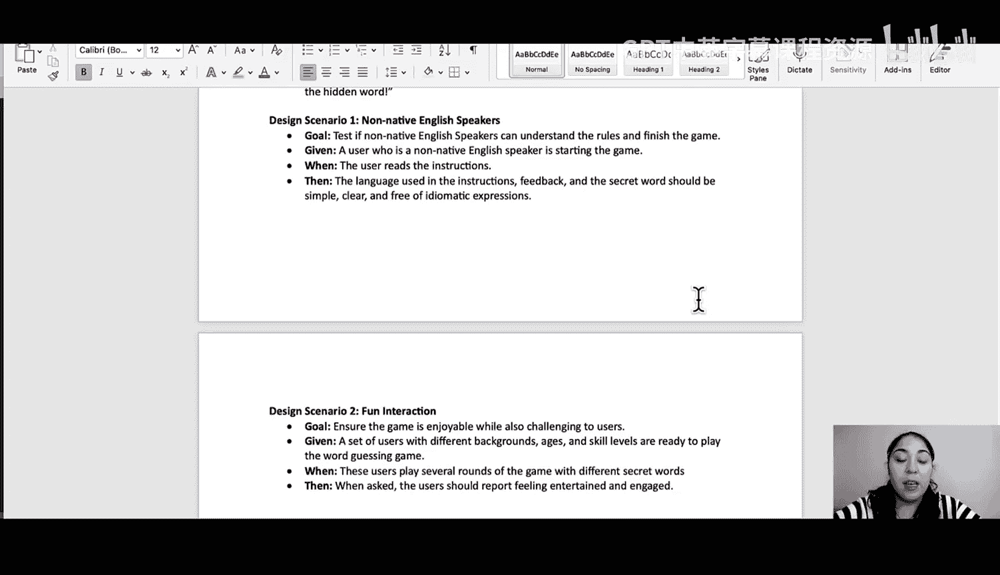

# Python编程实践：55：调试游戏第一部分演示 🎮

在本节课中，我们将学习如何为一个字母猜词游戏制定调试计划。我们将通过创建一系列“计划场景”和“设计场景”来系统地验证游戏逻辑和设计目标，这是调试复杂程序前的关键准备步骤。

## 游戏玩法概述

我们首先来了解这个字母猜词游戏的基本玩法。游戏目标是逐一猜出一个秘密单词中的每个字母。当所有字母都被猜出后，游戏结束。

运行游戏时，首先会看到游戏说明：猜出一个四字母单词中的每个字母。接着，程序会提示你猜测秘密单词中的下一个字母。由于尚未猜出任何字母，当前需要猜测的是单词的第一个字母。

例如，如果秘密单词以字母“A”开头，你可以输入“A”。如果猜测错误，程序会提示“再试一次”，并且“当前已猜出的单词”部分不会更新。如果猜测正确，例如输入“B”并猜对了第一个字母，那么“当前已猜出的单词”部分会显示“B”，表示第一个字母已被正确猜出。

随后，游戏会提示猜测第二个字母。如果猜对（例如字母“I”），已猜出部分会更新为“BI”。如果猜错（例如字母“C”），已猜出部分保持不变。继续这个过程，直到猜出所有字母（例如“B”、“I”、“R”、“D”）。当最后一个字母被猜出时，游戏会显示完整的单词并给出成功信息：“你找到了隐藏的单词！”。

## 创建调试场景

在后续视频中，我们将分析一段试图实现此游戏的代码，但该代码包含许多错误。为了有效地找出并修复这些错误，我们首先需要坐下来创建一些游戏可能出现的“场景”。创建这些场景将极大地帮助调试过程。

以下是创建场景时的一些建议：
*   建议创建多个场景。场景越多，越容易判断程序是否正确。
*   建议从简单的场景开始，然后逐渐增加复杂度。
*   没有唯一正确的方法来编写这些场景，任何有效的方法都可以。我将展示一种特定方式，但你可以自由调整策略。

我将使用文本编辑器来帮助我们创建和记录这些场景。我喜欢为场景编号，这有助于保持条理。

## 计划场景

计划场景用于验证游戏程序逻辑的正确性。每个场景都遵循相同的模板，包含以下部分：
*   **目标**：描述创建该场景的目的，即要验证或测试程序的哪部分功能。
*   **给定**：描述场景发生时的背景信息，即已知为真的条件。
*   **当**：描述在场景中发生的具体操作或事件。
*   **然后**：描述在这些操作发生后，程序**应该**做出的正确反应或行为。

请注意，“然后”部分描述的是程序应有的**正确**行为，而非其实际行为。这个区别在调试时至关重要。

### 计划场景 1：处理一次正确的猜测

*   **标题**：处理一次正确的猜测
*   **目标**：测试程序是否能正确处理一次正确的猜测。
*   **给定**：用户刚刚开始游戏。
*   **当**：用户被要求输入第一个字母，并输入了正确的字母。
*   **然后**：程序应确认猜测正确，显示更新后的已猜出字母列表，并提示用户输入下一个字母。

### 计划场景 2：处理一次错误的猜测

上一节我们介绍了处理正确猜测的场景，本节中我们来看看当用户猜错时的情况。

*   **标题**：处理一次错误的猜测
*   **目标**：测试程序是否能正确处理一次错误的猜测。
*   **给定**：用户已正确猜出一个字母，现在正尝试猜测秘密单词的第二个字母。
*   **当**：用户被要求输入第二个字母，并输入了一个错误的字母。
*   **然后**：程序应指示用户再试一次，并且**不**推进“猜测索引”。（“猜测索引”用于跟踪当前正在猜测的是第几个字母。如果第二个字母猜错，应让玩家继续尝试猜第二个字母，而不是跳到第三个字母。）

### 计划场景 3：在游戏后期处理一次正确的猜测

接下来，我们考虑一个更复杂的场景，涉及多次猜测。

*   **标题**：在游戏后期处理一次正确的猜测
*   **目标**：测试程序在游戏后期是否能正确处理一次正确的猜测。
*   **给定**：经过一系列（一次或多次）猜测后，用户当前正尝试猜测秘密单词的第二个字母。
*   **当**：用户被要求输入第二个字母，并输入了正确的字母。
*   **然后**：程序应确认猜测正确，显示更新后的已猜出字母列表，并提示用户输入下一个字母。

### 计划场景 4：赢得游戏

最后，我们需要一个场景来测试游戏的胜利条件。

*   **标题**：赢得游戏
*   **目标**：检查是否有可能赢得游戏。
*   **给定**：用户从游戏开始玩起。
*   **当**：通过一系列正确和错误的猜测，用户最终猜出了秘密单词中的所有字母。
*   **然后**：
    *   每次正确猜测后，用户应看到指示正确的消息。
    *   每次错误猜测后，应出现“再试一次”的消息。
    *   每次猜测后，用户应能看到进度，即显示已正确猜出的字母。
    *   在最后一次正确猜测后，游戏结束，用户应看到消息：“你找到了隐藏的单词！”。

当然，你还可以构思更多计划场景，例如混合正确和错误猜测的更复杂序列，或者玩家始终无法猜出单词的情况。创建自己的场景是非常好的练习，也是调试时非常有效的工具。

## 设计场景

除了验证程序逻辑的“计划场景”，我们还可以创建“设计场景”来验证游戏的设计初衷和目标是否得以实现。

### 设计场景 1：非英语母语使用者

*   **标题**：非英语母语使用者
*   **目标**：测试非英语母语使用者是否能理解规则并完成游戏。
*   **给定**：有一位非英语母语使用者即将开始游戏。
*   **当**：用户阅读游戏说明。
*   **然后**：游戏说明、反馈信息和秘密单词本身所使用的语言应简单、清晰，并且**没有习语表达**。这意味着语言应该是非英语母语使用者能够识别和理解的，而不是特定于某种文化的。

### 设计场景 2：用户体验与趣味性

另一个重要的设计目标是确保游戏具有挑战性且引人入胜。

*   **标题**：用户体验与趣味性
*   **目标**：确保游戏在具有挑战性的同时，也能让用户感到愉快。
*   **给定**：有一组背景（如年龄、技能水平）不同的用户准备玩这个猜词游戏。
*   **当**：这些用户使用不同的秘密单词进行多轮游戏。
*   **然后**：当被问及时，用户应报告感到娱乐和投入。

与计划场景一样，你也可以构思更多设计场景，例如测试游戏对不同年龄段的适应性，或者评估其重复可玩性。创建符合你自身目标和期望的场景总是有益的，场景多多益善。

## 总结

本节课中我们一起学习了为字母猜词游戏制定系统化调试计划的方法。我们首先回顾了游戏的基本玩法，然后重点介绍了如何创建“计划场景”和“设计场景”。计划场景（如处理正确/错误猜测、赢得游戏）帮助我们验证程序逻辑；设计场景（如面向非母语用户、确保趣味性）则帮助我们检验游戏设计目标是否达成。通过预先详细规划这些测试用例，我们能为后续的实际代码调试工作打下坚实基础，更高效地定位和修复程序中的错误。