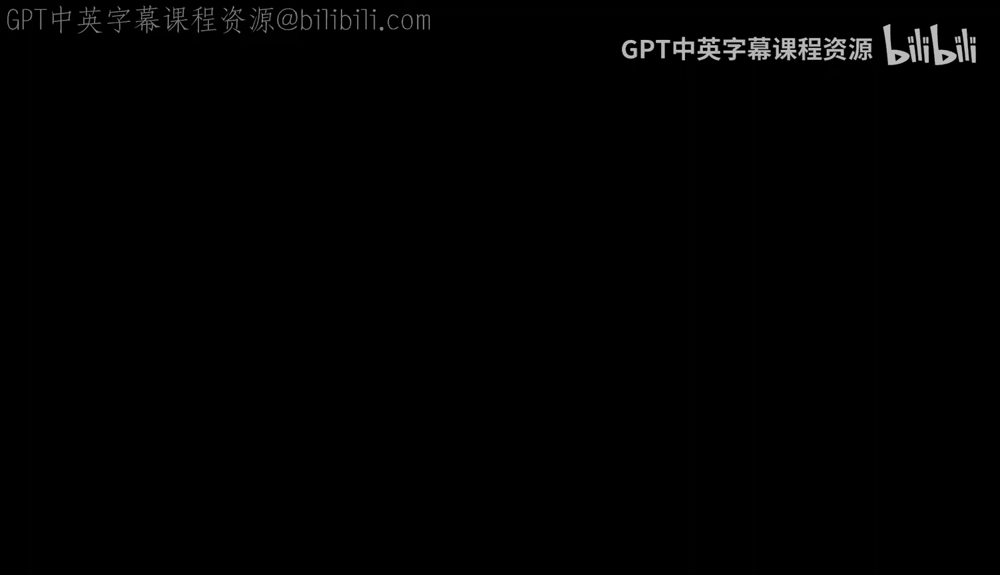
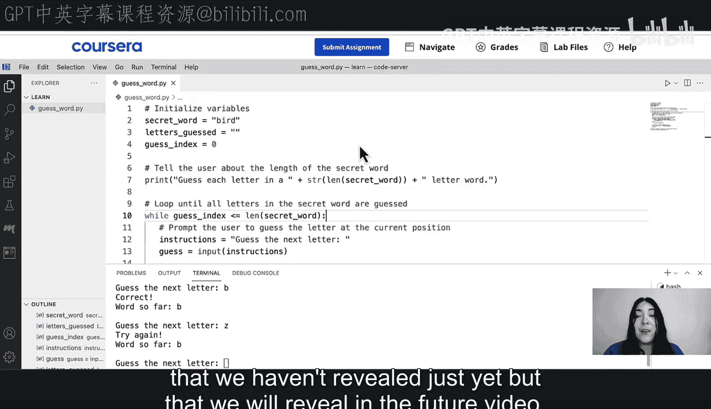

# 杜克大学《Python编程实践｜Practical Python： Start Your Programming Journey》中英字幕 p56 56_04_04_调试游戏第二部分演示.zh_en -BV1tTmCBWEQD_p56-

Now that you know how the letter guessing game is supposed to work。

 let's go ahead and look at some example code that was an attempt to create this game。 Now。

 this code does have quite a few errors in it， but that's okay。

 We're going to tackle those errors one at a time。So let's walk through this code。

So lines 2 through 4 are creating three variables in assigning them to default values。

 These three variables are going to be really important to maintaining the state of the game at every round。

 So you have the variable secret word。 And that's going to contain the secret word that the player is trying to guess。

 So in this example， the player is trying to guess the word bird。😊，You have letters guessed。

 which has a default value of an empty string and letters guessed is going to contain all the letters that the player has correctly guessed within the secret word。

And guess index is going to contain the index position of the letter that the player is currently trying to guess。

 So at the very start of the game， it's assigned the value 0。

 So the player is trying to guess the very first letter in the secret word， which is beat。

Then we present the player with this long print statement。

 which is essentially telling the player to guess each letter in a four letter word。

Here we're calculating the length of the secret word。We have our while loop。

 which is basically saying that it will continue looping as long as the guest index is less than or equal to the length of the secret word。

We're creating the variable instructions on line 12。And。

Here in this variable we're assigning it the string guest the next ladder。

 so instructions essentially are going to contain the instructions a player will see。On line 13。

 we're going to display those instructions that was created on line 12 and ask for the user input。

 and we're going to store that user input into the variable guess。

So this will contain so the variable guess will contain the letter that the player has just guessed in that round。

We have an ifL statement here。The condition to the E statement is basically checking if the letter that the player has guessed。

Does indeed match the letter inside of the secret word that's located at position guess index。

 If these are the same letters。Then the if block will execute what happens inside of the if block。

 while we update letters guest。So we'll add the letter that the player has correctly guessed to the variable letters guessed。

 making it a longer string， and that way letters guessed is going to constantly be containing all the correct letters that the player has guessed。

 and then we'll print correct。If the player was not successfully able to guess that letter。

 then the else block will execute， in which case we will print Try again。At the end of that round。

 we will print word so far。Followed by the letters that the player has correctly guessed。

And then we'll end the round by printing an empty with an empty print statement。

 and this will essentially just print an empty white line。

 which will help space out every round in the game。Just to make it easier to read。

And then at the very end of the game， once the game has finished looping through all the rounds。

At the very end will what will be printed to the terminal is you found the hidden worm。

Now you can probably already start seeing that the red squiggly lines on line 10 are probably hinting at a possible syntax error。

And maybe you already know where that error is。 If you would like to detect it。

 if you would like to try to spot the syntax error。

 feel free to pause this video and see if you can find where it is。 There might be more than one。

Alright， let's go ahead and run this program and see if our suspicions are correct。

 Is it it really a syntech center？So I'll run this in the terminal。And it looks like we were correct。

 so we are seeing that there is indeed a syntax error in our code as the red squiggly lines are seeming to hint at。

😊，嗯。And more specifically， you'll notice that we have this carrot symbol here that is pointing to the beginning of our while loop。

 so it is possible that the syntax error has something to do with our while loop condition。

We are also being told by this error message that the program crashed at line 10 and specifically in the file that we're currently working on。

 which is guessword dot PY。So let's go ahead and go to line 10 where it seems that we will have a while loop header there。

 and maybe there's this syntax error there we should look at。So going over to line 10。

 let's see if we can spot the syntax error so it says guess index less than or equal to the length of the secret word。

 we have our colon here opening and closing parentheses so it doesnt this line looks correct。

 I don't think there is a syntax error there。😊，Now， since we can't find a syntax error in line 10。

 we could search the previous lines of code for that syntax error。

 at least we know that it's not going to be after line 10 because the program crashed when it reached line 10。

So it's not going to be after line 10。It could be the syntax error could be between line 1 through 10。

 at least we know that much。So let's go look at line7， let's go one line up， one line of code up。

 and see maybe， maybe this syntaxt area is there。So we have a string here and we're using string concatenation。

To combine three different strings together gather here we have secret word， which is a string。

 We're calculating the length， which would return an integer。

And then we're converting that integer into a string。

 which should make it possible to use string concatenation。 So that shouldn't be an issue there。

 Well， let's check the quotes。 Does every beginning quote。And with an ending。

And that does seem to be the case， so that's not an issue there。 maybe the parentheses are an issue。

 does every opening parentheses have a closing parentheses？Oh。

 and it looks like we're missing a closing parentheses here at the end of this really long print statement。

So let oh， and you notice that once I added that ending parentheses。

 the squiggly line outline line 10 disappeared。So that usually hints at the fact that the syntax error is now gone。

So let's go ahead and run this code one more time。And see if it's gone。

And it looks like it is indeed gone， we are no longer getting that same error message。

So what are we presented with， guess each letter in a four letter word。

And guess the next letter so we our first we fixed our first error， we fixed our first in error。

Now let's go ahead and pull out our scenarios that we created in a previous video and let's try to execute our very first scenario and see if we can find any more errors in this game。

Here are the list of scenarios that we worked on in previous video。

You can see we have quite a few of them， the very first scenario details the situation where the user just barely started playing their game。

 they make their very first guess， and it just so happens to be a correct guess。

The then section of this first scenario details what the program should do if it were a correct。

A correct program， if it were behaving correctly。So in this case。

 the program should acknowledge the correct guess， it should show the updated list of letter guesses so far。

 and then ask the user to enter the next letter。So let's go ahead and play out this scenario ourselves and see if we actually get our program to behave in this expected way。

So here we're just barely starting the game and we're going to make our very first guess so we're going to enter the letter B because that is the very first letter in our secret word。

 which is B， so we're going to go ahead and press En and we can see the program output for our very first guess。

Checking out our scenario once more。We can check if the actual behavior of the program match the expected behavior which is detailed in the then section。

 so the first thing is that the program should acknowledge the correct guess， did it do that。😊，Well。

 yeah， you can see that the terminal shows the string correct。

And then if should show the updated list of letter guesses so far。

 and that is what Word so far is doing， Word so far is just displaying the letter B because that's the only letter we have correctly guessed so far。

😊，And then at the very end it should ask the user to enter the next letter and that is what it does at the very bottom of this terminal。

 so this scenario actually is not detecting any incorrect behavior in our program。

 which is actually a good thing So what I will do now is I will write a new section in this scenario called actual。

And this section is going to detail what the program actually did， in our case。

 the program matched the expected behavior。Why do we care to write this section in each scenario Well it's important to stay organized as you have more and more scenarios it's going to be harder to keep track of which scenarios you've already。

Check verified and check that it worked correctly in your program。

And which scenarios you have yet to tackle so the actual section can help you keep track of that so it helps you stay organized it can also it's really also great when it comes to debugging in that you're explicitly differentiating what the program actually did versus what you intended it to do so and that differentiation is extremely important when it comes to debugging。

😊，So this is one of the many reasons why you would want the actual section in your scenario。

Let's go ahead and look at the second scenario。 The second scenario plays off of the very first one in this new scenario。

 you are you have already guessed the very first letter in the secret word。 So in our example。

 we have already guessed the letter B。😊，We're currently trying to guess the second letter in our case。

 it would be the letter I， but we're going to make it incorrect guess。

 So instead of guessing the letter I， we're actually going to guess the letter Z and making it an incorrect guess。

 So let's go ahead and type in the letter Z。Now let's take a look at that。Then section of scenario 2。

 It says the program should instruct the user to try again。 Is that what it actually did。 Well。

 we can see here in the terminal that it does display the string try again， which is great。

 And it says that the guest index should not be advanced。 If you look at words so far。

 it's still only displaying the letter B。 It's not displaying the letter I or any other words in the secret word。

 So we're still trying to guess the second letter of the secret word。

 So that is actually what it should be doing。 So it seems that this second scenario hasn't revealed any incorrect program behavior。

 So in the actual section of this scenario， I will also write matched the expected behavior。😊。

Therefore， updating our notes。Now in a future video we're going to go ahead and look at the rest of these scenarios。

 which I can tell you right now is going to reveal few other unexpected behavior that we haven't seen so far。

 I encourage you to play around with this code see if you can detect the errors that we haven't revealed just yet but that we will reveal in the future video and overall does that fun with it。

