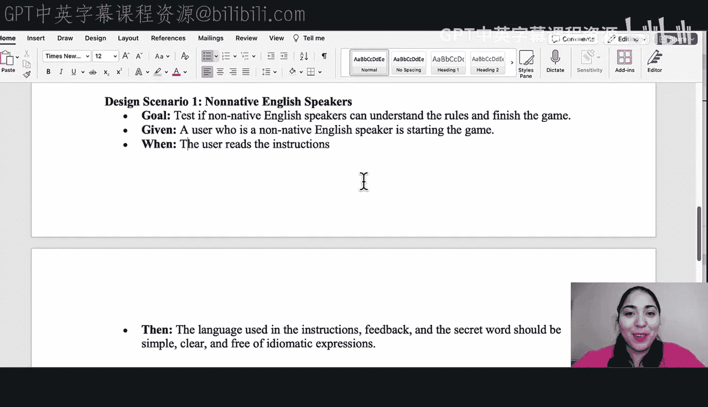

# 杜克大学《Python编程实践｜Practical Python： Start Your Programming Journey》中英字幕 p57 57_04_05_调试游戏第三部分演示.zh_en -BV1tTmCBWEQD_p57-

In a previous video， we were looking at a letter guessing game where players supposed to guess each letter in a secret word。

 In our example， the secret word just happens to be burnt。😊，Now。

 this code does have a lot of errors in it， and in order to try to verify that if this code works。

 we created the series of scenarios。And in doing so。

 we've already looked at scenarios 1 and 2 in a previous video。

 and we're going to go ahead and now look at scenario number 3。 Now。

 scenario number 3 is the case where the player has already correctly guessed the very first letter in the secret word。

 And now they're currently trying to guess the second letter。 And in doing so， they guess correctly。

😊，So let's go ahead and play this game from the very beginning。And let's try to do scenario number3。

 So it's going to ask you to guess each letter in our four letter word， our four letter word。

 of course， being bird。 We're going to go ahead and guess the letter B。

 which is a very first letter in our secret word。And it's telling us that it is correct。

 is displaying the words so far since we correctly guess the letter B。

 it is going to slowly reveal the secret word。 And once the word so far has the full secret word。

 the game will officially end。And that is asking us to guess a second letter in this secret word。Now。

 this is actually where scenario number 3 officially starts。

 Remember that the context behind scenario number 3 is that the user is currently trying to guess a second letter。

 The action being that they do guess it and it happens to be a correct guess。

 What should happen if the guess is correct is that the program should acknowledge the correct guess。

 It should show the updated list of correct letter guesses so far。

 So instead of it just showing the letter B in words so far。

 itll now show the letter B and the letter I as well。

And then I'll ask the user to enter the next letter。

 essentially prompting the user to guess the third letter。

So let's go ahead and make our second guess for our essentially our guess for the second letter in this secret word。

 And we're going to guess correctly， as is described in the third scenario。

 So I'm going to type in the letter I。Oh， and that's not correct。

 So it's telling us to try again when it should have said it was correct。 And essentially。

 it doesn't look like we correctly processed。This guess。

So it looks like we have our very first logic error， but that's okay。 let's pause for now。

And let's recollect what we see。So the actual section。Of。

This scenario should describe what actually happened versus the then section。

 which describes what should have happened。 So what actually happened was that the programme didn't。

 didn't interpret this as a correct guess。 So the programme instructed the user to essentially try again。

We were told to try again。And it didn't even advance。So with that advancing。The gas index。

As you can see here， we didn't move on to the next letter。

 We're still trying to guess the second letter because if we were trying to guess the third letter。

 then you would see two letters revealed here。 But we're only seeing one letter revealed。

 which means we're trying to guess the second letter。

So there seems to be a mismatch between expected and actual behavior。 Now。

 why might the program be behaving this way well。Let's try using one of our debugging strategies to help us find out why。

 let's go ahead and use print statements。Now， it's generally good to place these print statements where the incorrect behavior happened or just before where the incorrect behavior happened。

For us， where might that be？Well， let's think about this。

What our first guess for the first letter was correctly processed。

 but our second guess was not correctly processed。 So the error might actually be happening where our guesses are being evaluated to whether or not they were a correct guess or an incorrect guess。

Now， where in our code might that be？Go ahead and pause this video if you would like a chance to spot it。

It would be right before the if statement。So let's go ahead and place our。

Let's go ahead and place our print statements right before the if statements。 Now。

 what should we print， So we know where we want to place our print statements。 What should we print。

Well， generally， it's good to print the variable values of everything that is associated with the incorrect behavior。

 So in our case， we want to essentially figure out why the guesses are being evaluated to why the guesses are being evaluated incorrectly。

 So let's go ahead and print on all the variable values that have anything to do with how these guesses are being evaluated and for us。

 essentially is practically all these variables。😊，So what I'm going to do is I'm going to type in guesses。

And I'm going to type in guess that way I in the console。

 I'll be able to clearly see guess being displayed along with the string guesses。A spacing issue。

Okay。Next。We get the we can print out secret word， so secret word is because that's another variable that is important。

That's another variable that's important when it comes to determining if a guess was correct or not。

Another variable we might want to print out is gas index。

Guess index is basically going to take store the index position of the letter that the player is currently trying to guess。

Let's go ahead and also print out。What current letter？That the player is trying to guess。

So in our case， we essentially want to。In print out that inside of secret word。

So inside of secret word， there is the letter that the player is currently trying to guess。

 so the player is currently trying to guess。The letter that's located at position guess index inside of secret word。

And let's go ahead and also put that in our string so we know what it is that we are。Essentially。

Trying to print。So here is going to make it very clear that this value that will be printed into the console is actually。

The letter， a position guess index inside of secret word。Next， we have our if condition。Is。

And then we're gonna go ahead and type in。Guess， essentially， we're going to type in our。

 our if condition and our if condition was。If you recall， was essentially checking。

If guess was equivalent to that letter in sight of secret word。

That letter specifically at location guest index。So that is a lot of print statements。

 I am essentially printing out all these variable values。

I am printing out the if statement condition。Because that all has to do。

 these are all interesting values and variables that I want to keep track of when determining if a guess was correct or not。

So let's go ahead and run this code one more time， and these print statements are going to help us visualize what exactly is happening in this code。

So let's go ahead and run this。Okay， so。Let me go ahead and quit。

This game and start from the very beginning。 So we're going to go ahead and guess our first letter。

 which was a letter B。 and notice what gets printed Now。

 we have a lot more information getting printed， And that is the beauty of our print statements here。

 Our print statements are creating a lot more things to be displayed on the terminal。Essential。

 So we guess the letter B。😊，And then we have our guess is。 Remember， we have guesses。

 And it's going to display the letter because that is what the player guesss。

 So this is our user input。 secret word is bird。 Yep， that is correct。 Gu index is 0。

 That's true because we are trying to guess the very first letter in the secret word。

 So that makes sense。嗯。What is the secret， What is the letter inside of secret word at position 0。

 And that is going to be the letter B。 That is correct。

So should this bullying condition be true or false， and it looks like it evaluated to true。

Becauseuse remember， here in our print statement， we。Oh。We printed this boolean。Expression。

 which would evaluate to either true or false because of the double assignment operator。

 essentially the quality operator。 This is checking if it's truly equal to。

So if condition is and this will be either true or false， and in our case。

 when we correctly guess the first letter， it evaluateds a truth。And then it's displaying correct。

And then here we have words so far。 and it is showing the letter B。 All right。

 so let's go ahead and guess our second letter and see if it's any different。

So what did we type in the letter I because it is a correct case for the second letter？

And see what happens。 So guess is I。 That is true。 That is our input。 So that's correct。

 Secret word is bird。 That is correct。 That's still the secret word we're trying to print。

Gss index is 0。 Well， that's not right。Remember that we're currently guessing the second letter in the secret word。

 The second letter is index position1。Not0。So this should not be 0。

 This is already an incorrect value， and we wouldn't have caught this if we didn't exhaustively print all this information。

These print statements， although it does look like a lot of work。

 they really help to reveal incorrect behavior。 And here we just spotted one。Let's see what else。

 So what is。The secret letter that they were trying to guess in opposition。In this case。

0 because it should not be 0， but it is 0。 And that is why it's revealing B when it should be the letter I。

And of course， then we have the if condition is false when it should have been true。

 and that is why it says try again。Interesting。So， let's go ahead and check。Where in our code。Is。

The bullyan condition evaluating to false。Well， that would be the if statement。

And the estimate is evaluating to false because gas index stayed at position 0。

 and it didt update to position 1 After we guessed the correct first letter。

 It stayed at the first letter when it should have moved on to the second letter。

So I guess the question is。😊，Why isn't the guest index not updating？

And we know it's not updating because we can see that it printed out 0 both for the first gas and the second gas Gu index was 0 for the second gas。

 Ga index was 0 for the first gas。Where should it be updated since it's obviously not being updated？

Feel free to pause this video if you would like a chance to figure it out。Well。

One possible place that we could be updated。Is。Once we have determined that we have correctly guessed a letter in the secret word at that point。

 we know we need to move on to the next letter。 So at that point would be a good time to update guest index。

 So where in this code， do we know that。We have correctly guessed of a letter in the secret word。

 that would be the if block。So if this condition evaluates to true。

 then the player has correctly guessed a letter in their secret word。😊，So then essentially。

 that is why it just says correct。 So let's go ahead at this point， only inside the if block。

 will we update gas index。And I'll go ahead and update it by one by increasing the value of gas index by just one。

So it's guess and disks plus equals one。And the reason doing it at the very end of this if block and not at the very beginning is because I want to make sure that letters guessed。

Is going to be。Receiving the correct letter that the player guested。

 So we want to make sure we store the correct letter that the player guested into letters guested before we move on to the next letter。

All right。 let's go ahead and run this code and see， see if it fix， if the the issue is resolved。

So I'm going to go ahead and clear the terminal。 You can do that by right clicking the terminal。

And select and clear。And I'll go ahead and run。Pt this code on the console once more。

Oh I need to end end the game， end the game by killing the terminal。

So let's go ahead and run this code once more from the very beginning。

 let's go ahead and type in the letter B。😊，For our first guess。

 So you can see guess is the guest that we entered is B， Se word is bird Gu index is 0。

The the letter at gas index is B， which is position0， which is good。

 the F statement evaluated to true， which means it was a correct guess。

 and that is why we see correct。And that is why word so far is showing the letter B。 Okay。

 let's guess the letter I。Okay， the letter I in the letter that we guessed is a letter I secret word as bird。

Guess index is one。 Notice how it's no longer 0。 So it is finally updating， which is good。 Let's see。

 if the rest is correct。Secret word。And what is the secret letter that we're currently trying to guess inside of secret word。

 the one at position guess index， and that is I， which is good。

 we want it to be I since we're guessing the letter I at the moment。

And then our bullying condition evaluated to true， which is awesome because it was a crcast。

 And that is why we see correct being displayed。 and words so far finally shows the letters B and the letters I。

😊，Essentially， we fixed our first logic bug。Which is really awesome。

 And that would have been so much harder to essentially fix or to even detect what this bug was if we didn't have these really awesome print statements and these really awesome scenarios that essentially guide us in this debugging process。

 So now that this is no longer the actual behavior of this program。😊。

We can go ahead and update this to say that it match。

The actual behavior because we want to make sure that we stay we keep our notes updated。

 that is really important to stay organized， keep your notes updated， and so on and so forth。

Let's go ahead and move on to the fourth scenario。 So here the player is going to go ahead and eventually win the game。

So that is what the scenario we're will tackle next。

 So what should happen is that the user should see a message after each correct guess indicating that it was correct。

And a tri and message should appear after every incorrect guess。

And the user should also see their progress after each guess with the correctly guest letters displayed。

And then after the final correct guess， the game ends and the user should see the message saying。

 you found the hidden word。So let's go ahead and recreate the scenario and see if that's exactly what happens in our game。

So going back to our game， let me go ahead and。Quit the game， will' kill the terminal。

 and we'll start it up once more。So this is still including our print statements that we use because we still want to keep those until we know for sure that we're no longer going to need them。

So let me go ahead and make some correct and incorrect guesses until we eventually win the game。

 So the first one would be the letter B， a correct guess， maybe the letter Z， an incorrect one。

 Notice how guest index is being updated。And W so far did not update after the letter Z because Z is incorrect。

So let's try the letter I， you can see where it so far did update。

Now we're going to go ahead and guess the next letter， so let's guess the letter R。

That is a correct gas。Guess index is two since we just correctly guessed the second letter。

And you can see ours the third letter， I'm sorry， guess index is two because we correctly guess the third letter and。

We see that the first three letters are displayed here。Let's make an incorrect gas， maybe see。

You can see that's notch updating and it shouldn't because it's an incorrect guess。

And let's go ahead and type pin D。Oh， that's interesting。

 So the game should have finished by now because the full secret word is revealed at this point。

What happens if I guess one more time？ Let's try S。Oh， okay， so we got our first runtime error here。

Which is fine because error messages give us a lot of useful information。

 so let's go ahead and see what's happening here。So it's telling us we have an index error。

 which usually means that there's some type of index position that is either too high or too low and so that at least hints us to what's happening that've caused this error to happen so something about a string。

Index as out of range。 So somewhere in our string， we have an index position that is either too high or too low。

And of course this is happening in our file that we're currently working on specifically on line 18 now remember this might not explicitly be on line 18。

 this could be any line that comes before line 18 so lines 1 through 18。

 the error might be present in those lines。And you can see they。

Display a line of code where the error message might be located。

 And that is essentially the line of code where we're printing out the letter that the player is currently trying to guess。

This is one of our debugging print statements。So let's go ahead and see what's happening。

So if we look at the output when we run our program。

 we can see other clues aside from just the error message， which is also important to notice。

Is that we should inspect what。Lines of code were able to successfully execute before the error message was displayed。

So here we made our， we made a guess that went past what should have been the final round。

 basically they asked us to keep going after the game should have been over。 and we see the letter S。

 And then here we see that the guess is S， which is the Prince statement on line 15。

 secret word is bird。 That's line 16。 Gu index is 4。 Yep， that's what happens on line 17。

 and that is correct。 Gu index should have been4 at that point in time。And then。We have。The error。

On line 18， which this print statement is the exact same print statement that's highlighted in the error message。

 So this probably hints that at the error message being exactly on line 18 and not before line 18。

 And the reason we can say that is because lines 15 through 17 were able to successfully execute correctly here。

And line 18 is where the error message was displayed。Essentially， that's where the game crashed。

Let's go ahead and update our notes。To reflect our new findings。Oh。So the actual behavior。

This is so tiny。The actual behavior that we saw。When we ran this game， this scenario specifically。嗯。

Was essentially that when the user correctly guessed。All the letters。In this secret word。

What happened， Well， the game。Asked the user to guess again。This correctly spell user gear。

 the game asked the user to guess again。 And then when the user guessed another letter。

The game crashed。And a runtime。Errr was encountered。Now。

 you can choose to be more detailed than I am。 That is perfectly fine。

So this is what actually happened， which does not match the expected behavior。

Since we pinpoint the error message to be exactly at lines 18。

 let's go ahead and look at what's happening here。 Now， we know this is an index error message。

 So it has something to do with line 18 and an index position being too either too big or too small。

 So the only index position we're looking at in line 18 is the guess index variable。

 So gas index variable is either too large or too small。

 And we see here that right before the program crashed。It actually printed out what was line 17。

 which was the value of guest index。 And it told us that guest index was the value of 4。

Right before liing team executed， causing the program to cash。 So what。

Letter in sight of secret word is position 4 will sense a string as bird。And it's four letters long。

 That means its index position 0 to 3。 There is no。Position 4。

Position index a letter at index position 4 in the string bird does not exist。

So that is actually what the issue is， is that guess index is too large。

And this was very easy for us to detect because we had these print statements without these print statements。

 this would have been so much harder to detect that this was even the issue。

So that's yet another reason why print statements are a very useful tool when it comes to debugging。

All right。 So the question is， why is guess index updating to too large of a value， Well。

 if we look the output of the program because the output has a lot of details。

 has a lot of clues that we can inspect。 We noticed that the game kept going after we correctly guess the full word。

 We revealed the full secret word， and then the game just kept going and asked us to guess yet another letter past the full secret word。

So that means that this。Game isn't ending when it's supposed to。

 And the while loop is what's determining when this game should be ending。

So it looks like the while loop might not be ending when it's supposed to the while loop is essentially running each round in the game。

So let's take a look at the Y loop condition， so it's saying is guess index less than or equal to the length of the secret word？

And that's what exactly what the issue is。 It shouldn't be less than or equal to。

 It should be strictly less than We always want the index position to be strictly less than the length of the secret word than the length of the string。

 because index positions are 0 up to， but not including the length。 So 0 up to the length， -1。

 So it has to be strictly less than。Alright， so it looks like that might be what's causing the runtime error。

 So now that we fix that， let's go ahead and end our game。

 let's clear this terminal and let's run this code one more time。And see if we can。

spot any difference in behavior。Alright， so let' let's make a few correct and incorrect guesses Z R。

Aye。Agon。D a。And it looks like it ended it。 It ended the game correctly。 So we were able to remove。😊。

Essentially the error， that is awesome。Now， let's go ahead and remove these Prince statements since we won't be needing them anymore。

 You some of you might choose to comment them out。If you're no for a fact that you're no longer going to be using these print statements is good programming practice to just delete them because leaving stale or outdated or unused code as comments permanently is considered bad practice。

Now I'm going to go ahead and change the secreter word to cat。It's just a different word。

 It's a different length as well。 This is a three letter word。

 but we don't have to worry about it being a different length because we're using the length function everywhere in our code。

 So because we're using the length function and not a specific number like the number 4。

 the length function will automatically adjust to this new string。

It's the beauty of using these built in functions。 So let's go ahead and。Clear this terminal。

 and this plate is one more time。See， it says three letter word instead of four letter word。

 so let's type in letter C， the letter Y， that's an incorrect guess， let's do a correct guess。

And let's do a correct guess， and it works。 The game officially works for the plan scenarios。Now。

 let's go ahead。And。Well we have left。 Oh， we should update our notes。 So remember。

 it is important to update your notes。 keep them updated every time you essentially see a difference in your programming behavior。

 whether it is that you finished resolving the bug or whatever the case happened。

 So I'm going to say that it's now matched the expected behavior。

So we want to make sure we stay organized。Now older there is left are these design scenarios。

 in which case I recommend that you reach out to your friends and your family。

 you ask them to play the game， and then you ask them the the questions that these scenarios are trying to test。

 Did you have fun， Were you able to understand the instructions。

And if they have constructive feedback， you know， have them provide them for you so that you can improve the game。

 I will leave that up to you to do。And essentially。

 feel free to come up with your own scenarios when it comes to this game or any other program that you're running。

 you maybe you want to adapt this game to work for a different language or maybe you want to make this game。

Harder， you can change the code to make this game harder。

 you might want to change the code to provide the very first letter from the very beginning。

 Another change you might want to consider is maybe you can randomly choose between different secret words so it's not always the same secret word。

Or maybe you want to。Change the game to display all the letters that the player has guessed。

 not just the correct ones。Or maybe you want to make it so that the player only has a certain number of guesses before they lose the game。

There's a lot of really fun things you can do to this game to make it fancier。

 make it harder or make it easier， whatever it is you choose to do at the end of the day。

 just have fun with it， happy programming。

