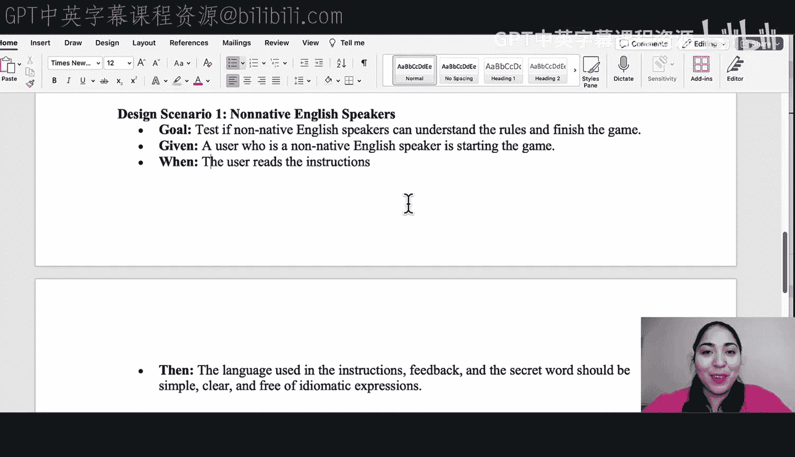

# Python编程实践：57：调试游戏第三部分演示 🐛

在本节课中，我们将学习如何调试一个字母猜词游戏。我们将通过分析一个具体的场景（玩家正确猜出第二个字母），来定位并修复代码中的逻辑错误。我们将使用打印语句作为调试工具，并学习如何系统地记录和验证程序行为。

---

在之前的视频中，我们分析了一个字母猜词游戏，玩家需要猜出一个秘密单词中的每个字母。在我们的示例中，秘密单词是“bird”。这段代码包含多个错误。为了验证代码是否能正常工作，我们创建了一系列测试场景。我们已经在前一个视频中查看了场景1和2，现在我们将继续分析场景3。

场景3描述了玩家已经正确猜出秘密单词的第一个字母，现在正在尝试猜第二个字母，并且他们猜对了。

让我们从头开始运行游戏，并尝试重现场景3。程序会要求我们猜一个四字母单词（即“bird”）中的每个字母。我们先猜字母“B”，这是秘密单词的第一个字母。程序提示猜对了，并显示当前已猜出的单词部分。由于我们正确猜出了“B”，程序会逐步揭示秘密单词。当“已猜单词”部分完全显示秘密单词时，游戏正式结束。现在，程序要求我们猜秘密单词的第二个字母，这正是场景3的开始。

场景3的背景是用户正在尝试猜第二个字母，其行为是他们猜对了。如果猜测正确，程序应确认猜测正确，并更新显示当前已猜对的字母列表。因此，“已猜单词”部分不应只显示字母“B”，而应同时显示“B”和“I”。然后，程序应提示用户输入下一个字母，即开始猜第三个字母。

现在，让我们进行第二次猜测，即猜秘密单词的第二个字母。根据场景3的描述，我们猜字母“I”。然而，程序提示“再试一次”，而它本应提示“正确”。看起来程序没有正确处理这次猜测。

我们发现了第一个逻辑错误。现在暂停一下，回顾我们观察到的现象。

**实际发生的情况**与**预期应发生的情况**存在差异。实际发生的情况是程序没有将此视为正确猜测，因此程序指示用户再试一次，并且游戏进度没有推进。我们仍然在尝试猜第二个字母，因为如果已经进入猜第三个字母，这里应该显示两个字母，但现在只显示一个字母。

预期行为和实际行为似乎不匹配。现在，我们尝试使用一种调试策略来找出原因。我们将使用打印语句。通常，最好将打印语句放在错误行为发生的位置或即将发生之前。

对我们而言，错误可能发生在哪里？第一次猜测（第一个字母）被正确处理了，但第二次猜测没有。因此，错误可能发生在评估猜测是否正确的位置。

在我们的代码中，这可能在哪里？如果你想自己找找看，可以暂停视频。它就在`if`语句之前。

让我们在`if`语句之前放置打印语句。我们应该打印什么？我们知道了放置位置，现在需要决定打印内容。通常，最好打印与错误行为相关的所有变量值。

在我们的案例中，我们想弄清楚为什么猜测被错误评估。因此，我们将打印所有与评估猜测相关的变量值，这基本上包括了所有相关变量。

以下是我们要打印的内容：
*   `guess`：玩家的当前猜测。
*   `secret_word`：秘密单词。
*   `guess_index`：存储玩家当前尝试猜测的字母在单词中的索引位置。
*   玩家当前尝试猜测的字母：即`secret_word[guess_index]`。
*   `if`语句的条件：即检查`guess`是否等于`secret_word[guess_index]`。

这些打印语句将帮助我们可视化代码中到底发生了什么。让我们再次运行代码。

我们猜第一个字母“B”。打印信息显示：`guess`是‘B’，`secret_word`是‘bird’，`guess_index`是0（正确，因为我们在猜第一个字母），`secret_word[0]`是‘B’。`if`条件评估为`True`，程序显示“正确”，“已猜单词”显示字母‘B’。一切正常。

现在，猜第二个字母“I”。打印信息显示：`guess`是‘I’，`secret_word`是‘bird’，但`guess_index`仍然是0。这不对！我们现在应该猜第二个字母，其索引位置应该是1，而不是0。如果我们没有详尽地打印这些信息，可能不会发现这个错误。打印语句虽然看起来工作量很大，但它们确实有助于揭示错误行为。我们刚刚发现了一个。

`secret_word[guess_index]`显示的是‘B’（因为`guess_index`是0），而它本应是‘I’。因此，`if`条件评估为`False`（本应为`True`），所以程序提示“再试一次”。

那么，为什么`guess_index`没有更新？我们看到在第一次和第二次猜测时，它打印的都是0。它显然没有被更新。它应该在何时被更新？

一旦我们确定玩家正确猜出了一个字母，我们就知道需要继续猜下一个字母。因此，那将是更新`guess_index`的好时机。在代码中，我们如何知道玩家正确猜出了一个字母？那就是在`if`代码块中。如果条件评估为`True`，则玩家正确猜出了一个字母。

因此，我们应该只在`if`代码块内部更新`guess_index`。我们将在`if`块的末尾将其值增加1（`guess_index += 1`）。之所以在末尾而不是开头进行，是为了确保先将玩家猜对的字母存入`letters_guessed`列表，然后再移动到下一个字母。

让我们运行修复后的代码，看看问题是否解决。

我们再次从开头运行。猜第一个字母“B”：`guess_index`为0，条件为`True`，显示“正确”，“已猜单词”显示‘B’。很好。

现在猜第二个字母“I”：`guess_index`现在是1（终于更新了！），`secret_word[1]`是‘I’，`if`条件评估为`True`，显示“正确”，“已猜单词”现在显示了‘B’和‘I’。太棒了！我们修复了第一个逻辑错误。如果没有这些打印语句和指导我们调试过程的场景，发现和修复这个错误会困难得多。

既然这不再是程序的实际行为，我们可以更新我们的笔记，标记场景3的预期行为与实际行为现在匹配了。保持笔记更新、保持条理清晰非常重要。

接下来，让我们继续处理场景4。在这个场景中，玩家最终将赢得游戏。

预期行为是：用户每次正确猜测后应看到“正确”消息，每次错误猜测后应看到“再试一次”消息。用户每次猜测后还应看到他们的进度，显示已猜对的字母。在最后一次正确猜测后，游戏结束，用户应看到“你找到了隐藏的单词”消息。

让我们重现这个场景，看看游戏中是否完全按此发生。

回到我们的游戏，我们进行一些正确和错误的猜测，直到最终赢得游戏。我们首先猜“B”（正确），然后猜“Z”（错误），注意`guess_index`在更新，“已猜单词”在‘Z’之后没有更新（因为‘Z’错误）。接着猜“I”（正确），“已猜单词”更新了。再猜“R”（正确），`guess_index`变为2（因为我们刚正确猜出第三个字母），“已猜单词”显示了前三个字母。再猜“C”（错误），“已猜单词”没有更新。最后猜“D”。

有趣的是，此时完整的秘密单词应该已经揭示，游戏本应结束。但如果我再猜一次呢？让我们试试“S”。程序出现了运行时错误。

错误信息是`IndexError`，这通常意味着某个索引位置过高或过低。错误发生在我们的文件第18行附近（具体位置可能因环境而异）。错误信息提示“字符串索引超出范围”。

除了错误信息，检查在错误消息显示之前成功执行了哪些代码行也很重要。我们看到，在猜测“S”之后，打印语句成功输出了`guess`（‘S’）、`secret_word`（‘bird’）和`guess_index`（4）。然后，在第18行的打印语句处程序崩溃了。

因此，问题很可能就出在第18行。第18行打印的是`secret_word[guess_index]`。我们刚看到`guess_index`的值是4。字符串“bird”的长度是4，其有效索引是0到3。索引位置4不存在，这就是问题所在：`guess_index`的值太大了。

如果没有这些打印语句，要发现这个问题会困难得多。这再次证明了打印语句在调试中是非常有用的工具。

那么，为什么`guess_index`会更新到一个过大的值呢？查看程序输出，我们注意到在正确猜出整个单词、完整揭示秘密单词后，游戏仍然继续，并要求我们猜测完整秘密单词之后的下一个字母。这意味着游戏没有在应该结束时结束。

决定游戏何时结束的是`while`循环。看起来`while`循环可能没有在应该结束时终止。让我们看看`while`循环的条件：`guess_index <= len(secret_word)`。问题就在这里！它不应该是“小于或等于”，而应该是“严格小于”。索引位置必须严格小于字符串的长度（即0到`长度-1`）。所以条件应该是`guess_index < len(secret_word)`。

看起来这就是导致运行时错误的原因。修复之后，让我们结束当前游戏，清除终端，再次运行代码，看看行为是否有差异。

我们进行一些正确和错误的猜测：B（正确），Z（错误），I（正确），R（正确），C（错误），D（正确）。游戏正确结束了！我们成功消除了错误。

现在，既然我们确定不再需要这些打印语句，可以删除它们了。将过时、未使用或已弃用的代码永久保留为注释被认为是糟糕的编程实践。

接下来，我们把秘密单词改成“cat”。这是一个不同长度的单词（三个字母）。但我们不必担心长度不同，因为我们在代码中到处使用`len()`函数，而不是硬编码数字（如4）。`len()`函数会自动适应新字符串的长度，这就是使用内置函数的好处。

让我们清除终端，再玩一次。程序现在提示“三字母单词”。输入字母C（正确），Y（错误），A（正确），T（正确）。游戏运行正常，符合所有测试场景。

我们应该更新笔记，标记场景4的预期行为与实际行为现在匹配了。保持笔记更新非常重要。

剩下的就是一些设计相关的场景了。我建议你邀请朋友或家人来玩这个游戏，然后询问他们这些场景试图测试的问题：玩得开心吗？能理解游戏说明吗？如果他们有任何建设性的反馈，可以提出来帮助你改进游戏。你可以自由发挥，为这个游戏或其他程序创建自己的测试场景。

也许你想改编这个游戏以支持其他语言，或者让它变得更难。你可以修改代码，例如从一开始就提供第一个字母，或者随机选择不同的秘密单词，或者显示玩家猜过的所有字母（不仅仅是正确的），或者限制玩家在游戏失败前的猜测次数。有很多有趣的事情可以做，让游戏变得更花哨、更难或更容易。无论如何，最重要的是享受编程的乐趣。编程愉快！

---

本节课中，我们一起学习了如何通过创建测试场景和使用打印语句来系统地调试一个Python程序。我们定位并修复了`guess_index`变量未及时更新以及`while`循环条件错误导致的索引越界问题。我们还强调了在调试过程中保持笔记更新和条理清晰的重要性。通过实践，你掌握了发现、诊断和解决代码逻辑错误的基本方法。