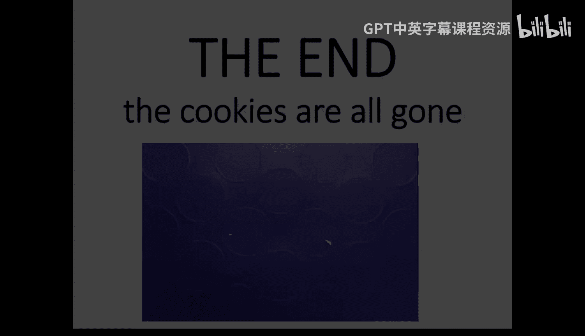

# 杜克大学《Python编程实践｜Practical Python： Start Your Programming Journey》中英字幕 p58 58_04_02_制作Python标志饼干.zh_en -BV1tTmCBWEQD_p58-

Today we're going to make Python logo cookies。

You'll be able to make cookies to share with your friends， so let's get started。

I have a cup of butter， which is two sticks， and I've already gone ahead and put it in here。

 and you want it softened but not melted。We add one and a half cups of sugar。

And we're going to stir up。Keep stirring until it's really creamy。Next， we're going to add two eggs。

Here's the two eggs。And one teaspoon of vanilla extract。Startir it up good。Next。

 add three cups of flour， there's one。There's two。And three。Add half a teaspoon of baking powder。

And half a teaspoon of salt。Then stir it up again。You have to scoop underneath and make sure you get all the flour。

Hey， are the cookies ready yet？Not yet。When it's good and doughy。Then get some plastic wrap。

And make three sheets of plastic wrap。Then make the dough into three balls。

And lay them on the plastic wrap。Then wrap them up。

And you're going to freeze them for just a little while， you can do it overnight。

 or you can just do it for a little while to make the dough a little bit firmer。

 and then you're ready to start making the cookies。The dough is nice and cold。

 so we're going to go ahead and roll it out。I'm going to cut it in half。

And I'm going to put flour down。Allright。Are they ready yet Oh， cookies aren't ready yet？

I put flour on the rolling pin too。Yeah。Now I have a thin spalor。

 and I'm going to pick up the dough and put it on the cookie sheet。There we go。6。

How to cut out cookies， what I've done。Is I have a picture of the logo。And then I've cut out a piece。

 and I'm just going to lay it on there。And I'm going to get a knife。And I'm going to cut it out。Now。

 alternatively， you could make a 3D cookie cutter。What I did was， I got a。Cookie， crafting kit。

And I made。A cookie cutter out of that。So I'm going to use that for the rest of the dough。

I also got a cookie cutter set of numbers that had a little tiny round piece in it。

And I'm going to use that to cut out the eyes。I mean we just pull the dough off。Well。

 so don't forget to preheat the oven to 350 degrees。 I'll do that now。There。

We now have a tray full of cookies and let's put them in the oven。They'll bake for 15 minutes。

Those cookies smell really good。Oh， they're ready。Let's get him out of the oven。

There we have the cookies are baked。Now I'm going to get a sheet of wax paper。

And I'm going to set them on that to cool， and then we'll ice them。Be careful where you put the hole。

 this one， I put it in the tail。Oh， no。Now we're going to ice the cookies。

Going to push them up a little bit。We're going to get some white icing。And we're going to stir it up。

And we're going to split it into two bowls。あ。I like to use gel icing。 I've got golden yellow here。

There， that looks pretty good。And then I'm going to use royal blue。And that looks pretty good。

Now we're ready to ice the cookies。So I'm just going to get a knife and plop it on。

And we have one golden yellow Python。Now let's paint some blue Python cookies。

And now we have a blue Python cookie。Now the cookies are iced。They need to dry for a couple of hours。

 and then I'll let my family have a few， and I'll take the rest into work to share。And we now have。

Python logo cookies。They still need to dry a little bit。Anyway。

 I hope you enjoy making them and sharing them with your friends。

After making these cookies， you can eat them with your friends， oh boy。嗯 really咁嗯。Enjoy the cookies。

Okay。The end。

The cookies are all gone。

