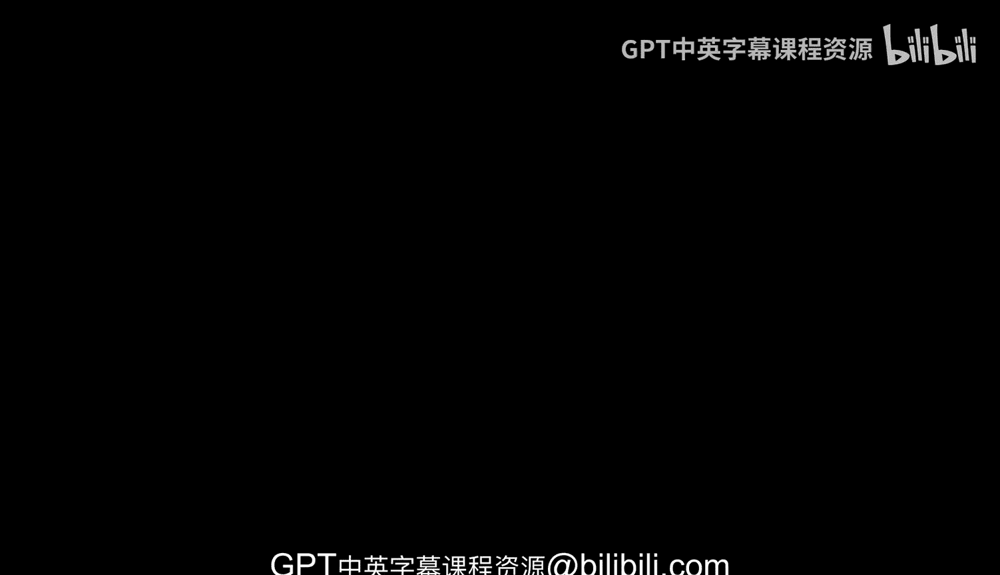
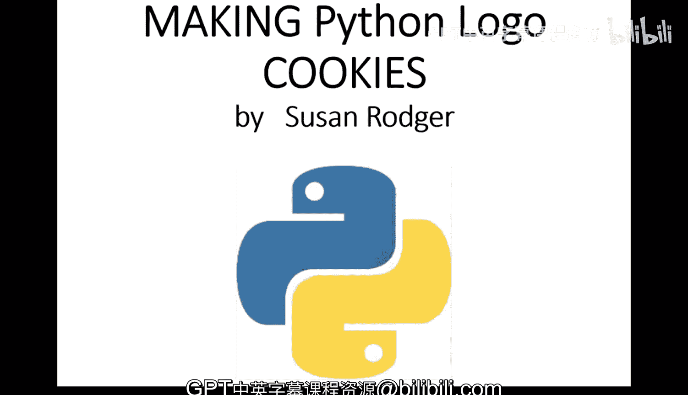
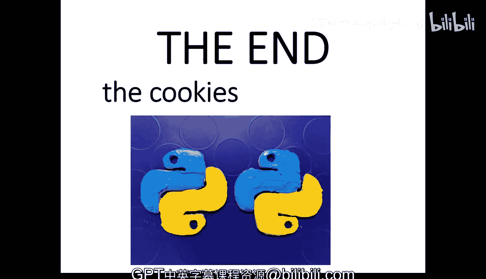
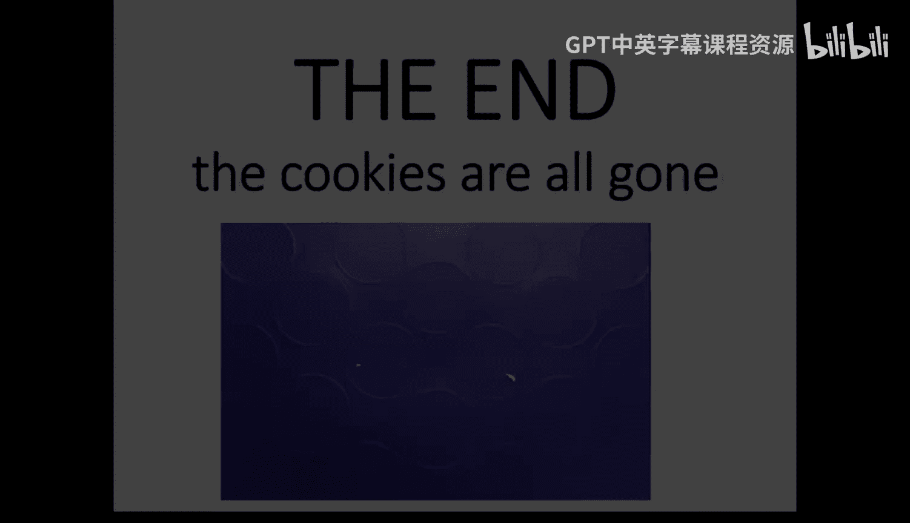

# Python编程实践：58：制作Python标志饼干 🍪

在本节课中，我们将学习如何制作印有Python标志的饼干。你将能够亲手制作饼干并与朋友分享。整个过程分为准备面团、塑形、烘烤和装饰几个主要步骤。

---

## 准备面团材料

上一节我们介绍了课程目标，本节中我们来看看制作饼干所需的具体材料。

以下是制作面团所需的全部材料清单：
*   一杯黄油（约两条）
*   一杯半白糖
*   两个鸡蛋
*   一茶匙香草精
*   三杯面粉
*   半茶匙泡打粉
*   半茶匙盐

---

## 混合面团

准备好材料后，我们开始混合面团。

1.  将软化（非融化）的黄油与白糖放入碗中，搅拌至质地柔滑。
2.  加入两个鸡蛋和一茶匙香草精，继续搅拌均匀。
3.  分次加入三杯面粉、半茶匙泡打粉和半茶匙盐。
4.  充分搅拌，确保碗底的面粉也完全混合。

---

## 冷藏面团

面团混合均匀后，需要将其冷藏以方便后续操作。

1.  准备三张保鲜膜。
2.  将面团分成三份，分别揉成球状。
3.  用保鲜膜分别包裹好面团球。
4.  将面团放入冰箱冷冻一段时间，可以过夜或仅冷冻至面团变硬。

---

## 擀面与切割

面团冷藏好后，我们开始擀开并切割成Python标志的形状。

1.  在案板和擀面杖上撒一些面粉防粘。
2.  取出一份面团，用擀面杖擀成薄片。
3.  将擀好的面片转移到烤盘上。
4.  使用Python标志的图案作为模板，用刀沿着轮廓切割。也可以使用自制的3D饼干切模。
5.  使用小型圆形切模（例如数字饼干切模中的小圆点）切出标志的“眼睛”部分。
6.  预热烤箱至 **350华氏度（约177摄氏度）**。

---

## 烘烤饼干

切割好形状后，就可以进行烘烤了。

1.  将切割好的饼干生坯放入预热好的烤箱。
2.  烘烤约 **15分钟**，直至饼干烤熟。
3.  将烤好的饼干取出，放在蜡纸上冷却。

---

## 装饰饼干

饼干冷却后，最后一步是进行装饰。

1.  准备白色糖霜，并将其分到两个碗中。
2.  在一个碗中加入金黄色食用色素凝胶，另一个碗中加入皇家蓝色食用色素凝胶，分别调匀。
3.  用抹刀将糖霜涂抹在冷却的饼干上，制作出金黄色和蓝色的Python标志饼干。
4.  涂抹好糖霜的饼干需要静置数小时，待糖霜完全干燥。

---

## 总结与分享

本节课中我们一起学习了制作Python标志饼干的完整流程，从准备材料、混合面团、塑形、烘烤到最终装饰。

饼干干燥后，你就可以与家人、朋友或同事分享你的作品了。希望你能享受制作和分享的乐趣。