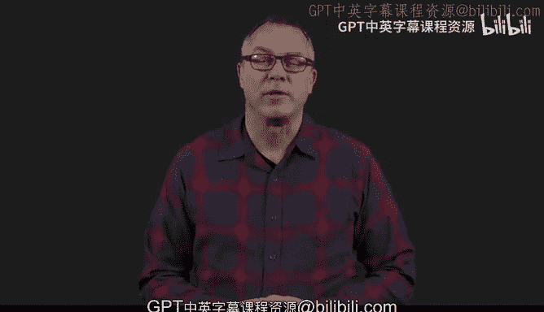

#  002：肯尼迪·贝尔曼 👨‍🏫

在本节课中，我们将认识本课程的讲师肯尼迪·罗伯特·贝尔曼，并了解课程的核心内容和目标。

大家好，欢迎来到《数据工程中的Python与Pandas》课程。我是肯尼迪·罗伯特·贝尔曼。

我是一名高级数据工程师、作家和教育工作者。我使用Python管理数据已有数十年经验。

本课程将为你提供开启数据工程职业生涯所需的技能。

我们将涵盖Python项目的正确设置、Python编程基础、介绍强大的Pandas库，并介绍一些流行的开发环境。

我希望你和我一样对深入学习这些内容感到兴奋。让我们开始吧。

---

上一节我们认识了讲师，本节中我们来看看本课程将要涵盖的具体内容。以下是课程的核心模块：

1.  **Python项目设置**：学习如何为数据工程项目搭建一个规范、高效的Python开发环境。
2.  **Python编程基础**：掌握Python语言的核心语法和概念，为数据处理打下坚实基础。
3.  **Pandas库介绍**：探索专为数据分析设计的强大库Pandas，学习其核心数据结构和操作。
4.  **开发环境**：了解并实践几种在数据工程领域流行的集成开发环境（IDE）和工具。

---

本节课中我们一起学习了课程讲师肯尼迪·贝尔曼的简介，并概述了本课程将涵盖的四个主要技能模块：Python项目设置、Python基础、Pandas库以及开发环境。这些内容是步入数据工程领域的重要第一步。

