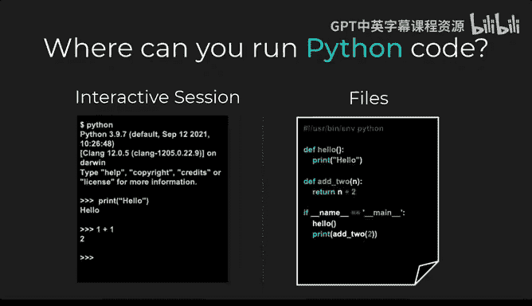
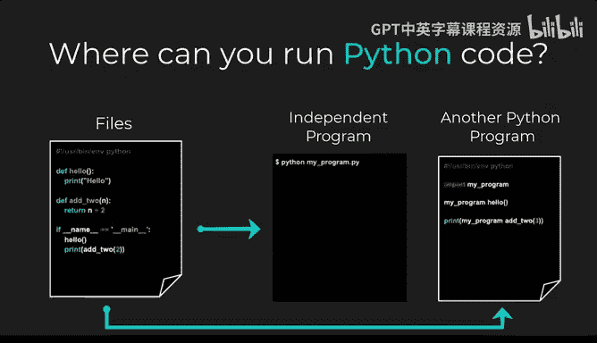
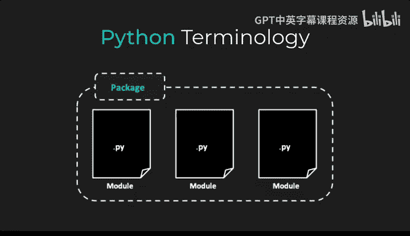
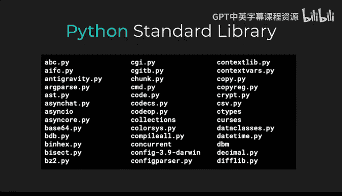
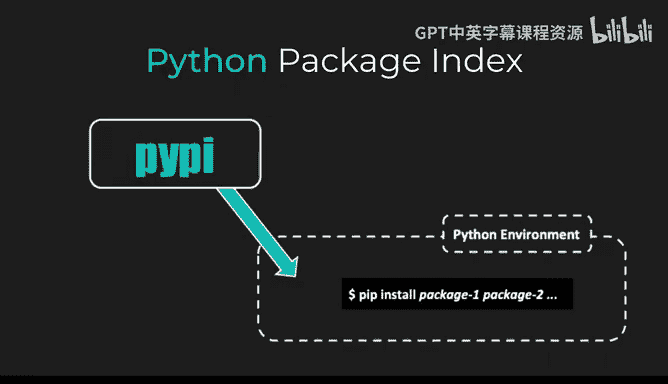
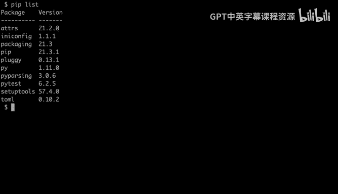

#  005：使用pip安装Python包 📦


在本节课中，我们将学习如何使用pip来管理Python包。我们将涵盖如何列出已安装的包、安装新包（包括特定版本）、卸载包以及升级现有包。

## 什么是Python包？🤔

Python代码可以通过在命令行输入`python`进入交互式会话运行，也可以从文件中运行。




当Python代码被保存到文件中时，该文件中的代码可以作为一个独立的程序运行，或者被导入并在另一个Python程序中使用。



当代码被保存到文件中以便重复使用时，它被称为一个**模块**。

当一个模块或一组模块被打包在一起，专门用于分发和安装到多个Python环境中时，它就被称为一个**包**。

## Python标准库与第三方包



每个Python安装都附带一组被称为**Python标准库**的包。这些包可以在任何Python程序中使用。



除了标准库，还有一个庞大的**第三方包**生态系统。这些包为默认安装增添了各种专业功能。这些包的主要存放地是**Python包索引**，也被称为PyPI。

## pip：Python包管理器

**pip**是Python的包安装程序。它是管理Python包安装的默认工具。默认情况下，它会从Python包索引下载并安装包，但它也可以指向其他位置。从Python 3.4版本开始，pip作为Python默认安装的一部分被安装。

## 检查Python环境

要查看您环境中使用的Python版本，请打开一个shell并输入带有版本标志的`python`命令：
```bash
python --version
```
在许多系统上，存在多个Python安装。通常有一个遗留的Python 2副本和一个较新的Python 3版本。可以通过别名访问它们，通常`py2`或`python2`对应Python 2版本，`py3`或`python3`对应Python 3版本。如果您的默认Python版本是Python 2，请在本课程的示例中使用`python3`别名。



## 使用pip

pip通常可以通过两种方式调用：
1.  使用Python模块方式调用：`python -m pip`
2.  作为一个独立的命令：`pip`

`pip help`命令会列出所有可用的命令和通用选项。要查看特定命令的文档，请在help命令后键入命令名称。

在本节课的剩余部分，我们将使用三个命令：`list`、`install`和`uninstall`。

### 列出已安装的包

`list`命令会列出当前环境中已安装的包及其版本号。
```bash
pip list
```

### 安装包

使用`install`命令，后跟一个模块名或模块名列表来安装它们。

以下是安装流行的测试库`pytest`的示例：
```bash
pip install pytest
```
我们可以看到，pip不仅安装了`pytest`，还安装了我们没有明确要求的其他包。这些是`pytest`所依赖的包。pip会自动安装我们请求的包所需的库。

### 安装特定版本

默认情况下，`install`命令会安装可用的最新版本。我们可以通过在模块名后使用双等号来安装特定版本。

一个查看有哪些版本可用的技巧是留出版本号空白：
```bash
pip install pytest==
```
这会显示一个错误，但错误信息会报告所有可用的版本。

要安装特定版本，请将版本号直接放在双等号后面：
```bash
pip install pytest==6.2.5
```
我们可以看到指定的版本被安装了。

### 卸载包

要卸载一个包，请使用`uninstall`命令，后跟包名。
```bash
pip uninstall pytest
```
请注意，pip卸载了`pytest`，但没有卸载其依赖项。我们也必须用`uninstall`命令明确命名它们才能将其移除。

### 升级包

如果我们希望升级到包的最新版本，我们可以先卸载再重新安装，或者使用`install`命令的`--upgrade`选项。
```bash
pip install --upgrade pytest
```
现在，该包已升级到最新版本。

## 总结



在本节课中，我们一起学习了Python包的基本概念以及如何使用pip进行包管理。您学会了如何列出环境中的已安装包、安装新包（包括指定版本）、卸载包以及升级现有包。现在，是时候在您自己的环境中尝试这些操作了。