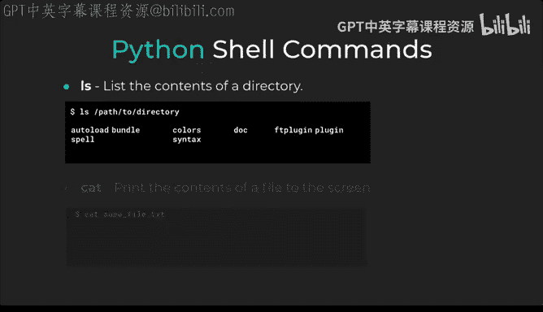
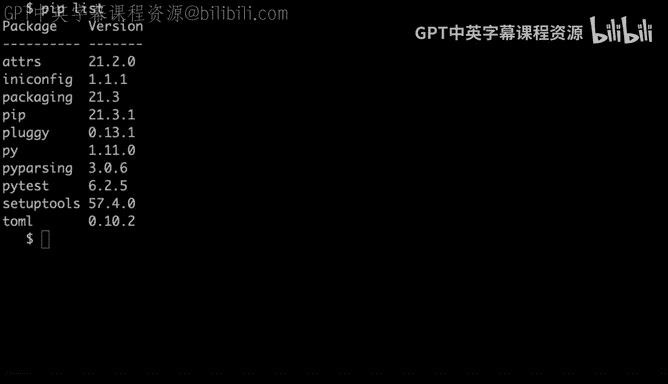
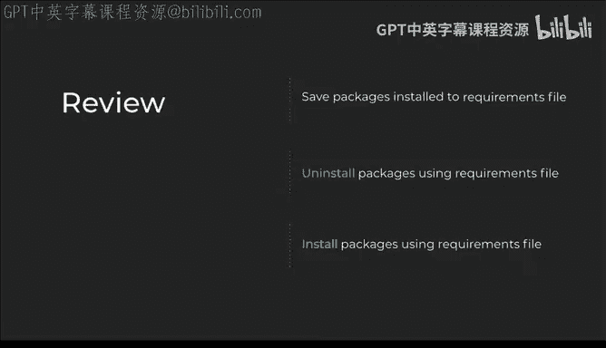

#  006：06_01_04_保存Python依赖文件 📦

在本节课中，我们将学习如何保存Python包安装的当前状态到一个需求文件中，以及如何使用该文件来安装和卸载包。掌握这项技能是确保项目可移植性和可复现性的关键。

## 概述

当你完成一个Python项目所需的包安装后，最佳实践是保存这些包的记录。这能使你的项目具有可移植性，意味着你可以在不同的机器上设置并运行你的项目。例如，当你的Python程序开发完成后，你可能需要将其部署到生产服务器或分享给同事使用。在这两种情况下，你都需要记录程序运行所依赖的包。

## 准备工作：了解两个Shell命令

在开始之前，我们需要了解两个在本课中会用到的Shell命令：`ls` 和 `cat`。

*   `ls` 命令用于显示当前目录的内容。如果我们提供一个路径，它将显示该路径下的内容。
*   `cat` 命令用于将文件的内容回显到你的屏幕上。

此外，请记住 `pip list` 命令会显示当前已安装的包及其版本号。

## 第一步：查看已安装的包

首先，让我们查看当前环境中已经安装了哪些包。我们可以使用 `pip list` 命令。

```bash
pip list
```

`pip freeze` 命令会显示相同的信息，但其输出格式可以与 `install` 和 `uninstall` 命令配合使用。

## 第二步：生成需求文件



我们可以使用重定向操作符（即右尖括号 `>`）将 `pip freeze` 的输出重定向到一个文件中，从而生成需求文件。

```bash
pip freeze > requirements.txt
```

这里，我们将文本输出到一个名为 `requirements.txt` 的文件。任何文件名都可以，但惯例是将其命名为 `requirements.txt`。

我们可以使用 `cat` 命令来查看这个文件的内容。

```bash
cat requirements.txt
```

你会看到文件中列出的包与环境中安装的包是匹配的。

## 第三步：使用需求文件卸载包

要卸载需求文件中列举的所有包，可以在 `pip uninstall` 命令后使用 `-r` 标志并指定文件名。

```bash
pip uninstall -r requirements.txt -y
```

（注意：`-y` 参数用于自动确认卸载，避免交互式提示。）

执行后，我们可以再次使用 `pip list` 来查看，会发现只剩下Python自身运行所必需的基础包。

## 第四步：使用需求文件安装包

更常见的用法是将需求文件与 `pip install` 命令结合使用，以在新环境中一键安装所有依赖。同样使用 `-r` 标志和文件名。



```bash
pip install -r requirements.txt
```

安装完成后，我们可以再次使用 `pip list` 命令来检查安装结果。

这是为他人项目进行环境配置，或在自己新环境中重建项目依赖的标准方法。



## 总结


在本节课中，我们一起学习了如何创建一个记录包安装状态的需求文件，以及如何使用该文件来安装和卸载包。现在，你应该练习创建和使用需求文件，这是管理Python项目依赖的核心技能。