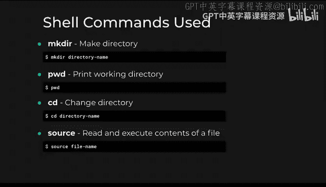
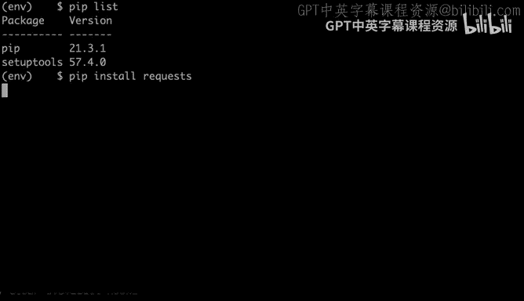
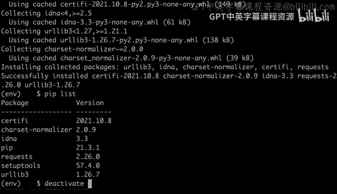
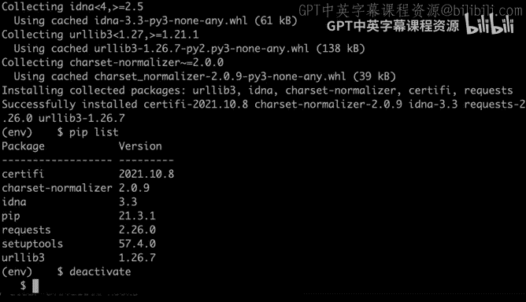
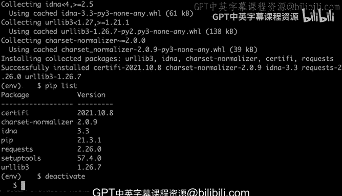

#  007：创建与使用Python虚拟环境 🐍


在本节课中，我们将要学习如何创建和使用Python虚拟环境。虚拟环境是管理项目依赖、避免版本冲突的重要工具。我们将从创建环境开始，逐步学习激活、使用以及退出环境的完整流程。

---

## 概述 📋

默认情况下，安装Python包会将其安装到全局用户环境中。这意味着该环境中的所有项目都会共享这些包。

如果仅在本地开发，这通常没有问题。但如果希望开发可移植的项目，共享依赖会导致两个问题。

以下是这两个问题的具体说明：

第一，确定单个项目具体需要哪些包具有挑战性。如果从一个共享环境中重新生成需求文件，该文件可能会引用当前项目不需要的包。当随项目分发这些需求时，安装不需要的包会浪费时间和磁盘空间。

第二，随着时间的推移，可能会出现不同项目需要同一包的不同版本的情况。如果共享已安装的包，则需要在切换项目时更改已安装的版本，或者不断更新旧项目以使用新的包版本。

为了避免这些挑战，理想的做法是为每个项目配置一个独立的环境。

实现这一目标有多种方法，包括虚拟机和容器。但对于Python项目，一个轻量级的选择是使用Python虚拟环境。

当处于Python虚拟环境中时，安装的包仅会安装到该环境中。为每个项目创建一个虚拟环境很容易，从而可以隔离每个项目的依赖关系。

创建虚拟环境时，需要指定一个位置来存储相关的包和配置。

关于存储虚拟环境的最佳位置存在不同观点。一种惯例是将所有虚拟环境存储在一个中心位置，通常是在主目录的子目录中。另一种是将其存储在相关的项目目录中。

历史上，创建虚拟环境的能力依赖于`virtualenv`包。但从Python 3.5版本开始，标准库提供了`venv`模块。

在本节课中，我们将介绍以下Shell命令：
*   `mkdir`：用于创建新目录。
*   `pwd`：显示当前位置的路径。
*   `cd`：进入指定目录。
*   `source`：读取并执行文件内容。

---

## 创建项目目录 📁

设置新项目的第一步是创建一个目录来存放其代码和文档。

让我们使用`mkdir`命令创建一个名为`my_first_project`的目录。

```bash
mkdir my_first_project
```

现在，我们可以使用`cd`命令进入这个目录，并使用`pwd`命令查看我们当前所在的位置。

```bash
cd my_first_project
pwd
```

---

## 创建虚拟环境 ⚙️

上一节我们创建了项目目录，本节中我们来看看如何在该目录中创建虚拟环境。

要创建虚拟环境，我们使用Python的`-m`模块标志调用`venv`模块，并指定我们希望存储新环境的路径。

在这个例子中，我们将环境命名为`.venv`，并将其存储在当前项目目录中。

```bash
python3 -m venv .venv
```

使用`ls`命令，我们可以看到该命令创建了一个以环境名称命名的新目录。

```bash
ls -la
```

如果我们查看这个目录内部，会看到三个子目录和一个配置文件。



```bash
ls -la .venv/
```

---

## 激活与使用虚拟环境 🚀

创建环境后，我们需要激活它才能使用。

我们通过执行环境目录下`bin`子目录中的`activate`脚本来实现。

```bash
source .venv/bin/activate
```

现在，我们已处于虚拟环境中。命令提示符通常会发生变化，显示环境名称（如`(.venv)`）。

我们可以使用`pip list`来查看当前环境中可用的包，此时应该只显示必需的最小包集合。

```bash
pip list
```

如果我们在环境中安装一个包，它将仅为此环境安装。

```bash
pip install requests
```

这意味着，如果我们在该环境中创建需求文件，它将仅反映我们为此项目安装的包。

```bash
pip freeze > requirements.txt
```

---



## 停用虚拟环境 🛑

当我们准备停止在此项目上工作时，需要停用该环境。

`venv`模块会自动提供一个`deactivate`命令。

```bash
deactivate
```



现在，我们回到了共享的全局用户环境中。

---

## 总结 ✨

本节课中，我们一起学习了Python虚拟环境的完整使用流程。



我们首先了解了为什么需要虚拟环境，然后逐步实践了如何创建项目目录、使用`venv`模块创建虚拟环境、通过`source`命令激活环境、在环境中使用`pip`安装包，以及最后使用`deactivate`命令退出环境。



掌握虚拟环境的使用，是进行规范、可移植的Python项目开发的基础技能。