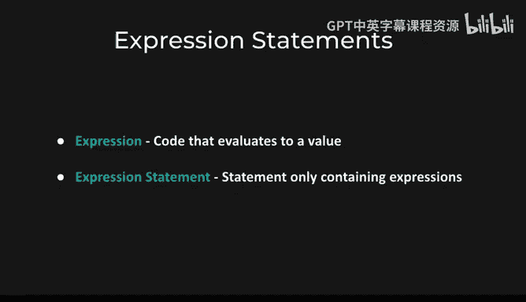
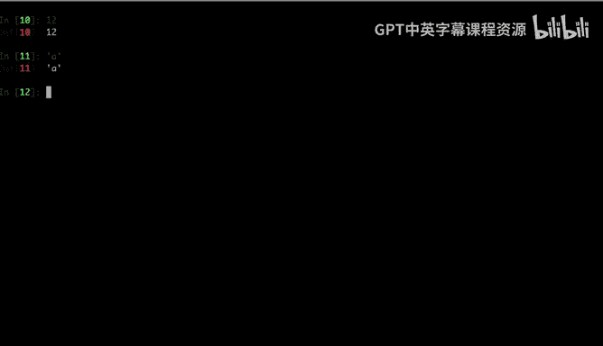

#  008：Python中的表达式语句 🐍

在本节课中，我们将学习如何安装和运行IPython，使用IPython交互式shell来运行代码，并执行Python的表达式语句。

Python程序由一系列语句构成。语句被定义为一行独立的逻辑代码。语句通常可以分为简单语句和复合语句。我们将要学习的第一个简单语句就是表达式语句。

一个Python表达式是一段能够计算出某个值的代码。表达式语句是一种只包含一个表达式的简单语句。

## 启动交互式Python Shell 💻

表达式语句在交互式Python shell中通常更为实用。正如我们之前所见，你可以在命令行中通过输入 `python` 来打开一个交互式shell。这会打开默认的Python shell，它包含在任何Python安装中。

多年来，人们在这个shell的基础上构建了功能更丰富的shell。其中最流行的是IPython shell。

以下是安装和启动IPython的步骤：

*   你可以使用 `pip` 来安装IPython shell。
*   安装完成后，你可以使用命令 `ipython` 来打开这个shell。

## 执行表达式语句 ➕➖✖️➗

在交互式shell中输入一个语句并按回车键后，该语句会被执行，并且任何返回值都会显示出来。

例如，我们输入了简单的表达式 `1 + 1`，可以看到结果在下一行显示出来。

你可以在shell中执行其他数学运算，例如：

*   **乘法**：`2 * 3`
*   **减法**：`5 - 2`
*   **除法**：`10 / 2`
*   **幂运算**：`2 ** 3`
*   **取模运算**：`7 % 3`

你也可以使用括号来组合这些表达式，例如：`(1 + 2) * 3`。

## 查看对象的值 👀

如果你在输入一个单独的对象后按回车键，例如数字 `12` 或引号中的 `‘a’`（我们称之为字符串），该值会被回显为输出。

在我们介绍了变量和导入模块之后，这个功能会变得非常有用。但现在，你只需要记住：如果你想查看一个Python对象包含什么值，你可以在交互式shell中直接输入它的名字，然后查看返回的结果。

---

在本节课中，我们一起学习了如何启动交互式Python shell，使用IPython shell交互式地运行代码，以及执行Python表达式语句。现在，你应该尝试在IPython shell中使用表达式语句了。