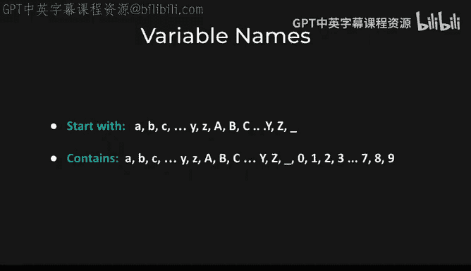
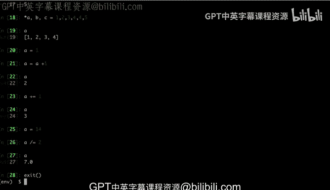

#  009：Python中的赋值语句

在本节课中，我们将学习如何为变量赋值、如何在表达式中使用变量、如何为多个变量赋值，以及如何通过表达式更新变量的值。

---

接下来我们将讨论的语句类型是赋值语句。这些语句用于为变量赋值。这里的“值”可以是Python中的任何数据类型，例如数字、文本或其他对象。

变量是一个指向数据的名称。理解变量是指向数据的引用，而非数据本身，这一点非常重要。多个变量可以指向同一个值，并且已存在的变量可以被改变以指向不同的值。

变量名必须以字母或下划线开头。变量名中的所有字符必须是字母、数字或下划线。



请记住，Python的变量名是区分大小写的。

---

让我们打开一个iPython交互式环境来演示变量赋值。要为变量赋值，我们使用赋值操作符，即等号 `=`。

```python
A = 1
```

这里我们将值 `1` 赋给了名为 `A` 的变量。在交互式会话中，我们可以通过直接输入变量名来轻松检查其值。


```python
A
```

我们现在可以在表达式中使用这个变量。例如，由于我们变量 `A` 的值是一个数字，我们可以对其执行数学运算。

```python
A + 2
```

我们也可以将一个表达式的结果赋值给一个变量，并在变量之间进行操作。

```python
B = A * 3
C = A + B
```

---

我们可以通过链式赋值，将多个变量赋给同一个值。

```python
x = y = z = 10
```

我们也可以通过逗号分隔，将多个值赋给多个变量。这些值将按照给定的顺序进行赋值。

```python
a, b, c = 1, 2, 3
```

如果你想赋值的数量多于变量名的数量，可以使用星号操作符 `*`。当给定的值组比变量名组长时，带有星号的变量名将被赋予额外的值。

```python
first, *rest = [1, 2, 3, 4, 5]
```

星号可以放在任何一个变量名前。

---

你可以将一个使用相同变量的表达式的结果赋值给该变量本身。例如，如果我们先将变量 `A` 赋值为 `1`：

```python
A = 1
```

然后，我们可以使用其当前值在一个表达式中更新它的值。

```python
A = A + 1
```

这种操作非常常见，因此有专门的语法快捷方式，称为**增强赋值**。所以，我们可以用增强赋值操作符 `+=` 来代替之前的表达式。

```python
A += 1
```

现在我们可以看到 `A` 的值增加了我们指定的量。所有数学运算都有对应的增强赋值操作符。

例如，如果我们设置 `B = 14`，然后希望将其重新赋值为除以 `2` 的结果，我们可以使用增强除法赋值操作符 `/=`。

```python
B = 14
B /= 2
```

操作符后面跟上我们希望除以的数字。

---

要退出Python环境，需要使用 `exit()` 命令。

---

本节课中，我们一起学习了如何为变量赋值、如何在表达式中使用变量、如何为多个变量赋值，以及如何通过表达式更新变量的值。现在你应该尝试练习使用变量了。



