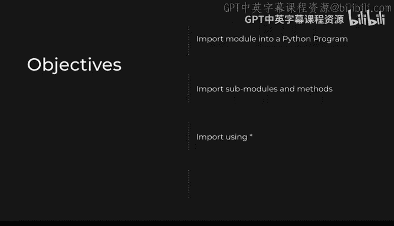
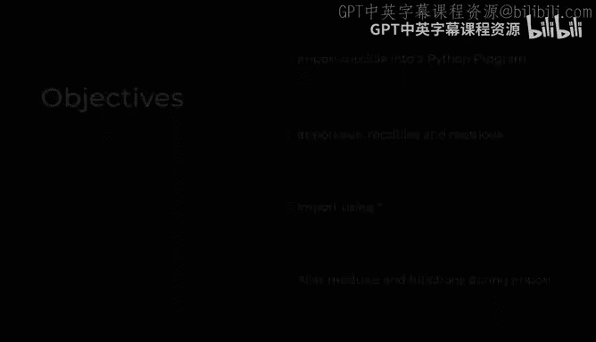
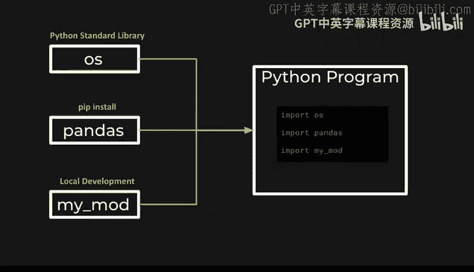
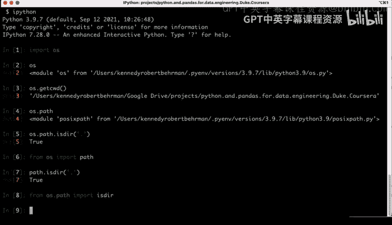
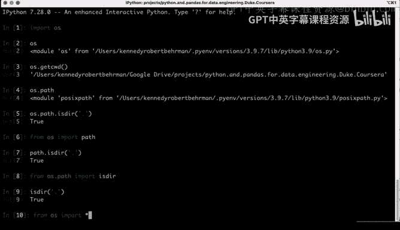
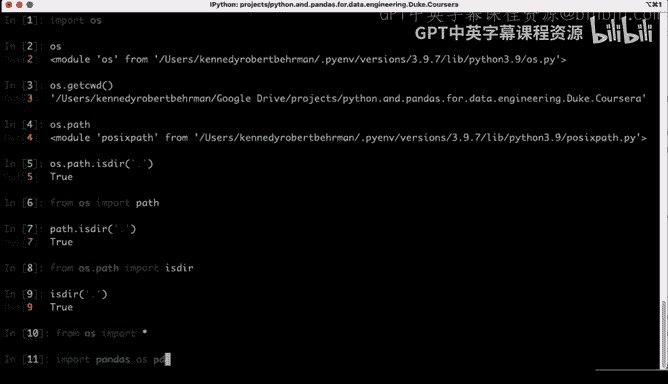
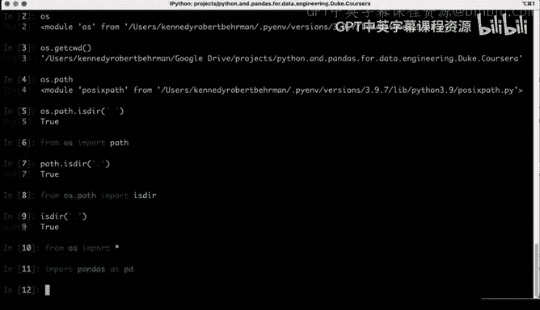
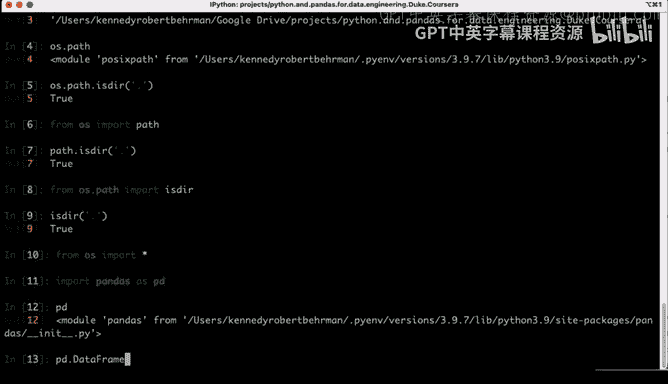
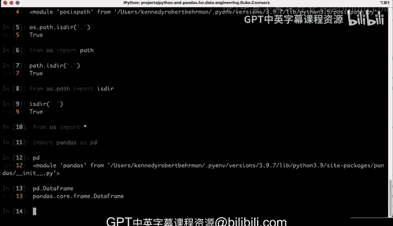

#  010：Python中的导入语句 📦


在本节课中，我们将要学习如何在Python程序中导入模块。导入是使用外部代码库功能的基础，掌握不同的导入方式能让你的代码更清晰、更高效。





## 概述

为了在Python程序中使用包或模块，必须将其加载到程序的运行内存中。这通过**导入语句**实现。你可以导入Python标准库中的模块、使用PIP安装的库，或者你自己编写的模块。



## 导入基础模块

上一节我们介绍了导入的必要性，本节中我们来看看最基本的导入方式。

要导入一个模块，使用 `import` 关键字，后跟模块名。导入后，该模块在当前交互会话或运行的程序中即可用。

以下是导入标准库 `os` 模块的示例：
```python
import os
```
现在，我们可以使用点语法访问该模块中定义的函数，例如获取当前工作目录的函数：
```python
os.getcwd()
```
点语法用于访问模块的函数、属性和子模块。

## 导入子模块和特定函数

有时我们只需要模块的一部分。Python提供了 `from ... import ...` 语法来实现精确导入。

以下是导入子模块和特定函数的两种方式：
1.  仅导入子模块：
    ```python
    from os import path
    ```
    之后可以直接使用 `path`，而无需前缀 `os.`。
2.  导入特定函数：
    ```python
    from os.path import isdir
    ```
    之后可以直接调用 `isdir()` 函数。



## 使用星号语法导入

Python允许使用星号 `*` 作为通配符，一次性导入模块的所有内容。



以下是使用星号语法导入的示例：
```python
from os import *
```
虽然这种方法可行，但通常不推荐。通用约定是导入整个模块，或者仅导入程序中需要使用的子模块和函数，以避免命名冲突和保持代码清晰。

## 使用别名导入



在导入时，可以使用 `as` 关键字为模块或函数创建别名。这在模块名较长或遵循特定社区惯例时非常有用。





在数据科学领域，一个常见的惯例是将 `pandas` 库导入并重命名为 `pd`：
```python
import pandas as pd
```
之后，便可以使用 `pd` 来访问该模块的所有功能：
```python
df = pd.DataFrame()
```

## 总结



本节课中我们一起学习了Python中多种导入模块的方法。你学会了如何将模块导入Python程序、如何导入特定的子模块或方法、如何使用星号语法导入，以及在导入时如何为模块或函数设置别名。现在，是时候尝试在你自己的Python会话中实践这些导入技巧了。