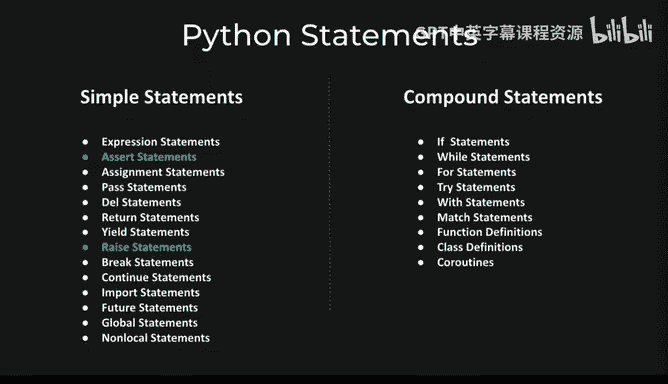
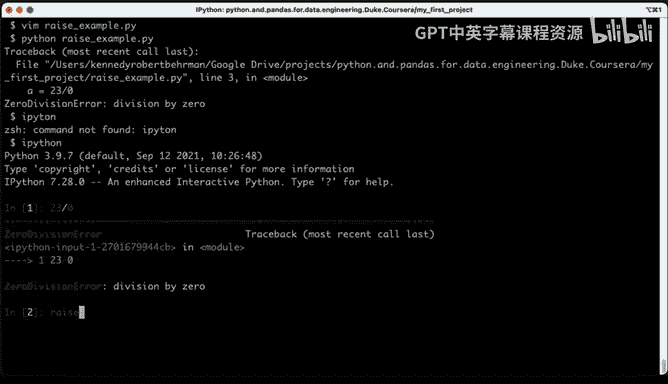
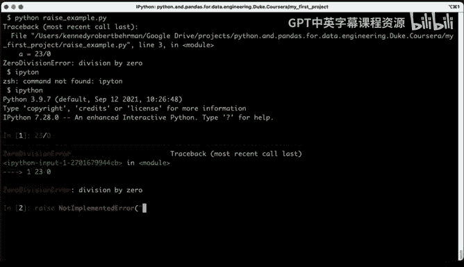
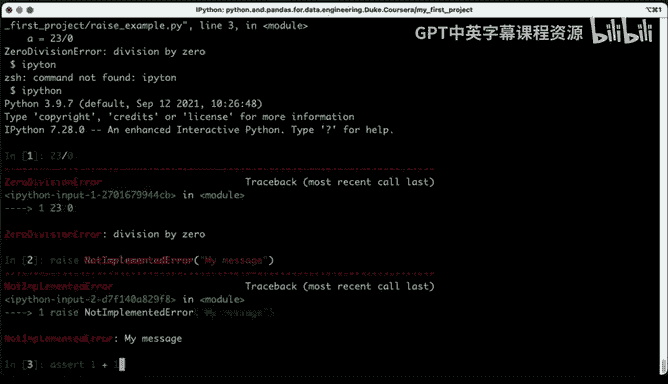
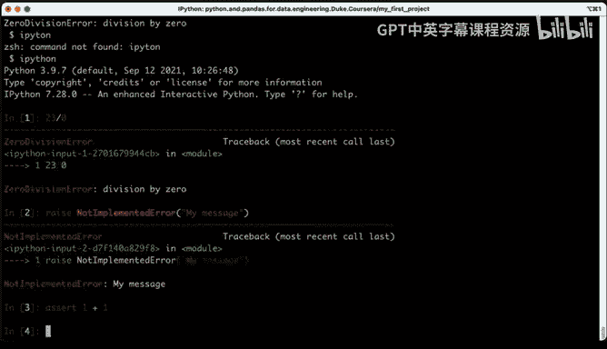
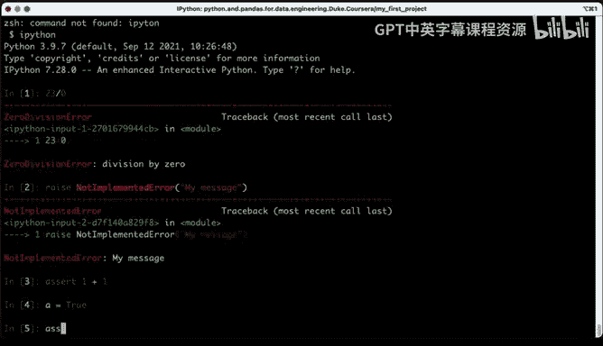
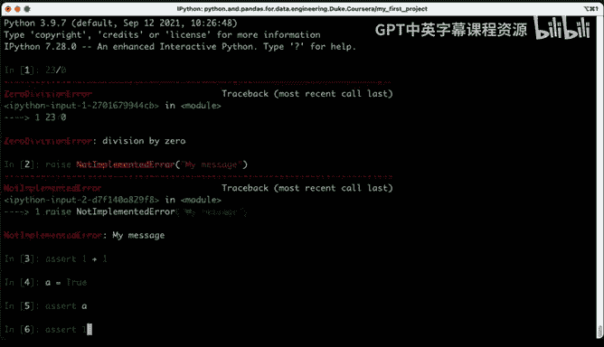
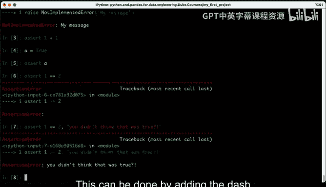
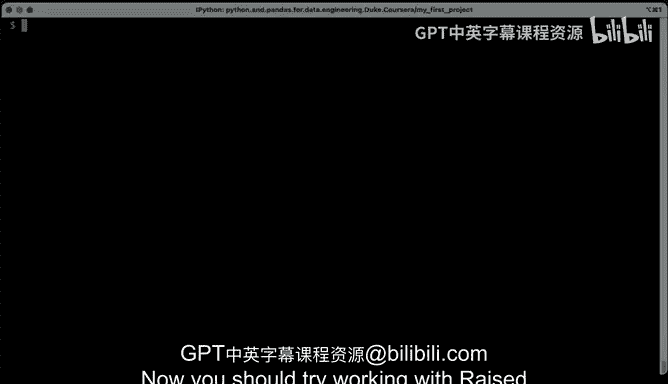

#  011：Python中的其他简单语句 🐍


在本节课中，我们将学习Python中除表达式、赋值和导入语句之外的其他简单语句。我们将重点探讨与异常处理相关的 `raise` 语句和 `assert` 语句，理解它们的作用和使用场景。

---

## 什么是异常？ ⚠️

异常是会导致程序停止执行的错误。

例如，在下面的程序中，我们尝试将一个表达式的值赋给变量，然后使用 `print` 函数显示该变量的值。

```python
result = 10 / 0
print(result)
```

问题在于，表达式 `10 / 0` 进行了除以零的操作。当我们运行这个程序时，会看到抛出了一个 `ZeroDivisionError` 异常。这个异常在发生点停止了程序，后续的代码行（如 `print` 语句）将不会被执行。

异常信息中包含一个“回溯”，它显示了异常发生的行以及导致异常的语句。

在交互式环境（如IPython shell）中执行相同的表达式，异常信息会被显示，但shell本身不会退出，这与运行脚本文件不同。



---

## `raise` 语句 🚨

`raise` 语句用于主动引发一个异常。其语法是关键字 `raise`，后跟一个异常类，括号内可以包含一个可选的消息。

```python
raise NotImplementedError("这个功能尚未实现")
```

上面的代码引发了内置的 `NotImplementedError` 异常。当我们定义了一个函数名但尚未实现其行为时，这个异常非常有用。

Python 提供了许多内置的异常类型。你也可以通过对象继承定义自己的异常类，但这超出了本课程的范围。

---



## `assert` 语句 ✅

`assert` 语句用于确认程序中的某个条件为真。它可以是一个表达式，也可以是一个变量。



如果表达式为真，`assert` 语句不会执行任何操作。

```python
assert 1 + 1 == 2  # 条件为真，无事发生
assert my_variable > 0  # 假设 my_variable 值为 5，条件为真
```

然而，如果表达式为假，则会引发一个 `AssertionError` 异常。

```python
assert 1 + 1 == 3  # 条件为假，引发 AssertionError
```



你可以在 `assert` 语句后添加一个错误消息。



```python
assert temperature > 0, "温度必须高于零度"
```



当断言失败时，这个错误消息会作为异常信息的一部分显示出来。



`assert` 语句通常用于程序开发或调试阶段。因为它们会减慢程序的运行速度，所以在运行生产代码时通常会禁用它们。这可以通过在运行 Python 程序时添加 `-O` 标志来实现。

```bash
python -O my_program.py
```

使用 `-O` 标志后，程序中的 `assert` 语句将不会被执行。

---



## 总结 📚

在本节课中，我们一起学习了 Python 中两个重要的简单语句：`raise` 语句和 `assert` 语句。

*   `raise` 语句允许你主动引发异常，用于指示程序执行过程中出现了预期或非预期的错误情况。
*   `assert` 语句是一种调试辅助工具，用于在代码中声明必须为真的条件，如果条件不成立，则会引发异常。



现在，你应该尝试在代码中练习使用 `raise` 语句和 `assert` 语句，以更好地掌握它们在实际编程中的应用。