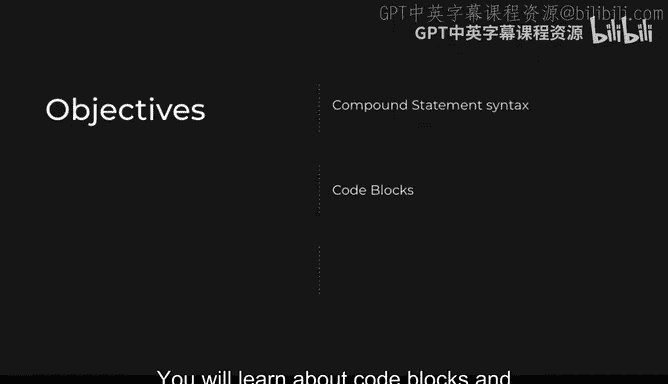
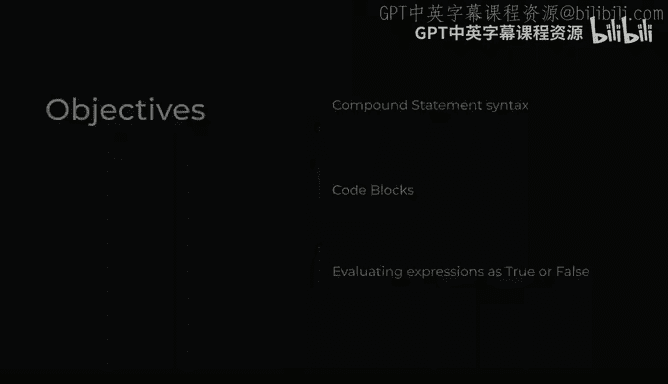
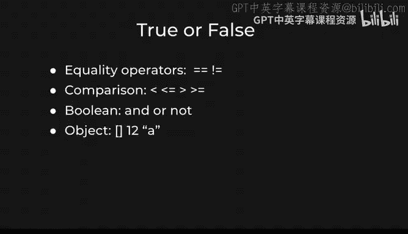
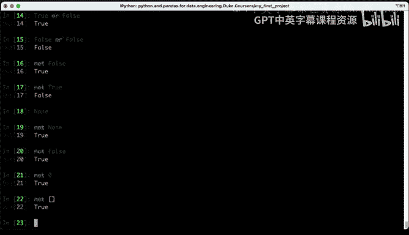

#  012：Python中的复合语句 🐍


在本节课中，我们将要学习Python中复合语句的基本语法。你将了解什么是代码块，以及如何将表达式评估为真（True）或假（False）。这些概念是编写条件判断和循环等复杂程序逻辑的基础。

---



## 复合语句的通用语法



复合语句由一个控制语句和一组被控制的语句组成。控制语句决定了被控制语句的执行方式。

控制语句通常是一个关键字、一个表达式，后面跟着一个冒号 `:`。

被控制的语句可以通过以下两种方式之一进行分组。

---

## 代码块分组方式

更常见的方式是将它们分组为一个**代码块**。在Python中，一个代码块是一组共享相同缩进级别的语句。当出现缩进更少的行时，代码块即告结束。

以下是代码块的示例：
```python
if condition:
    # 这是代码块内的语句
    statement1
    statement2
# 缩进恢复，代码块结束
```

---

## 单行分组方式

另一种分组方式是将被控制的语句放在与控制语句同一行，并用分号 `;` 分隔。这种方式通常只在被控制语句简短且易于在一行内阅读时使用。

例如：
```python
if x > 0: print(“Positive”); y = x
```

---



## 复合语句的关键字

我们将要学习的几种复合语句的关键字是：`if`、`while`、`for` 和 `def`。

`if` 和 `while` 语句依赖于评估为真或假的表达式。这些表达式主要来自以下几种操作：**相等性操作**、**比较操作**、**布尔操作** 和 **对象评估**。

---

## 评估为真或假的表达式

上一节我们介绍了复合语句的结构，本节中我们来看看构成其判断条件的各种表达式。让我们在IPython环境中逐一查看。

### 相等性操作符

有两种相等性操作符：等于操作符和不等于操作符。

*   **等于操作符**：形式为双等号 `==`。它接受两个参数，如果这两个参数的值相同，则返回 `True`；如果值不同，则返回 `False`。
    *   通常，比较不同类型的对象（例如字符串和数字）时，`==` 操作符总是返回 `False`。
    *   例外情况是数值类型（如浮点数 `float` 和整数 `int`），如果它们的值相同，可以返回 `True`。

*   **不等于操作符**：形式为感叹号加等号 `!=`。如果它的两个参数不相等，则返回 `True`；如果相等，则返回 `False`。

### 比较操作符

比较操作符基于顺序的概念。它们是：小于 `<`、小于或等于 `<=`、大于 `>`、大于或等于 `>=`。

以下是每个操作符的示例：
*   `3 < 5` 返回 `True`，因为第一个参数小于第二个。
*   `5 <= 5` 返回 `True`，因为两个参数相等（满足“小于或等于”）。
*   大于 `>` 和大于或等于 `>=` 的逻辑与之类似。

### 布尔操作符

布尔操作符是 `and`、`or` 和 `not`。

*   `and` 操作符接受两个参数。仅当**两个**参数评估都为 `True` 时，它才返回 `True`；如果任一参数为 `False`，则返回 `False`。
*   `or` 操作符接受两个参数。如果**任一**参数评估为 `True`，它就返回 `True`；仅当两个参数都为 `False` 时，才返回 `False`。
*   `not` 操作符接受一个参数，并返回与该参数布尔值相反的值。

### 对象的真值评估

Python中的所有对象都可以被评估为 `True` 或 `False`。

*   一般来说，大多数对象评估为 `True`。
*   评估为 `False` 的例外情况包括：
    *   常量 `None` 和 `False`。
    *   值为 `0` 的数值类型。
    *   任何长度为0的对象（如空字符串 `""`、空列表 `[]`）。

---

## 总结

本节课中我们一起学习了Python复合语句的核心概念。我们了解了复合语句由控制语句和代码块组成，掌握了代码块通过缩进定义的原则，并深入探讨了用于条件判断的各种表达式，包括相等性比较、大小比较、布尔逻辑以及Python对象的真值评估规则。这些是构建 `if`、`while` 等流程控制语句的基石。



---

接下来，我们将具体学习不同类型的复合语句。