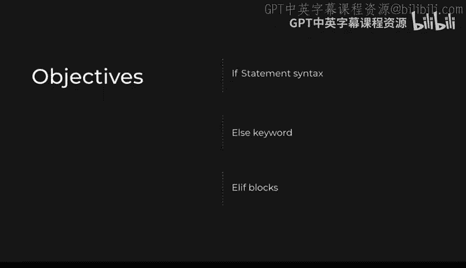
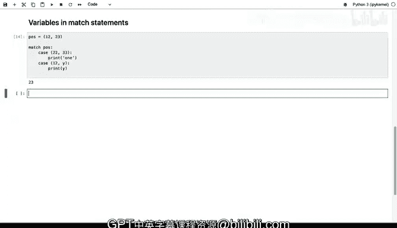

#  013：Python中的条件语句 🐍


在本节课中，我们将要学习Python中条件语句的语法。具体内容包括：`if`语句、`else`关键字、`elif`代码块以及`match`语句。



## 概述 📋

条件语句是编程中用于根据特定条件执行不同代码块的核心结构。它们让程序能够做出决策，从而实现更复杂和动态的逻辑。

## `if`语句基础

上一节我们介绍了课程概述，本节中我们来看看`if`语句的基本语法。

`if`语句使用关键字`if`，后跟一个表达式。如果该表达式的求值结果为`True`，则执行其控制的代码块；如果结果为`False`，则跳过该代码块。

例如，在以下代码中，表达式是常量`True`：

```python
if True:
    print("This block is executed.")
print("This runs after the if statement.")
```

执行此代码时，`if`语句控制的代码块和其后的代码都会被执行。

如果表达式的求值结果为`False`，则其控制的代码块会被跳过。

## `else`关键字

`else`关键字用于为主要的`if`代码块提供一个替代的执行路径。当控制`if`代码块的表达式结果为`False`时，将执行`else`控制的代码块。

以下是`else`关键字的使用示例：

```python
score = 1
if score > 3:
    print("Score is greater than 3.")
else:
    print("Score is 3 or less.")
```

在这个例子中，因为`score`等于1，表达式`score > 3`求值为`False`，所以第一个代码块被跳过，第二个由`else`控制的代码块被执行。

如果将`score`改为一个大于3的值，则第一个代码块会执行，而`else`代码块会被跳过。

## 嵌套`if`语句与`elif`代码块

我们可以将`if`语句嵌套在`else`上下文中，以创建更精细的条件分支。

以下是一个嵌套`if`语句的例子：

```python
score = 4
if score > 3:
    print("Score is greater than 3.")
else:
    if score == 3:
        print("Score is exactly 3.")
    else:
        print("Score is less than 3.")
```

这种逻辑很常见，但代码量较多。因此，Python提供了`elif`关键字，它结合了`else`和嵌套`if`的功能，使代码更简洁。

以下是使用`elif`的等效代码：

```python
score = 4
if score > 3:
    print("Score is greater than 3.")
elif score == 3:
    print("Score is exactly 3.")
else:
    print("Score is less than 3.")
```

`elif`语句会按顺序测试每个表达式。如果第一个表达式为`False`，则测试下一个，依此类推。在所有`elif`语句之后，仍然可以有一个`else`语句来捕获前面所有条件都不满足的情况。

## `match`语句

从Python 3.10版本开始，引入了一种新的语句类型：`match`语句。它在逻辑上与`if`和`elif`语句组合非常相似。

`match`语句的工作方式是匹配一个变量。以下是一个基本示例：

```python
temp = 35
match temp:
    case 33:
        print("Temperature is 33.")
    case 40:
        print("Temperature is too high.")
    case _:
        print("Temperature is something else.")
```

在这个例子中，`case 33`意味着检查变量`temp`是否等于33。最后一个使用下划线`_`的`case`被称为“通配符”，类似于`else`语句，当所有其他`case`都不匹配时执行。

`match`语句的一个特点是可以在`case`中使用变量进行解构匹配。

以下是一个使用变量匹配的示例：

```python
pos = (12, 23)
match pos:
    case (12, y):
        print(f"Matched first value 12, second value is {y}.")
    case _:
        print("No match.")
```

在这个例子中，代码匹配了元组的第一个值12，并将第二个值23赋值给了变量`y`，然后打印出来。

## 总结 🎯

本节课中我们一起学习了Python条件语句的核心内容。我们掌握了`if`语句的基本语法，了解了如何使用`else`关键字提供备选路径。我们还学习了如何使用`elif`代码块来简化多条件判断的逻辑。最后，我们初步认识了Python 3.10引入的`match`语句，它提供了一种强大的模式匹配功能。



现在，是时候尝试编写一些你自己的条件语句了！