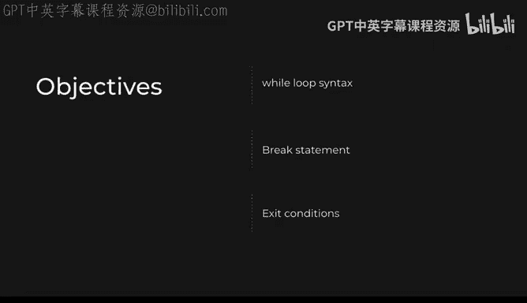
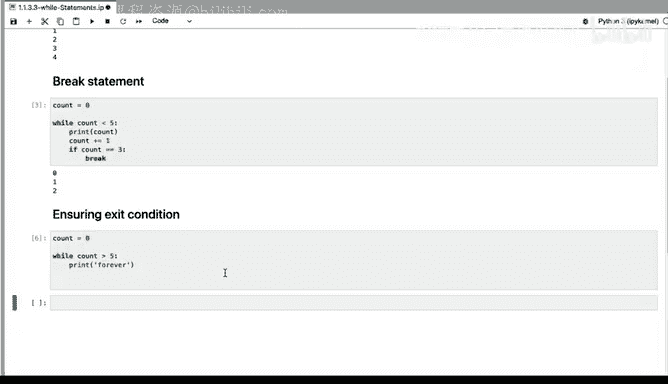

#  014：Python中的while循环 🔄


在本节课中，我们将要学习Python中`while`循环的语法。我们将了解`break`语句的用法，并重点探讨提供和保证循环退出条件的重要性。

---

## 循环语句类型



在Python中，有两种复合语句类型被称为循环，分别是`while`循环和`for`循环。

上一节我们介绍了循环的基本概念，本节中我们来看看`while`循环的具体语法。

## `while`循环语法

`while`循环的控制语句由关键字`while`后跟一个表达式组成。

以下是`while`循环的基本结构：
```python
while 表达式:
    # 被控制的代码块
```
`while`循环会反复执行其代码块，只要控制表达式的结果为`True`。通常，我们会使用一个变量，并在代码块中改变这个变量的值，最终使表达式变为`False`，从而结束循环。

## 一个简单的`while`循环示例

让我们来看一个具体的例子。在这个循环中，每次迭代都会打印出一个值。

```python
count = 0
while count < 5:
    print(count)
    count += 1
```
我们可以观察到，在循环的每次迭代中，变量`count`的值都会被打印出来，并且其值会递增，直到不满足`count < 5`的条件。

## 使用`break`语句

现在，我们在同一个循环中添加一个`break`语句。`break`语句会中断循环的执行。

```python
count = 0
while count < 5:
    print(count)
    break
```
在这个例子中，循环只运行了一次。一旦执行到`break`语句，循环就会立即停止。

`break`语句通常与嵌套的`if`语句结合使用。

以下是结合使用的示例：
```python
count = 0
while count < 5:
    print(count)
    if count == 3:
        break
    count += 1
```
这里，当变量`count`等于3时，`break`语句会被执行，循环随之终止。运行结果也证实了这一点。

## 循环的退出条件

在我们目前看到的循环中，都有一个条件决定循环何时结束，这被称为退出条件。退出条件可以是循环表达式变为`False`，也可以是执行了`break`语句。

对于循环来说，确保存在退出条件至关重要。否则，你可能会陷入无限循环，这会导致程序在运行一段时间后崩溃。

有时，我们会看到一种循环约定：使用一个永远为`True`的表达式。

```python
while True:
    # 代码块
```
在这种情况下，就必须使用`break`语句来提供退出途径。

## 导致无限循环的常见错误

以下是两种常见的导致无限循环的情况：

第一种情况是，循环表达式永远为`True`，且内部没有`break`语句。

```python
# 错误示例：缺少break语句
while True:
    print("这将永远运行")
```

第二种情况是，在嵌套的`if`语句中，设计了一个永远不可能为`True`的条件。

```python
count = 0
while count < 5:
    print(count)
    # 条件永远不成立，因为count从0开始递增
    if count < 0:
        break
    count += 1
```
由于`count`从0开始并递增，它永远不会小于0，因此`break`语句永远不会执行。

另一种常见的导致无限循环的错误是，在受控代码块中忘记改变变量的值。

```python
count = 0
while count < 5:
    print(count)
    # 忘记递增 count += 1
```
当你的代码块变得更复杂时，这尤其是一个容易出错的地方。如果发生这种情况，循环将没有退出条件，从而形成无限循环。

---



本节课中我们一起学习了`while`语句的语法，如何在`while`循环中使用`break`语句，以及提供和保证退出条件的重要性。


现在，你应该尝试编写一些自己的`while`循环来巩固理解。