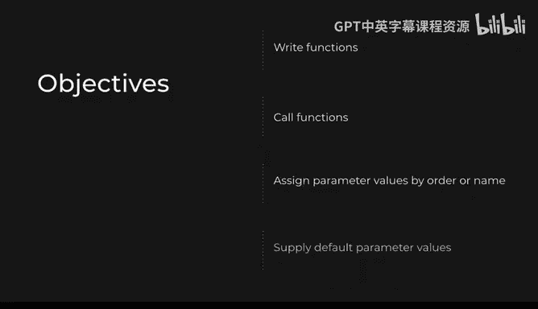
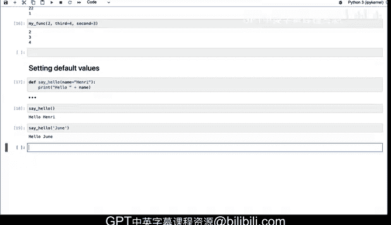

#  015：Python中的函数


在本节课中，我们将学习Python中的函数。你将学会如何编写函数、调用函数、按顺序或按名称给参数赋值，以及如何为参数提供默认值。

---



## 📝 函数定义

函数语句用于定义一个函数。函数是一个命名的包装器，允许你在多个位置执行同一段代码。

函数定义的语法如下：首先是关键字`def`，接着是你选择的函数名，然后是括号。括号内可以包含函数中使用的参数名，我们将在本课后面详细讨论。最后是一个代码块。

要执行一个函数，我们输入函数名和括号。这会执行函数内的代码块。

```python
def my_function():
    # 代码块
    pass
```

`pass`语句是一个不执行任何操作的语句。但由于函数需要一个代码块，当你在规划程序架构时，可能只想先放入函数名但尚未实现其行为，`pass`语句就很有用。

我们可以看到，`pass`语句允许你有一个不执行任何操作的代码块，因此你的函数将被定义而不会引发错误。

---

## 🔄 函数返回值

在Python中，所有函数都会返回一个值。例如，我们这里的“什么都不做”函数返回`None`值，我们可以通过使用双等号将其与`None`进行比较来验证这一点。

默认情况下，所有函数都会返回`None`。但我们可以使用`return`语句来定义一个返回值。例如，这个函数将返回整数`2`。

```python
def return_two():
    return 2
```

---

## 🎯 函数参数

正如我之前提到的，函数定义中的括号有机会定义参数。参数是函数代码块中可用的变量，可以在函数被调用时传入。

这里我们有一个函数，我们定义了一个名为`num`的参数，函数返回该参数加一。因此，如果我们向函数传入整数`2`，它将返回`3`。如果我们传入`5`，它将返回`6`。

```python
def add_one(num):
    return num + 1
```

这种为同一函数传入不同参数值的能力使得函数非常强大，因为你可以在代码中重复使用相同的逻辑，但使用不同的值，而只需定义函数一次。

---

## 🔢 多个参数

函数可以接受多个参数。当我们通过调用函数为参数赋值时，有两种方式可以做到这一点。

第一种方式是按顺序赋值。也就是说，函数定义中参数的顺序将决定函数调用时传入的值被分配给这些参数的顺序。

```python
def example_function(a, b, c):
    return a + b + c

result = example_function(1, 3, 4)
```

这里我们看到整数`1`被分配给第一个参数，整数`3`被分配给第二个参数，整数`4`被分配给第三个参数。

第二种调用函数的方式是按名称赋值。我们使用函数定义中为参数定义的名称，然后在调用函数时使用等号赋值。当我们这样做时，参数的顺序无关紧要。

```python
result = example_function(c=4, a=1, b=3)
```

这里我们为第三个定义的参数先赋值，第一个定义的参数第二个赋值，第二个定义的参数第三个赋值，但这都不重要。

我们可以在同一个函数调用中结合按顺序调用和按名称调用。但如果我们这样做，按顺序调用必须在前，不能在按名称调用之后进行按顺序调用，否则会出错。

---

## ⚙️ 默认参数值

我们还可以为参数定义默认值。在函数定义期间，我们使用等号给它一个值。

这里我们有一个名为`say_hello`的函数，它有一个名为`name`的参数。在函数定义中，我们给该参数一个默认值`"Enri"`。

```python
def say_hello(name="Enri"):
    return f"Hello, {name}!"
```

当我们调用它时，现在我们可以调用函数而不为该参数提供参数或值，你会看到它使用默认值。我们也可以用一个值调用它，我们会看到它将使用该值代替默认值。

---

## 📚 总结



本节课中，我们一起学习了如何定义和调用函数，以及如何使用顺序和关键字为参数提供值，并为参数提供默认值。现在你应该尝试自己编写一些函数。