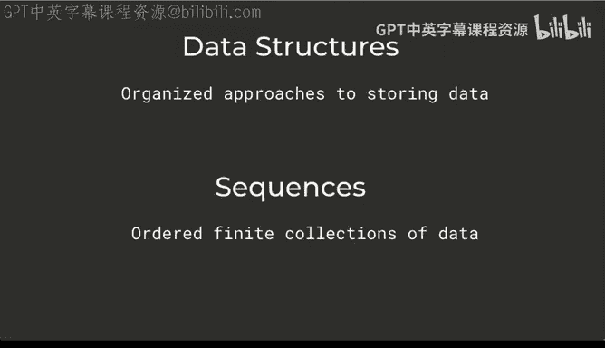
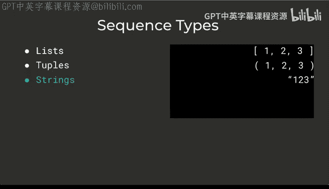
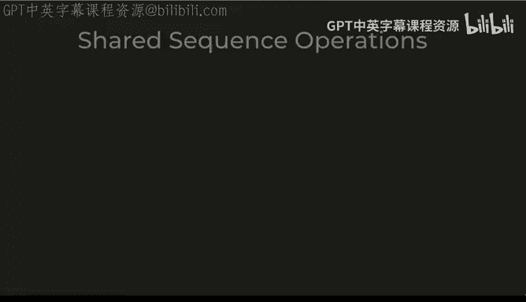
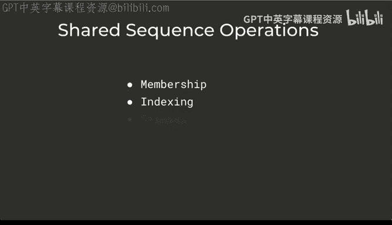
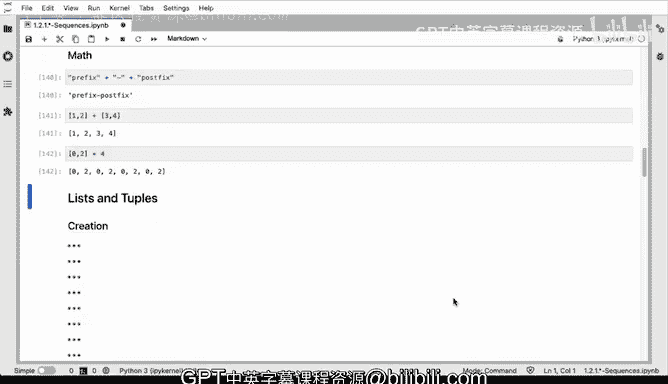

#  017：Python中的序列类型 📚

在本节课中，我们将要学习Python中的**序列**。序列是Python中最广泛使用的数据结构家族，用于有序地存储和操作数据。我们将重点了解序列的成员关系操作、索引、切片、查询以及数学运算。

---

## 什么是序列？ 🧱

数据结构是存储和处理数据的组织化方法。Python中有专门的数据结构适用于各种问题，无论是优化数据检索还是高效处理大型数据集。其中，**序列**是最核心的一类。

序列是**有序的、有限的数据集合**。






Python中主要的序列类型包括：
*   **列表** (`list`)
*   **元组** (`tuple`)
*   **字符串** (`str`)






此外，还有：
*   **二进制字符串** (`bytes`, `bytearray`)
*   **范围对象** (`range`)


所有序列类型都共享一组核心操作，这些操作可以分为以下几类：成员关系操作、索引操作、切片操作、查询操作和数学运算。

---

## 成员关系操作（`in` 与 `not in`）🔍

上一节我们介绍了序列的基本概念，本节中我们来看看如何检查一个元素是否存在于序列中。我们使用关键字 `in` 来测试。

以下是使用 `in` 和 `not in` 的示例：

```python
# 检查数字 3 是否在列表中
my_list = [1, 2, 3, 4, 5]
print(3 in my_list)  # 输出: True

# 检查数字 12 是否不在列表中
print(12 not in my_list)  # 输出: True
```

`in` 操作符返回布尔值（`True` 或 `False`）。`not in` 则返回相反的结果。

---

## 索引操作 📍

因为序列中的元素是有序排列的，所以我们可以使用**索引**来访问序列中的特定元素。Python中的索引通常从0开始。

以下是索引操作的示例：

```python
name = "Monteverde"
# 访问第一个元素（索引0）
print(name[0])  # 输出: M
# 访问第四个元素（索引3）
print(name[3])  # 输出: t
```

我们也可以使用**负索引**从序列末尾开始计数。索引 `-1` 代表最后一个元素。

```python
name = "Monteverde"
# 访问最后一个元素
print(name[-1])  # 输出: e
# 访问倒数第二个元素
print(name[-2])  # 输出: d
```

---

## 切片操作 🔪

切片操作用于从原序列中创建一个新的子序列。其语法是在方括号中使用起始索引、结束索引和可选的步长，用冒号分隔。

以下是切片操作的示例：

```python
name = "Palestrina"
# 从索引2（包含）切片到索引5（不包含）
print(name[2:5])  # 输出: les

# 省略起始索引，默认从0开始
print(name[:4])   # 输出: Pale
# 省略结束索引，默认到序列末尾
print(name[4:])   # 输出: strina

# 使用负索引进行切片
print(name[-3:])  # 输出: ina

# 使用步长参数（每隔一个元素取一个）
print(name[::2])  # 输出: Plsia
# 使用负步长（反转序列）
print(name[::-1]) # 输出: anirtselaP
```

**切片公式**：`sequence[start:stop:step]`
*   `start`：起始索引（包含），默认为0。
*   `stop`：结束索引（不包含），默认为序列长度。
*   `step`：步长，默认为1。

---

## 序列查询操作 ❓

序列提供了一些内置方法来查询其属性。了解如何查询序列后，我们来看看如何获取序列的长度、查找极值等。

以下是序列查询操作的示例：

```python
my_seq = "Python"

# 获取序列长度
print(len(my_seq))  # 输出: 6

# 查找序列中的最小元素（按字符编码比较）
print(min(my_seq))  # 输出: P

# 查找序列中的最大元素
print(max(my_seq))  # 输出: y

# 计算某个元素在序列中出现的次数
print(my_seq.count('o'))  # 输出: 1

# 查找某个元素首次出现的索引
print(my_seq.index('t'))  # 输出: 2
```

**注意**：`max()` 和 `min()` 函数要求序列中的元素是可比较的。如果序列包含不同类型（如字符串和整数混合），调用这些函数会引发错误。

```python
mixed_list = [1, 'a', 3]
# print(max(mixed_list))  # 这会引发 TypeError
```

---

## 序列的数学运算 ➕✖️

最后，我们来探讨序列的数学运算。需要特别注意的是，序列的数学运算作用于**序列本身**，而不是序列内部的元素。

以下是序列数学运算的示例：

```python
# 字符串拼接（加法）
str1 = "Hello, "
str2 = "World"
str3 = "!"
print(str1 + str2 + str3)  # 输出: Hello, World!

# 列表拼接（加法）
list1 = [1, 2]
list2 = [3, 4]
print(list1 + list2)  # 输出: [1, 2, 3, 4] （注意：不是 [4, 6]）

# 序列乘法（重复）
seq = [1, 2]
print(seq * 4)  # 输出: [1, 2, 1, 2, 1, 2, 1, 2]
```

**关键点**：序列的加法和乘法是**连接**和**重复**操作，而不是对内部元素进行数值计算。

---

## 总结 🎯

本节课中我们一起学习了Python中的**序列**。我们了解到序列是有序的数据集合，主要包括列表、元组和字符串等类型。

我们详细探讨了序列共有的五种核心操作：
1.  **成员关系操作**：使用 `in` 和 `not in` 检查元素是否存在。
2.  **索引操作**：使用 `[index]` 访问特定位置的元素，支持正索引和负索引。
3.  **切片操作**：使用 `[start:stop:step]` 创建子序列。
4.  **查询操作**：使用 `len()`, `min()`, `max()`, `.count()`, `.index()` 获取序列信息。
5.  **数学运算**：`+` 用于连接序列，`*` 用于重复序列。

现在，你应该尝试自己创建一些序列并练习这些操作，以加深理解。



