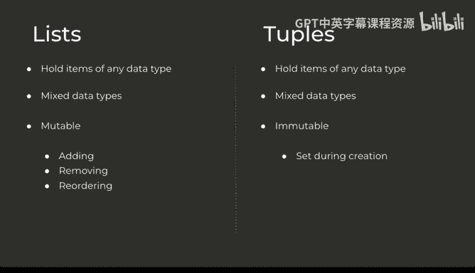
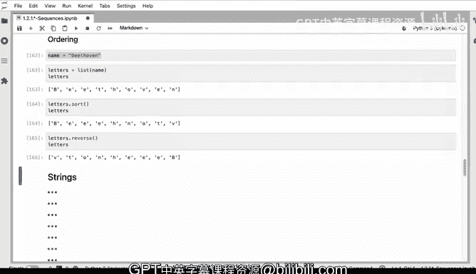

#  018：Python中的列表与元组


在本节课中，我们将学习如何创建列表和元组，如何向列表中添加和删除元素，以及如何对列表进行重新排序。

列表和元组是Python中两种密切相关的序列类型。它们都可以存储任意数据类型的元素，甚至可以在同一个列表或元组中混合存储不同类型的元素。列表和元组的主要区别在于：**列表是可变的**，而**元组是不可变的**。这意味着列表创建后，其内容可以通过添加、删除或重新排序来改变；而元组的内容在创建时确定，之后无法更改。

接下来，我们通过一些例子来具体了解列表和元组。

## 创建列表与元组

有多种方法可以创建元组，其中一种是使用 `tuple()` 函数。如果不传入参数，它将创建一个空元组。可以看到，元组在表示时使用圆括号 `()`。

```python
empty_tuple = tuple()
```



类似地，可以使用 `list()` 函数创建一个空列表。

```python
empty_list = list()
```

我们也可以直接使用圆括号并在其中放置元素来显式创建元组。注意，元素之间需要用逗号分隔。

```python
my_tuple = (1, 2)
```

列表则用方括号 `[]` 表示，可以用类似的方式创建。

```python
my_list = [1, 2]
```

需要注意的是，如果要创建只包含一个元素的元组，必须在元素后面加上逗号，否则它会被解释为普通的括号分组。

```python
single_item_tuple = (1,)  # 这是一个元组
not_a_tuple = (1)         # 这只是一个整数 1
```

此外，仅通过用逗号分隔元素（不加括号）也可以创建元组，Python会自动将其识别为元组。

```python
another_tuple = 1, 2, 3
```

我们可以通过“类型转换”将其他序列类型（如字符串）转换为列表或元组。具体做法是，将该序列作为参数传递给 `list()` 或 `tuple()` 函数。

```python
my_string = "hello"
list_from_string = list(my_string)   # 结果为 ['h', 'e', 'l', 'l', 'o']
tuple_from_string = tuple(my_string) # 结果为 ('h', 'e', 'l', 'l', 'o')
```

## 修改列表内容

元组一旦创建就无法更改，但列表可以。下面我们来看看如何修改列表。

首先，创建一个包含两个字符串的列表。

```python
my_list = ["apple", "banana"]
```

向列表中添加元素最常用的方法是使用 `append()` 方法，它会将元素添加到列表的末尾。

```python
my_list.append("cherry")  # 列表变为 ["apple", "banana", "cherry"]
```

也可以使用 `insert()` 方法，它接受一个索引参数，指定在哪个位置插入新元素。例如，在索引0（即列表开头）插入元素。

```python
my_list.insert(0, "date")  # 列表变为 ["date", "apple", "banana", "cherry"]
```

要从列表中移除元素，可以使用 `pop()` 方法。默认情况下，`pop()` 会移除并返回列表的最后一个元素。我们也可以指定一个索引参数来移除特定位置的元素。

```python
last_item = my_list.pop()      # 移除 "cherry"
first_item = my_list.pop(0)    # 移除 "date"
```

## 合并列表

假设我们有两个列表，并希望将一个列表的所有元素添加到另一个列表中。这时可以使用 `extend()` 方法。

```python
composers = ["Beethoven", "Mozart"]
my_list = ["apple", "banana"]
composers.extend(my_list)  # composers 列表变为 ["Beethoven", "Mozart", "apple", "banana"]
```

## 列表乘法与潜在问题

我们已经讨论过乘法运算，但需要理解一个重要的细节：如果乘法的操作数是一个列表，结果会是一个包含多个相同子列表的列表。

```python
list_of_lists = [[]] * 3  # 创建 [[], [], []]
```

然而，通过这种方式创建的列表，其内部的三个空列表实际上是**同一个列表对象的多个引用**。这意味着，如果我们修改其中一个子列表，所有子列表都会同时改变，这可能导致难以察觉的错误。

```python
list_of_lists[0].append(4)
print(list_of_lists)  # 输出 [[4], [4], [4]]，而不是 [[4], [], []]
```

为了避免这个问题，在需要创建包含多个独立空列表的列表时，推荐使用**列表推导式**。

```python
list_of_lists = [[] for _ in range(3)]
list_of_lists[0].append(4)
print(list_of_lists)  # 输出 [[4], [], []]
```

## 列表排序

Python提供了内置方法来对列表中的元素进行重新排序。例如，我们可以将一个字符串转换为字符列表，然后对其进行排序。

```python
name = list("Beethoven")  # 结果为 ['B', 'e', 'e', 't', 'h', 'o', 'v', 'e', 'n']
```

调用列表的 `sort()` 方法可以按字母数字顺序（默认根据ASCII码）对列表进行原地排序。需要注意的是，大写字母的ASCII码值小于小写字母，因此排序时会排在小写字母前面。

```python
name.sort()  # 列表变为 ['B', 'e', 'e', 'e', 'h', 'n', 'o', 't', 'v']
```

我们也可以使用 `reverse()` 方法将列表中的元素顺序完全颠倒。

```python
name.reverse()  # 列表变为 ['v', 't', 'o', 'n', 'h', 'e', 'e', 'e', 'B']
```

## 总结



在本节课中，我们一起学习了Python中的列表和元组。你掌握了多种创建列表和元组的方法，并学会了如何通过添加、删除和重新排序来修改列表的内容。现在，你应该尝试自己动手练习使用列表和元组，这是掌握它们的关键步骤。